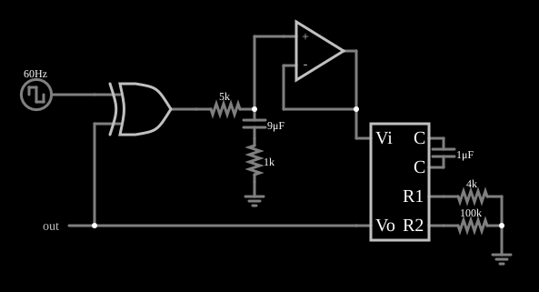

# PLL tipo I (detector de fase XOR)

<!-- navegacao:inicio -->
[Índice](README.md) · [Anterior: XOR Phase Detector](xorphasedet.md) · [Próximo: Phase Comparator (Type II)](phasecomp.md)
<!-- navegacao:fim -->

## Objetivo

Mostrar uma malha de captura de fase (PLL) de tipo I: um detector de fase XOR, um filtro passa-baixas e um oscilador controlado por tensão (VCO) que, em regime, segue a frequência do sinal de entrada, com um erro de fase constante.

## O circuito

<!-- esquema:inicio -->

<!-- esquema:fim -->

A entrada é uma onda quadrada de $60\ \text{Hz}$ ($0$ a $5\ \text{V}$). Uma porta XOR compara a entrada com a saída do VCO. A saída da XOR passa por um resistor de $5\ \text{k}\Omega$ a um filtro formado por um capacitor de $9\ \mu\text{F}$ em série com um resistor de $1\ \text{k}\Omega$ para a terra, e daí a um amplificador operacional seguidor, que aplica a tensão de controle $V_i$ ao VCO. O VCO, com $C = 1\ \mu\text{F}$, $R_1 = 4\ \text{k}\Omega$ e $R_2 = 100\ \text{k}\Omega$, gera uma onda quadrada que volta à XOR. Elementos de saída e três osciloscópios mostram os sinais.

<!-- componentes:inicio -->
| N.º | Tipo | Elemento | Valores |
|----:|------|----------|---------|
| 0 | `VCOElm` | VCO |  |
| 1 | `CapacitorElm` | capacitor | Capacitance (F) = 1μ; Trapezoidal Approximation = sim; Initial Voltage (on Reset) = 1m; Series Resistance = 0 |
| 2 | `ResistorElm` | resistor | Resistance (ohms) = 4k |
| 3 | `ResistorElm` | resistor | Resistance (ohms) = 100k |
| 5 | `GroundElm` | ground | Symbol = Earth |
| 6 | `XorGateElm` | XOR gate | # of Inputs = 2; High Logic Voltage = 5; Schmitt Inputs = não; Propagation Delay (s) = 0; DeMorgan's Symbol = não |
| 7 | `RailElm` | square wave gen | Max Voltage = 2.5; Waveform = Square Wave; DC Offset (V) = 2.5; Internal Resistance (ohms) = 0; Show Voltage = não; Specify As = Frequency/Duty Cycle; Frequency (Hz) = 60; Phase Offset (degrees) = 0; Duty Cycle = 50; Rise/Fall Time (s) = 0 |
| 10 | `ResistorElm` | resistor | Resistance (ohms) = 5k |
| 11 | `CapacitorElm` | capacitor | Capacitance (F) = 9μ; Trapezoidal Approximation = sim; Initial Voltage (on Reset) = 1m; Series Resistance = 0 |
| 13 | `OutputElm` | output | Show Voltage = não |
| 14 | `OpAmpElm` | op-amp | Max Output (V) = 15; Min Output (V) = -15; Gain = 100k |
| 20 | `ResistorElm` | resistor | Resistance (ohms) = 1k |
| 21 | `GroundElm` | ground | Symbol = Earth |
<!-- componentes:fim -->

## Teoria

O VCO do simulador é um oscilador de relaxação com três pinos externos: a tensão de controle $V_i$ alimenta, pelo resistor $R_1$, uma corrente $V_i/R_1$, somada a uma corrente fixa $V_\text{ref}/R_2$ (com $V_\text{ref} = 5\ \text{V}$, pelo resistor $R_2$), que carrega e descarrega o capacitor externo $C$ entre $0{,}5$ e $4{,}5\ \text{V}$ ($\Delta V = 4\ \text{V}$), invertendo o sentido da corrente a cada limite. A saída é uma onda quadrada de $0$ a $5\ \text{V}$ com frequência

$$f_\text{VCO} = \frac{I}{2\,C\,\Delta V} = \frac{V_i/R_1 + 5/R_2}{8\,C}.$$

**Malha.** O detector XOR produz uma tensão média $V_{DD}\,|\varphi|/\pi$ proporcional à defasagem $\varphi$ entre a entrada e o VCO; o filtro entrega esse valor médio como $V_i$; o VCO ajusta a frequência a $f_\text{VCO}(V_i)$. Em **regime travado** ($f_\text{VCO} = f_\text{ent}$), o $V_i$ necessário para essa frequência fixa a defasagem:

$$V_i = \frac{8\,C\,f_\text{ent} - 5/R_2}{1/R_1} = R_1\left(8\cdot 1\ \mu\text{F}\cdot 60\ \text{Hz} - 50\ \mu\text{A}\right) = 4\ \text{k}\Omega\cdot 430\ \mu\text{A} = 1{,}72\ \text{V},$$

$$\varphi = \pi\,\frac{V_i}{V_{DD}} = \pi\cdot\frac{1{,}72}{5} \approx 62^\circ.$$

Um PLL de tipo I precisa, portanto, de um **erro de fase constante** ($\varphi \ne 0$) para produzir a tensão de controle que mantém o VCO na frequência certa; o erro cresce quando a frequência de entrada se afasta da frequência central do VCO.

## Resultados esperados

O exemplo é salvo já em regime travado:

| Grandeza | Teoria | Simulador |
|----------|-------:|----------:|
| Frequência do VCO | $60\ \text{Hz}$ (igual à da entrada) | $59{,}995\ \text{Hz}$ (janela de $0{,}1$ a $0{,}2\ \text{s}$) |
| Tensão de controle $V_i$ | $1{,}72\ \text{V}$ | $1{,}7223\ \text{V}$ |
| Defasagem em regime | $\approx 62^\circ$ (da fórmula) | — |

As verificações conferem a frequência do VCO (tolerância de $0{,}5\%$) e a tensão de controle (tolerância de 1%). Em $t = 1\ \text{s}$ e em $t = 2\ \text{s}$ a frequência continua em $59{,}999\ \text{Hz}$.

## O que observar

- O VCO, a $60\ \text{Hz}$, tem a mesma frequência da entrada mas está defasado dela (o erro de fase constante, de cerca de $62^\circ$).
- A saída do detector XOR é uma sequência de pulsos de largura constante ($\approx 34\%$ do período); o filtro a transforma na tensão contínua $V_i$.
- Altere a frequência da fonte de entrada (por exemplo, para $70\ \text{Hz}$): se estiver dentro da faixa de captura, o VCO acompanha, e a tensão de controle e a defasagem mudam.

## Limites do modelo

O VCO e o detector são modelos ideais. A fórmula do VCO ignora a resistência de $1\ \text{M}\Omega$ em paralelo com o capacitor interno do modelo e as pequenas perdas de tempo nas comutações, o que leva a diferenças de décimos de porcento. Um PLL de tipo I só trava dentro de uma faixa de captura limitada, e a de segurança (*lock range*) é maior que a de captura (*pull-in range*), o que não foi medido aqui.

## Referências

- R. E. Best, *Phase-Locked Loops: Design, Simulation, and Applications*, McGraw-Hill.
- F. M. Gardner, *Phaselock Techniques*, Wiley.
- B. Razavi, *Design of Analog CMOS Integrated Circuits*, McGraw-Hill.

O circuito deste exemplo faz parte da coleção do simulador original de Paul Falstad e Iain Sharp (CircuitJS1); a explicação é deste projeto.
