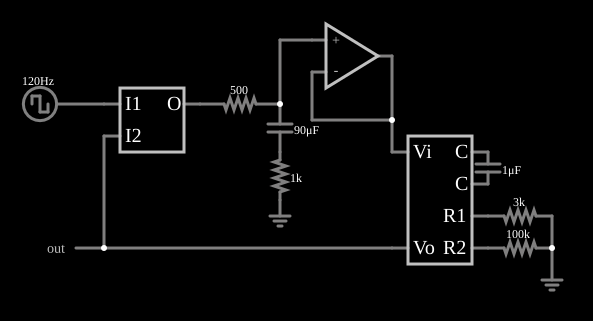

# PLL tipo II (comparador de fase e frequência)

<!-- navegacao:inicio -->
[Índice](README.md) · [Anterior: Phase Comparator Internals](phasecompint.md) · [Próximo: Type II PLL (fast)](pll2a.md)
<!-- navegacao:fim -->

## Objetivo

Mostrar o PLL de tipo II, com comparador de fase e frequência de três estados: a malha trava na frequência de entrada com erro de fase **nulo** e captura qualquer frequência (dentro da faixa do VCO), mesmo que ela comece distante.

## O circuito

<!-- esquema:inicio -->

<!-- esquema:fim -->

A entrada é uma onda quadrada de $120\ \text{Hz}$ ($0$ a $5\ \text{V}$). O comparador de fase e frequência (tipo II) compara-a com a saída do VCO. A saída do comparador passa por um resistor de $500\ \Omega$ a um filtro com um capacitor de $90\ \mu\text{F}$ em série com um resistor de $1\ \text{k}\Omega$ (o filtro de avanço-atraso) e a um amplificador operacional seguidor, que aplica $V_i$ ao VCO. O VCO tem $C = 1\ \mu\text{F}$, $R_1 = 3\ \text{k}\Omega$ e $R_2 = 100\ \text{k}\Omega$. Três osciloscópios mostram os sinais. O *slider* "Frequency" do painel lateral deveria mudar a frequência da fonte de entrada; no arquivo desta versão ele está ligado ao campo de resistência interna da fonte, e não ao de frequência (um erro conhecido do exemplo), então para variar a frequência edite a fonte de onda quadrada diretamente.

<!-- componentes:inicio -->
| N.º | Tipo | Elemento | Valores |
|----:|------|----------|---------|
| 0 | `VCOElm` | VCO |  |
| 1 | `CapacitorElm` | capacitor | Capacitance (F) = 1μ; Trapezoidal Approximation = sim; Initial Voltage (on Reset) = 1m; Series Resistance = 0 |
| 2 | `ResistorElm` | resistor | Resistance (ohms) = 3k |
| 3 | `ResistorElm` | resistor | Resistance (ohms) = 100k |
| 5 | `GroundElm` | ground | Symbol = Earth |
| 6 | `RailElm` | square wave gen | Max Voltage = 2.5; Waveform = Square Wave; DC Offset (V) = 2.5; Internal Resistance (ohms) = 0; Show Voltage = não; Specify As = Frequency/Duty Cycle; Frequency (Hz) = 120; Phase Offset (degrees) = 0; Duty Cycle = 50; Rise/Fall Time (s) = 0 |
| 10 | `OutputElm` | output | Show Voltage = não |
| 11 | `OpAmpElm` | op-amp | Max Output (V) = 15; Min Output (V) = -15; Gain = 100k |
| 16 | `PhaseCompElm` | phase comparator | High Logic Voltage = 5 |
| 17 | `ResistorElm` | resistor | Resistance (ohms) = 500 |
| 19 | `CapacitorElm` | capacitor | Capacitance (F) = 90μ; Trapezoidal Approximation = sim; Initial Voltage (on Reset) = 1m; Series Resistance = 0 |
| 20 | `ResistorElm` | resistor | Resistance (ohms) = 1k |
| 21 | `GroundElm` | ground | Symbol = Earth |
<!-- componentes:fim -->

## Teoria

O VCO do simulador é um oscilador de relaxação com três pinos externos: a tensão de controle $V_i$ alimenta, pelo resistor $R_1$, uma corrente $V_i/R_1$, somada a uma corrente fixa $V_\text{ref}/R_2$ (com $V_\text{ref} = 5\ \text{V}$, pelo resistor $R_2$), que carrega e descarrega o capacitor externo $C$ entre $0{,}5$ e $4{,}5\ \text{V}$ ($\Delta V = 4\ \text{V}$), invertendo o sentido da corrente a cada limite. A saída é uma onda quadrada de $0$ a $5\ \text{V}$ com frequência

$$f_\text{VCO} = \frac{I}{2\,C\,\Delta V} = \frac{V_i/R_1 + 5/R_2}{8\,C}.$$

Com o comparador de fase e frequência, a saída em alta impedância, depois do filtro, integra o erro: um capacitor de $90\ \mu\text{F}$ guarda a tensão de controle e só se altera quando há erro de fase. O PLL trava, então, com **defasagem nula** (os pulsos do comparador desaparecem), e a tensão de controle $V_i$ fica fixa no valor que dá a frequência de entrada. A malha tem um integrador ideal (o filtro, vendo uma carga de alta impedância) e é de segunda ordem, com amortecimento dado pelo resistor de $1\ \text{k}\Omega$ em série com o capacitor.

Para travar em $f_\text{ent} = 120\ \text{Hz}$:

$$V_i = R_1\left(8\,C\,f_\text{ent} - \frac{5}{R_2}\right) = 3\ \text{k}\Omega\,(960\ \mu\text{A} - 50\ \mu\text{A}) = 2{,}73\ \text{V}.$$

## Resultados esperados

| Grandeza | Teoria | Simulador |
|----------|-------:|----------:|
| Frequência do VCO em $0{,}3$ a $0{,}4\ \text{s}$ | $120\ \text{Hz}$ | $120{,}09\ \text{Hz}$ |
| Frequência do VCO em $0{,}8$ a $0{,}9\ \text{s}$ | $120\ \text{Hz}$ | $120{,}012\ \text{Hz}$ |
| Frequência do VCO em $1{,}8$ a $1{,}9\ \text{s}$ | $120\ \text{Hz}$ | $120{,}002\ \text{Hz}$ |
| Tensão de controle $V_i$ | $2{,}73\ \text{V}$ | $2{,}741\ \text{V}$ ($2{,}737\ \text{V}$ em $2{,}9\ \text{s}$) |

A frequência do VCO converge a $120{,}000\ \text{Hz}$ (o erro cai de $0{,}09\ \text{Hz}$ para $0{,}002\ \text{Hz}$ em $1{,}5\ \text{s}$), e a tensão de controle concorda com a fórmula a $0{,}4\%$ (a diferença vem da resistência de $1\ \text{M}\Omega$ do modelo em paralelo com o capacitor do VCO). As verificações conferem a frequência em $0{,}8$ a $0{,}9\ \text{s}$ e a tensão de controle.

## O que observar

- A frequência do VCO se aproxima de $120\ \text{Hz}$ de forma lenta e suave (a constante de tempo da malha é de centenas de milissegundos).
- Compare com o PLL de tipo I: aqui não há erro de fase estático e a captura é mais ampla.
- O filtro de $90\ \mu\text{F}$ dá uma resposta lenta: veja o exemplo "Type II PLL (fast)", com um filtro menor.

## Limites do modelo

O comparador e o VCO são ideais; o resistor de $1\ \text{M}\Omega$ em paralelo com o capacitor do VCO (do modelo) e as comutações em $0{,}5$ e $4{,}5\ \text{V}$ dão desvios de décimos de porcento em relação à fórmula. Um PLL real tem ruído de fase e *jitter*, ausentes aqui.

## Referências

- R. E. Best, *Phase-Locked Loops: Design, Simulation, and Applications*, McGraw-Hill.
- F. M. Gardner, *Phaselock Techniques*, Wiley.
- B. Razavi, *Design of Analog CMOS Integrated Circuits*, McGraw-Hill.

O circuito deste exemplo faz parte da coleção do simulador original de Paul Falstad e Iain Sharp (CircuitJS1); a explicação é deste projeto.
