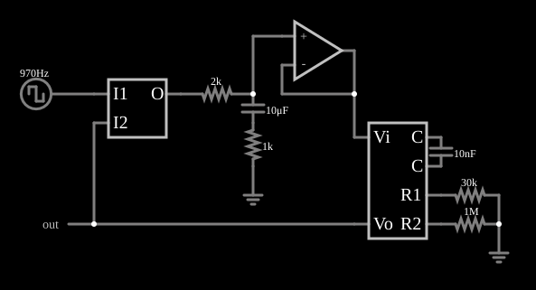

# PLL tipo II rápido

<!-- navegacao:inicio -->
[Índice](README.md) · [Anterior: Type II PLL](pll2.md) · [Próximo: Frequency Doubler](freqdouble.md)
<!-- navegacao:fim -->

## Objetivo

Mostrar uma versão do PLL de tipo II com a frequência central do VCO e a malha escolhidas para uma frequência cerca de oito vezes maior ($970\ \text{Hz}$) e uma resposta mais rápida, com um filtro de constante de tempo menor.

## O circuito

<!-- esquema:inicio -->

<!-- esquema:fim -->

Mesma estrutura do exemplo anterior (comparador de fase e frequência, filtro, seguidor e VCO), com a entrada em $970\ \text{Hz}$, o filtro com um resistor de $2\ \text{k}\Omega$ e um capacitor de $10\ \mu\text{F}$ em série com $1\ \text{k}\Omega$, e o VCO com $C = 10\ \text{nF}$, $R_1 = 30\ \text{k}\Omega$ e $R_2 = 1\ \text{M}\Omega$. O *slider* "Frequency" do painel lateral deveria mudar a frequência da fonte de entrada; no arquivo desta versão ele está ligado ao campo de resistência interna da fonte, e não ao de frequência (um erro conhecido do exemplo), então para variar a frequência edite a fonte de onda quadrada diretamente.

<!-- componentes:inicio -->
| N.º | Tipo | Elemento | Valores |
|----:|------|----------|---------|
| 0 | `VCOElm` | VCO |  |
| 1 | `CapacitorElm` | capacitor | Capacitance (F) = 10n; Trapezoidal Approximation = sim; Initial Voltage (on Reset) = 1m; Series Resistance = 0 |
| 2 | `ResistorElm` | resistor | Resistance (ohms) = 30k |
| 3 | `ResistorElm` | resistor | Resistance (ohms) = 1M |
| 5 | `GroundElm` | ground | Symbol = Earth |
| 6 | `RailElm` | square wave gen | Max Voltage = 2.5; Waveform = Square Wave; DC Offset (V) = 2.5; Internal Resistance (ohms) = 0; Show Voltage = não; Specify As = Frequency/Duty Cycle; Frequency (Hz) = 970; Phase Offset (degrees) = 0; Duty Cycle = 50; Rise/Fall Time (s) = 0 |
| 9 | `GroundElm` | ground | Symbol = Earth |
| 11 | `OutputElm` | output | Show Voltage = não |
| 12 | `OpAmpElm` | op-amp | Max Output (V) = 15; Min Output (V) = -15; Gain = 100k |
| 17 | `PhaseCompElm` | phase comparator | High Logic Voltage = 5 |
| 18 | `ResistorElm` | resistor | Resistance (ohms) = 2k |
| 20 | `CapacitorElm` | capacitor | Capacitance (F) = 10μ; Trapezoidal Approximation = sim; Initial Voltage (on Reset) = 1m; Series Resistance = 0 |
| 21 | `ResistorElm` | resistor | Resistance (ohms) = 1k |
<!-- componentes:fim -->

## Teoria

O VCO do simulador é um oscilador de relaxação com três pinos externos: a tensão de controle $V_i$ alimenta, pelo resistor $R_1$, uma corrente $V_i/R_1$, somada a uma corrente fixa $V_\text{ref}/R_2$ (com $V_\text{ref} = 5\ \text{V}$, pelo resistor $R_2$), que carrega e descarrega o capacitor externo $C$ entre $0{,}5$ e $4{,}5\ \text{V}$ ($\Delta V = 4\ \text{V}$), invertendo o sentido da corrente a cada limite. A saída é uma onda quadrada de $0$ a $5\ \text{V}$ com frequência

$$f_\text{VCO} = \frac{I}{2\,C\,\Delta V} = \frac{V_i/R_1 + 5/R_2}{8\,C}.$$

Para travar em $970\ \text{Hz}$ a tensão de controle é

$$V_i = R_1\left(8\,C\,f_\text{ent} - \frac{5}{R_2}\right) = 30\ \text{k}\Omega\,(77{,}6\ \mu\text{A} - 5\ \mu\text{A}) = 2{,}18\ \text{V}.$$

A constante de tempo do filtro, $(2\ \text{k}\Omega + 1\ \text{k}\Omega)\cdot 10\ \mu\text{F} = 30\ \text{ms}$, é menor que a do PLL de $120\ \text{Hz}$ ($(500\ \Omega + 1\ \text{k}\Omega)\cdot 90\ \mu\text{F} = 135\ \text{ms}$), e a captura é mais rápida.

## Resultados esperados

O exemplo é salvo em regime travado. Em janelas de $10\ \text{ms}$ (cerca de $10$ ciclos, o que dá uma incerteza de $\pm 0{,}3\%$ na medida de frequência):

| Janela | Frequência do VCO |
|--------|------------------:|
| $30$ a $40\ \text{ms}$ | $969{,}3\ \text{Hz}$ |
| $80$ a $90\ \text{ms}$ | $970{,}9\ \text{Hz}$ |
| $280$ a $290\ \text{ms}$ | $971{,}4\ \text{Hz}$ |
| $590$ a $600\ \text{ms}$ | $969{,}1\ \text{Hz}$ |

Todas dentro de $0{,}3\%$ de $970\ \text{Hz}$. A tensão de controle é de $2{,}232\ \text{V}$, cerca de $2\%$ acima da fórmula simples ($2{,}18\ \text{V}$) porque a resistência de $1\ \text{M}\Omega$ do modelo, em paralelo com o capacitor de $10\ \text{nF}$ do VCO, tem peso maior com um capacitor pequeno. As verificações conferem a frequência e a tensão de controle na janela de $590$ a $600\ \text{ms}$.

## O que observar

- A malha trava em frequência alta (quase $1\ \text{kHz}$) e a tensão de controle é quase constante.
- Compare as duas malhas: filtro menor, travamento mais rápido, porém menos filtragem do ruído de comparação.

## Limites do modelo

O passo de tempo é de $5\ \mu\text{s}$, o que dá cerca de $200$ passos por ciclo de $970\ \text{Hz}$; a quantização do período afeta o comparador de fase em fração de porcento. A medida de frequência por janelas de $10\ \text{ms}$ tem incerteza de $\pm 0{,}3\%$.

## Referências

- R. E. Best, *Phase-Locked Loops: Design, Simulation, and Applications*, McGraw-Hill.
- F. M. Gardner, *Phaselock Techniques*, Wiley.
- B. Razavi, *Design of Analog CMOS Integrated Circuits*, McGraw-Hill.

O circuito deste exemplo faz parte da coleção do simulador original de Paul Falstad e Iain Sharp (CircuitJS1); a explicação é deste projeto.
