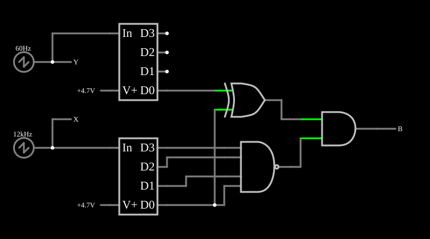

# Tabuleiro de xadrez no osciloscópio X–Y

<!-- navegacao:inicio -->
[Índice](README.md) · [Anterior: Lissajous Figures](lissa.md) · [Próximo: Color Checkerboard](plot2d-color.md)
<!-- navegacao:fim -->

## Objetivo

Mostrar o **osciloscópio bidimensional**, o modo X–Y com modulação de brilho: dois dentes de serra varrem a tela como num televisor e um circuito digital decide, ponto a ponto, se ele está aceso. É uma demonstração: o que importa é a imagem que o osciloscópio desenha (um tabuleiro de xadrez), e não um valor num componente.

## O circuito

<!-- esquema:inicio -->

<!-- esquema:fim -->

Dois geradores de dente de serra fazem o papel dos circuitos de varredura de um televisor: um de $12\ \text{kHz}$ (varredura horizontal, eixo X, de $0$ a $5\ \text{V}$) e um de $60\ \text{Hz}$ (varredura vertical, eixo Y, de $5$ a $0\ \text{V}$). Cada tensão passa por um conversor analógico-digital de 4 bits (16 níveis, $5/16 = 0{,}3125\ \text{V}$ por degrau), e as portas lógicas combinam os bits para decidir se o ponto da tela deve estar aceso. O osciloscópio, no modo X–Y com entrada de brilho, desenha o ponto na posição $(X, Y)$ e o acende conforme o sinal de brilho.

O sinal de brilho $B$ é

$$B = (a_0 \oplus b_0)\cdot\overline{b_3 b_2 b_1 b_0},$$

onde $a_0$ é o bit menos significativo do conversor do eixo Y, e $b_3\dots b_0$ são os bits do conversor do eixo X. A porta XOR dá o padrão de xadrez; a NAND de 4 entradas apaga a última coluna (código $1111$ do eixo X), o intervalo de retorno da varredura.

<!-- componentes:inicio -->
| N.º | Tipo | Elemento | Valores |
|----:|------|----------|---------|
| 0 | `RailElm` | sawtooth gen | Max Voltage = -2.5; Waveform = Sawtooth; DC Offset (V) = 2.5; Internal Resistance (ohms) = 0; Show Voltage = não; Frequency (Hz) = 60; Phase Offset (degrees) = 0 |
| 1 | `RailElm` | sawtooth gen | Max Voltage = 2.5; Waveform = Sawtooth; DC Offset (V) = 2.5; Internal Resistance (ohms) = 0; Show Voltage = não; Frequency (Hz) = 12k; Phase Offset (degrees) = 0 |
| 2 | `LabeledNodeElm` | Labeled Node | Text = Y; Internal Node = não; Rotate Text When Vertical = não |
| 3 | `LabeledNodeElm` | Labeled Node | Text = X; Internal Node = não; Rotate Text When Vertical = não |
| 4 | `ADCElm` | ADC | Bit Order = MSB First; # of Bits = 4 |
| 7 | `RailElm` | voltage source | Voltage = 4.7; Waveform = D/C; DC Offset (V) = 0; Internal Resistance (ohms) = 0 |
| 8 | `RailElm` | voltage source | Voltage = 4.7; Waveform = D/C; DC Offset (V) = 0; Internal Resistance (ohms) = 0 |
| 10 | `ADCElm` | ADC | Bit Order = MSB First; # of Bits = 4 |
| 12 | `XorGateElm` | XOR gate | # of Inputs = 2; High Logic Voltage = 5; Schmitt Inputs = não; Propagation Delay (s) = 0; DeMorgan's Symbol = não |
| 16 | `LabeledNodeElm` | Labeled Node | Text = B; Internal Node = não; Rotate Text When Vertical = não |
| 17 | `NandGateElm` | NAND gate | # of Inputs = 4; High Logic Voltage = 5; Schmitt Inputs = não; Invert Inputs = não; Propagation Delay (s) = 0; DeMorgan's Symbol = não |
| 19 | `RoutedWireElm` | wire | Show Current = não; Show Voltage = não; Show Bus Value = não; Show Bus Value (Hex) = não |
| 20 | `RoutedWireElm` | wire | Show Current = não; Show Voltage = não; Show Bus Value = não; Show Bus Value (Hex) = não |
| 21 | `RoutedWireElm` | wire | Show Current = não; Show Voltage = não; Show Bus Value = não; Show Bus Value (Hex) = não |
| 22 | `AndGateElm` | AND gate | # of Inputs = 2; High Logic Voltage = 5; Schmitt Inputs = não; Invert Inputs = não; Propagation Delay (s) = 0; DeMorgan's Symbol = não |
| 23 | `RoutedWireElm` | wire | Show Current = não; Show Voltage = não; Show Bus Value = não; Show Bus Value (Hex) = não |
| 24 | `RoutedWireElm` | wire | Show Current = não; Show Voltage = não; Show Bus Value = não; Show Bus Value (Hex) = não |
<!-- componentes:fim -->

## Teoria

Com 16 níveis em cada eixo, a tela fica dividida em $16\times 16$ células. O bit menos significativo de cada conversor muda de valor a cada célula (a cada degrau de $0{,}3125\ \text{V}$): ao longo de uma linha o do eixo X alterna $16$ vezes, e o do eixo Y alterna a cada $12{,}5$ linhas ($12\ \text{kHz}/60\ \text{Hz} = 200$ linhas por quadro, dividido em 16 faixas). O XOR dos dois bits vale $1$ quando as paridades da coluna e da linha diferem: é um tabuleiro de xadrez de $16\times 16$ casas.

A fração de tempo em que o ponto fica aceso é a das casas claras, $\tfrac12$, vezes a da retorno apagado, $\tfrac{15}{16}$: $\tfrac{15}{32} = 46{,}9\ \%$.

## Resultados esperados

O simulador dá:

- **Varreduras:** $60\ \text{Hz}$ no eixo Y (de $5$ a $0\ \text{V}$) e $12\ \text{kHz}$ no eixo X.
- **Bit menos significativo do conversor do eixo X:** $96\ \text{kHz}$ (16 transições por linha, 8 ciclos completos).
- **XOR:** nível médio de $2{,}5\ \text{V}$, isto é, aceso metade do tempo, e frequência de $96\ \text{kHz}$.
- **NAND:** nível médio de $4{,}70\ \text{V}$, o que corresponde a $15/16$ do tempo ($4{,}6875\ \text{V}$ pela teoria).
- **Brilho** (saída da AND): nível médio de $2{,}35\ \text{V}$, aceso $47\ \%$ do tempo, como na teoria.

## O que observar

Abra o osciloscópio e veja o tabuleiro de $16\times 16$ casas. Mude a frequência do eixo Y (por exemplo, para $30\ \text{Hz}$) para ver a imagem se esticar na vertical: as casas ficam mais altas.

## Limites do modelo

- A imagem é produzida pelo osciloscópio X–Y; as verificações do documento medem os sinais que a formam (as varreduras e as saídas das portas), mas não a tela.
- A quantização de 4 bits dá casas grandes e o retorno é um corte simples; num televisor real há sincronismo, retorno e pontos muito mais finos.

## Referências

Princípio do varrimento de televisão: Whitaker e Benson, *Standard Handbook of Video and Television Engineering*; Tektronix, *XYZs of Oscilloscopes* (modo X–Y e modulação do brilho, o eixo Z).

O circuito deste exemplo faz parte da coleção do simulador original de Paul Falstad e Iain Sharp (CircuitJS1); a explicação é deste projeto.
