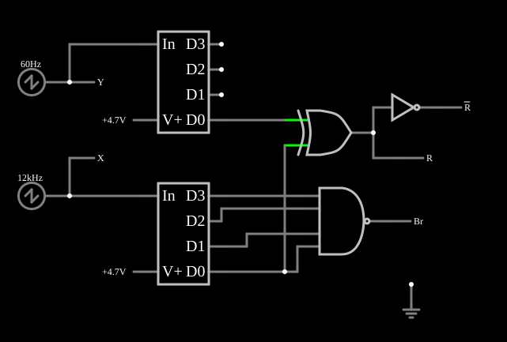

# Tabuleiro de xadrez colorido no osciloscópio X–Y

<!-- navegacao:inicio -->
[Índice](README.md) · [Anterior: Checkerboard](plot2d-checker.md) · [Próximo: Smiley](plot2d-smile.md)
<!-- navegacao:fim -->

## Objetivo

Mostrar o osciloscópio bidimensional com **cor**: além do brilho, as entradas de cor do osciloscópio recebem sinais digitais, e a imagem aparece colorida. É uma demonstração: o que importa é a imagem desenhada (um tabuleiro de xadrez em duas cores), e não um valor num componente.

## O circuito

<!-- esquema:inicio -->

<!-- esquema:fim -->

Dois geradores de dente de serra fazem o papel dos circuitos de varredura de um televisor: um de $12\ \text{kHz}$ (varredura horizontal, eixo X, de $0$ a $5\ \text{V}$) e um de $60\ \text{Hz}$ (varredura vertical, eixo Y, de $5$ a $0\ \text{V}$). Cada tensão passa por um conversor analógico-digital de 4 bits (16 níveis, $5/16 = 0{,}3125\ \text{V}$ por degrau), e as portas lógicas combinam os bits para decidir se o ponto da tela deve estar aceso. O osciloscópio, no modo X–Y com entrada de brilho, desenha o ponto na posição $(X, Y)$ e o acende conforme o sinal de brilho.

Aqui o XOR dos bits menos significativos dos dois conversores, $R$, e o seu inverso, $\overline R$ (um inversor), vão a canais de cor diferentes do osciloscópio. A NAND de 4 entradas dos bits do eixo X é o brilho, $B_r$, e apaga o retorno (código $1111$ do eixo X).

<!-- componentes:inicio -->
| N.º | Tipo | Elemento | Valores |
|----:|------|----------|---------|
| 0 | `RailElm` | sawtooth gen | Max Voltage = -2.5; Waveform = Sawtooth; DC Offset (V) = 2.5; Internal Resistance (ohms) = 0; Show Voltage = não; Frequency (Hz) = 60; Phase Offset (degrees) = 0 |
| 1 | `RailElm` | sawtooth gen | Max Voltage = 2.5; Waveform = Sawtooth; DC Offset (V) = 2.5; Internal Resistance (ohms) = 0; Show Voltage = não; Frequency (Hz) = 12k; Phase Offset (degrees) = 0 |
| 2 | `LabeledNodeElm` | Labeled Node | Text = Y; Internal Node = não; Rotate Text When Vertical = não |
| 3 | `LabeledNodeElm` | Labeled Node | Text = X; Internal Node = não; Rotate Text When Vertical = não |
| 4 | `ADCElm` | ADC | Bit Order = MSB First; # of Bits = 4 |
| 7 | `RailElm` | voltage source | Voltage = 4.7; Waveform = D/C; DC Offset (V) = 0; Internal Resistance (ohms) = 0 |
| 8 | `RailElm` | voltage source | Voltage = 4.7; Waveform = D/C; DC Offset (V) = 0; Internal Resistance (ohms) = 0 |
| 10 | `ADCElm` | ADC | Bit Order = MSB First; # of Bits = 4 |
| 12 | `XorGateElm` | XOR gate | # of Inputs = 2; High Logic Voltage = 5; Schmitt Inputs = não; Propagation Delay (s) = 0; DeMorgan's Symbol = não |
| 16 | `NandGateElm` | NAND gate | # of Inputs = 4; High Logic Voltage = 5; Schmitt Inputs = não; Invert Inputs = não; Propagation Delay (s) = 0; DeMorgan's Symbol = não |
| 18 | `RoutedWireElm` | wire | Show Current = não; Show Voltage = não; Show Bus Value = não; Show Bus Value (Hex) = não |
| 19 | `RoutedWireElm` | wire | Show Current = não; Show Voltage = não; Show Bus Value = não; Show Bus Value (Hex) = não |
| 20 | `RoutedWireElm` | wire | Show Current = não; Show Voltage = não; Show Bus Value = não; Show Bus Value (Hex) = não |
| 21 | `RoutedWireElm` | wire | Show Current = não; Show Voltage = não; Show Bus Value = não; Show Bus Value (Hex) = não |
| 22 | `LabeledNodeElm` | Labeled Node | Text = Br; Internal Node = não; Rotate Text When Vertical = não |
| 23 | `LabeledNodeElm` | Labeled Node | Text = R; Internal Node = não; Rotate Text When Vertical = não |
| 25 | `InverterElm` | inverter | Slew Rate (V/ns) = 500m; High Logic Voltage = 5; DeMorgan's Symbol = não |
| 26 | `LabeledNodeElm` | Labeled Node | Text = /R; Internal Node = não; Rotate Text When Vertical = não |
| 27 | `GroundElm` | ground | Symbol = Earth |
<!-- componentes:fim -->

## Teoria

Como no exemplo *Checkerboard*, o XOR de $a_0$ e $b_0$ vale $1$ nas casas de um tom do tabuleiro $16\times 16$ e $0$ nas outras. O inversor leva o sinal complementar ao outro canal de cor: onde um está aceso o outro está apagado, e as duas cores se alternam casa a casa. A fração do tempo em que cada canal está aceso é $\tfrac12$ (nível médio $2{,}5\ \text{V}$ nos dois), e o brilho fica aceso $\tfrac{15}{16}$ do tempo (nível médio $4{,}6875\ \text{V}$).

## Resultados esperados

O simulador dá:

- **Varreduras:** $60\ \text{Hz}$ (eixo Y, de $5$ a $0\ \text{V}$) e $12\ \text{kHz}$ (eixo X).
- **Sinais de cor** ($R$ e $\overline R$): nível médio de $2{,}5\ \text{V}$ cada um (acesos metade do tempo, complementares).
- **Brilho:** nível médio de $4{,}70\ \text{V}$ ($15/16$ do tempo).

## O que observar

Abra o osciloscópio: as casas do tabuleiro alternam duas cores. Compare com o *Checkerboard* de uma cor só, onde as casas apagadas ficam pretas.

## Limites do modelo

- A imagem é produzida pelo osciloscópio X–Y; as verificações do documento medem os sinais que a formam, mas não a tela.
- Quais cores aparecem dependem da paleta do osciloscópio para cada canal, e o documento não as fixa.
- A quantização de 4 bits dá casas grandes e o retorno é um corte simples; num monitor real há sincronismo e pontos muito mais finos.

## Referências

Princípio do varrimento de televisão: Whitaker e Benson, *Standard Handbook of Video and Television Engineering*; Tektronix, *XYZs of Oscilloscopes* (modo X–Y e modulação do brilho, o eixo Z).

O circuito deste exemplo faz parte da coleção do simulador original de Paul Falstad e Iain Sharp (CircuitJS1); a explicação é deste projeto.
