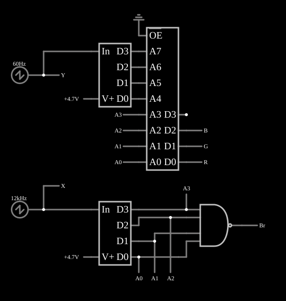

# Rosto sorridente no osciloscópio X–Y

<!-- navegacao:inicio -->
[Índice](README.md) · [Anterior: Color Checkerboard](plot2d-color.md)
<!-- navegacao:fim -->

## Objetivo

Mostrar o osciloscópio bidimensional desenhando uma **imagem armazenada numa memória**: uma ROM guarda a cor de cada ponto de uma tela de $16\times 16$, e a varredura lê a memória em ordem e a desenha. É uma demonstração: o que importa é a imagem desenhada (um rosto), e não um valor num componente.

## O circuito

<!-- esquema:inicio -->

<!-- esquema:fim -->

Dois geradores de dente de serra fazem o papel dos circuitos de varredura de um televisor: um de $12\ \text{kHz}$ (varredura horizontal, eixo X, de $0$ a $5\ \text{V}$) e um de $60\ \text{Hz}$ (varredura vertical, eixo Y, de $5$ a $0\ \text{V}$). Cada tensão passa por um conversor analógico-digital de 4 bits (16 níveis, $5/16 = 0{,}3125\ \text{V}$ por degrau), e as portas lógicas combinam os bits para decidir se o ponto da tela deve estar aceso. O osciloscópio, no modo X–Y com entrada de brilho, desenha o ponto na posição $(X, Y)$ e o acende conforme o sinal de brilho.

Os 4 bits de cada conversor formam, juntos, o endereço de 8 bits de uma ROM de $256\times 4$ bits. A palavra lida em cada endereço tem 3 bits de cor ($R$, $G$ e $B$, que vão aos canais de cor do osciloscópio); a NAND dos 4 bits do eixo X é o brilho e apaga o retorno.

<!-- componentes:inicio -->
| N.º | Tipo | Elemento | Valores |
|----:|------|----------|---------|
| 0 | `RailElm` | sawtooth gen | Max Voltage = -2.5; Waveform = Sawtooth; DC Offset (V) = 2.5; Internal Resistance (ohms) = 0; Show Voltage = não; Frequency (Hz) = 60; Phase Offset (degrees) = 0 |
| 1 | `RailElm` | sawtooth gen | Max Voltage = 2.5; Waveform = Sawtooth; DC Offset (V) = 2.5; Internal Resistance (ohms) = 0; Show Voltage = não; Frequency (Hz) = 12k; Phase Offset (degrees) = 0 |
| 2 | `LabeledNodeElm` | Labeled Node | Text = Y; Internal Node = não; Rotate Text When Vertical = não |
| 3 | `LabeledNodeElm` | Labeled Node | Text = X; Internal Node = não; Rotate Text When Vertical = não |
| 4 | `ADCElm` | ADC | Bit Order = MSB First; # of Bits = 4 |
| 7 | `RailElm` | voltage source | Voltage = 4.7; Waveform = D/C; DC Offset (V) = 0; Internal Resistance (ohms) = 0 |
| 8 | `RailElm` | voltage source | Voltage = 4.7; Waveform = D/C; DC Offset (V) = 0; Internal Resistance (ohms) = 0 |
| 10 | `ADCElm` | ADC | Bit Order = MSB First; # of Bits = 4 |
| 13 | `NandGateElm` | NAND gate | # of Inputs = 4; High Logic Voltage = 5; Schmitt Inputs = não; Invert Inputs = não; Propagation Delay (s) = 0; DeMorgan's Symbol = não |
| 15 | `RoutedWireElm` | wire | Show Current = não; Show Voltage = não; Show Bus Value = não; Show Bus Value (Hex) = não |
| 16 | `LabeledNodeElm` | Labeled Node | Text = Br; Internal Node = não; Rotate Text When Vertical = não |
| 17 | `LabeledNodeElm` | Labeled Node | Text = A0; Internal Node = não; Rotate Text When Vertical = não |
| 18 | `LabeledNodeElm` | Labeled Node | Text = A3; Internal Node = não; Rotate Text When Vertical = não |
| 19 | `LabeledNodeElm` | Labeled Node | Text = A2; Internal Node = não; Rotate Text When Vertical = não |
| 20 | `LabeledNodeElm` | Labeled Node | Text = A1; Internal Node = não; Rotate Text When Vertical = não |
| 21 | `LabeledNodeElm` | Labeled Node | Text = A0; Internal Node = não; Rotate Text When Vertical = não |
| 22 | `LabeledNodeElm` | Labeled Node | Text = A1; Internal Node = não; Rotate Text When Vertical = não |
| 23 | `LabeledNodeElm` | Labeled Node | Text = A2; Internal Node = não; Rotate Text When Vertical = não |
| 27 | `LabeledNodeElm` | Labeled Node | Text = A3; Internal Node = não; Rotate Text When Vertical = não |
| 28 | `LabeledNodeElm` | Labeled Node | Text = R; Internal Node = não; Rotate Text When Vertical = não |
| 29 | `LabeledNodeElm` | Labeled Node | Text = G; Internal Node = não; Rotate Text When Vertical = não |
| 30 | `LabeledNodeElm` | Labeled Node | Text = B; Internal Node = não; Rotate Text When Vertical = não |
| 32 | `RoutedWireElm` | wire | Show Current = não; Show Voltage = não; Show Bus Value = não; Show Bus Value (Hex) = não |
| 33 | `ROMElm` | ROM | High Logic Voltage = 5; Bit Order = MSB First; # of Address Bits = 8; # of Data Bits = 4; Contents = 0: 4 4 4 4 4 10: 4 4 4 4 4 16: 4 4 4 21: 3 3 3 3 3 28: 4 4 4; Hex Display = não; Restore Contents on Reset = não |
| 34 | `GroundElm` | ground | Symbol = Earth |
<!-- componentes:fim -->

## Teoria

A ROM é uma tabela de $16\times 16$ pontos. Lendo o conteúdo da ROM em linhas de 16, o código de cor de cada ponto é:

```
4 4 4 4 4 0 0 0 0 0 4 4 4 4 4 0
4 4 4 0 0 3 3 3 3 3 0 0 4 4 4 0
4 4 0 3 3 3 3 3 3 3 3 3 0 4 4 0
4 0 3 3 3 0 0 0 0 0 3 3 3 0 4 0
4 0 3 3 3 3 3 3 3 3 0 3 3 0 4 0
0 3 3 3 3 3 3 3 3 3 3 3 3 3 0 0
0 3 3 0 0 0 3 3 3 0 0 0 3 3 0 0
0 3 0 7 0 0 0 3 0 7 0 0 0 3 0 0
0 3 0 7 7 0 0 3 0 7 7 0 0 3 0 0
0 0 0 0 0 0 0 0 0 0 0 0 0 0 0 0
4 0 3 3 3 3 3 3 3 3 3 3 3 0 4 0
4 0 3 3 3 3 3 3 3 3 3 3 3 0 4 0
4 4 0 3 3 3 3 3 3 3 3 3 0 4 4 0
4 4 4 0 0 3 3 3 3 3 0 0 4 4 4 0
4 4 4 4 4 0 0 0 0 0 4 4 4 4 4 0
4 4 4 4 4 4 4 4 4 4 4 4 4 4 4 4
```

(ordem de leitura: cada linha do desenho é uma varredura horizontal; o primeiro endereço fica no canto superior esquerdo). Os valores são os 3 bits de cor em binário: $4 = 100_2$ (só o canal $B$), $3 = 011_2$ (os canais $R$ e $G$), $7 = 111_2$ (os três) e $0$ (nenhum, ponto preto). As proporções confirmam: $R$ e $G$ estão acesos em $98/256 = 38{,}3\ \%$ dos pontos e $B$ em $70/256 = 27{,}3\ \%$.

## Resultados esperados

O simulador dá, em média ao longo de um quadro de $1/60\ \text{s}$:

- **Canais $R$ e $G$:** nível médio de $1{,}93\ \text{V}$ nos dois, acesos em $38{,}5\ \%$ do quadro (contra $38{,}3\ \%$ dos endereços da ROM).
- **Canal $B$:** nível médio de $1{,}37\ \text{V}$, aceso em $27{,}4\ \%$ do quadro (contra $27{,}3\ \%$ dos endereços).
- **Brilho:** nível médio de $4{,}70\ \text{V}$, $15/16$ do tempo.
- **Varreduras:** $60\ \text{Hz}$ no eixo Y e $12\ \text{kHz}$ no eixo X.

## O que observar

Abra o osciloscópio e veja o rosto: um disco de pontos de cor $R+G$, um fundo azul ($B$), um contorno preto e pontos brancos ($7$) nos olhos. Edite o conteúdo da ROM para desenhar outra figura de $16\times 16$ pontos.

## Limites do modelo

- A imagem é produzida pelo osciloscópio X–Y; as verificações do documento medem os sinais de cor e de brilho médios, mas não a tela.
- A tabela acima é o conteúdo da ROM em ordem de endereço, 16 por linha; que o primeiro endereço fique no canto superior esquerdo da tela é uma suposição, não conferida na janela do osciloscópio.
- O desenho tem $16\times 16$ pontos grandes, por causa dos conversores de 4 bits.

## Referências

Princípio do varrimento de televisão: Whitaker e Benson, *Standard Handbook of Video and Television Engineering*; Tektronix, *XYZs of Oscilloscopes* (modo X–Y e modulação do brilho, o eixo Z).

O circuito deste exemplo faz parte da coleção do simulador original de Paul Falstad e Iain Sharp (CircuitJS1); a explicação é deste projeto.
