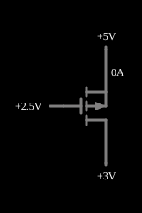

# Transistor MOSFET de canal p

<!-- navegacao:inicio -->
[Índice](README.md) · [Anterior: n-MOSFET](nmosfet.md) · [Próximo: Switch](mosswitch.md)
<!-- navegacao:fim -->

## Objetivo

Mostrar o MOSFET de canal p (PMOS), complementar do [n-MOSFET](nmosfet.md): o canal se forma quando a porta fica **abaixo** da fonte por mais do que $|V_t|$, e a corrente de dreno sai pelo dreno, em sentido oposto ao do NMOS.

## O circuito

<!-- esquema:inicio -->

<!-- esquema:fim -->

A **fonte** do transistor está ligada a $+5\ \text{V}$, e a **tensão de porta** ($0$ a $5\ \text{V}$) e a **tensão de dreno** ($0$ a $5\ \text{V}$) são duas fontes com *sliders*. O exemplo abre com a porta em $2{,}5\ \text{V}$ ($V_{SG} = 2{,}5\ \text{V}$) e o dreno em $3\ \text{V}$ ($V_{SD} = 2\ \text{V}$).

<!-- componentes:inicio -->
| N.º | Tipo | Elemento | Valores |
|----:|------|----------|---------|
| 0 | `VarRailElm` | voltage source | Min Voltage = 0; Max Voltage = 5; Slider Text = Gate Voltage |
| 3 | `PMosfetElm` | MOSFET | Model = default; Swap D/S = não |
| 4 | `VarRailElm` | voltage source | Min Voltage = 0; Max Voltage = 5; Slider Text = Drain Voltage |
| 5 | `RailElm` | voltage source | Voltage = 5; Waveform = D/C; DC Offset (V) = 0; Internal Resistance (ohms) = 0 |
<!-- componentes:fim -->

## Teoria

O PMOS segue as mesmas equações do NMOS, com todas as tensões e correntes trocadas de sinal: usam-se $V_{SG} = V_S - V_G$ e $V_{SD} = V_S - V_D$, com o limiar $|V_t| = 1{,}5\ \text{V}$. Com $V_{ov} = V_{SG} - |V_t|$ (modelo de lei quadrática de [n-MOSFET](nmosfet.md), $\beta = 0{,}02\ \text{A/V}^2$, $\lambda = 0$):

$$I_D = \begin{cases}
\approx 0 & V_{SG} < |V_t|\\
\beta\left(V_{ov}\,V_{SD} - \tfrac12 V_{SD}^2\right) & V_{SD} < V_{ov} \quad \text{(triodo)}\\
\tfrac12\beta\,V_{ov}^2 & V_{SD} \ge V_{ov} \quad \text{(saturação)}
\end{cases}$$

## Resultados esperados

Com $V_{SG} = 5 - 2{,}5 = 2{,}5\ \text{V}$, $V_{ov} = 1\ \text{V}$ e $V_{SD} = 2\ \text{V} \ge 1\ \text{V}$ (saturação):

$$I_D = \tfrac12 \cdot 0{,}02 \cdot 1^2 = 10\ \text{mA},$$

que o simulador confirma no transistor e na fonte de $5\ \text{V}$ (a corrente da fonte de dreno tem o sinal oposto, porque entra nela); a tensão de porta é $2{,}5\ \text{V}$. Movendo os *sliders* (valores conferidos no simulador, fora das verificações automáticas):

| Porta (V) | Dreno (V) | $V_{SG}$ (V) | $V_{SD}$ (V) | Região | $I_D$ |
|----------:|----------:|-------------:|-------------:|--------|------:|
| $2{,}5$ | $3{,}0$ | $2{,}5$ | $2{,}0$ | saturação | $10\ \text{mA}$ |
| $2{,}5$ | $4{,}5$ | $2{,}5$ | $0{,}5$ | triodo | $7{,}5\ \text{mA}$ |
| $2{,}0$ | $1{,}0$ | $3{,}0$ | $4{,}0$ | saturação | $22{,}5\ \text{mA}$ |
| $0{,}0$ | $3{,}0$ | $5{,}0$ | $2{,}0$ | triodo | $100\ \text{mA}$ |
| $0{,}0$ | $0{,}0$ | $5{,}0$ | $5{,}0$ | saturação | $122{,}5\ \text{mA}$ |
| $3{,}5$ | $0{,}0$ | $1{,}5$ | $5{,}0$ | limiar | $0$ |
| $4{,}0$ | $0{,}0$ | $1{,}0$ | $5{,}0$ | corte | $50\ \text{nA}$ (fuga) |

## O que observar

Diminua a tensão de porta: a corrente só começa a fluir quando ela fica abaixo de $5 - 1{,}5 = 3{,}5\ \text{V}$, e cresce com o quadrado de $V_{SG} - 1{,}5$. Com a porta em $0\ \text{V}$ o transistor fornece mais de $100\ \text{mA}$. A curva é a imagem especular da do NMOS: o PMOS "empurra" corrente do $+5\ \text{V}$ para o dreno, enquanto o NMOS "puxa" corrente do dreno para a terra. Essa simetria é a base do inversor CMOS ([CMOS Inverter](cmosinverter.md)).

## Limites do modelo

- Valem os limites do [n-MOSFET](nmosfet.md): lei quadrática, sem corrente de sublimiar, sem capacitâncias e sem modulação do comprimento do canal.
- No simulador o PMOS tem o mesmo $\beta$ e o mesmo $|V_t|$ do NMOS; num processo real o PMOS tem mobilidade menor, e para igualar as correntes ele precisa ser mais largo.

## Referências

Sedra e Smith, *Microelectronic Circuits*, capítulo sobre o MOSFET (características $i$–$v$ e modelo de lei quadrática); Razavi, *Fundamentals of Microelectronics*, capítulo sobre o MOSFET.

O circuito deste exemplo faz parte da coleção do simulador original de Paul Falstad e Iain Sharp (CircuitJS1); a explicação é deste projeto.
