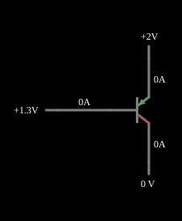

# Transistor PNP

<!-- navegacao:inicio -->
[Índice](README.md) · [Anterior: NPN Transistor](npn.md) · [Próximo: Switch](transswitch.md)
<!-- navegacao:fim -->

## Objetivo

Mostrar o transistor PNP, o complementar do NPN: com o emissor no potencial positivo, uma tensão de base **abaixo** do emissor de cerca de $0{,}7\ \text{V}$ o liga, e a corrente flui do emissor para o coletor.

## O circuito

<!-- esquema:inicio -->

<!-- esquema:fim -->

O emissor está em $+2\ \text{V}$ (fonte fixa); a base é uma fonte variável ($1{,}2$ a $1{,}5\ \text{V}$, "Base Voltage"; aberto em $1{,}2975\ \text{V}$); o coletor é uma fonte variável de $0$ a $2\ \text{V}$ (aberto em $0\ \text{V}$).

<!-- componentes:inicio -->
| N.º | Tipo | Elemento | Valores |
|----:|------|----------|---------|
| 0 | `VarRailElm` | voltage source | Min Voltage = 1.2; Max Voltage = 1.5; Slider Text = Base Voltage |
| 4 | `PTransistorElm` | transistor | Beta/hFE = 100; Swap E/C = não; Draw Circle = não; Model = default |
| 5 | `RailElm` | voltage source | Voltage = 2; Waveform = D/C; DC Offset (V) = 0; Internal Resistance (ohms) = 0 |
| 6 | `VarRailElm` | voltage source | Min Voltage = 0; Max Voltage = 2; Slider Text = Collector Voltage |
<!-- componentes:fim -->

## Teoria

O transistor bipolar do simulador (modelo "default") segue o modelo de Ebers–Moll, com $V_{BE}$ e $V_{BC}$ as tensões base-emissor e base-coletor (para um NPN):

$$I_C = I_s\left(e^{V_{BE}/V_T} - e^{V_{BC}/V_T}\right) - \frac{I_s}{\beta_R}\left(e^{V_{BC}/V_T} - 1\right),\qquad I_B = \frac{I_s}{\beta}\left(e^{V_{BE}/V_T} - 1\right) + \frac{I_s}{\beta_R}\left(e^{V_{BC}/V_T} - 1\right),$$

com $I_s = 10^{-13}\ \text{A}$, $\beta = 100$, $\beta_R = 1$ e $V_T = 25{,}865\ \text{mV}$; sem efeito Early, sem capacitâncias e sem resistências série. Na **região ativa** ($V_{BE} \approx 0{,}65$ a $0{,}75\ \text{V}$, junção base-coletor com polarização inversa) isso se reduz a $I_C = \beta I_B = I_s\,e^{V_{BE}/V_T}$, com transcondutância $g_m = I_C/V_T$ e resistência de emissor $r_e = V_T/I_E$. O PNP é o complementar, com todas as tensões e correntes invertidas.

## Resultados esperados

No PNP, $V_{EB} = V_E - V_B = 2 - 1{,}2975 = 0{,}7025\ \text{V}$ faz o papel de $V_{BE}$ do NPN, e as correntes têm o sentido oposto: entra pelo emissor, sai pelo coletor e pela base. O resultado é o mesmo do exemplo do NPN, com os sinais trocados:

$$|I_C| = I_s\,e^{0{,}7025/0{,}025865} = 62{,}45\ \text{mA},\qquad |I_B| = 0{,}6245\ \text{mA}.$$

As verificações conferem as correntes lidas nas fontes do coletor e da base (negativas, porque o sentido da corrente numa fonte é do terminal positivo para dentro da fonte) e as tensões de base e de emissor (tolerância de 1% e 0,2%).

## O que observar

- Compare com o NPN: aqui a base precisa ficar **abaixo** do emissor; um PNP com a base no potencial do emissor está desligado.
- A corrente flui do emissor (positivo) para o coletor (potencial mais baixo): o PNP "puxa" corrente da alimentação positiva.
- PNP e NPN juntos formam os pares complementares usados em seguidores push-pull (veja os exemplos adiante).

## Limites do modelo

Mesmas limitações do exemplo do NPN: sem efeito Early, sem capacitâncias e com $\beta$ constante.

## Referências

- A. S. Sedra e K. C. Smith, *Microeletrônica*, Pearson.
- P. Horowitz e W. Hill, *The Art of Electronics*, Cambridge University Press.

O circuito deste exemplo faz parte da coleção do simulador original de Paul Falstad e Iain Sharp (CircuitJS1); a explicação é deste projeto.
