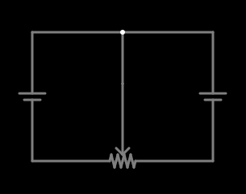

# Potenciômetro como duas resistências

<!-- navegacao:inicio -->
[Índice](README.md) · [Anterior: Voltage Divider](voltdivide.md) · [Próximo: Potentiometer Divider](potdivide.md)
<!-- navegacao:fim -->

## Objetivo

Mostrar que um potenciômetro de resistência total $R$ se comporta como duas resistências $xR$ e $(1-x)R$ cuja soma é constante, em que $x$ é a posição do cursor.

## O circuito

<!-- esquema:inicio -->

<!-- esquema:fim -->

Duas fontes de 5 V têm os polos negativos ligados às duas extremidades de um potenciômetro de $1\ \text{k}\Omega$, e os polos positivos ligados entre si e ao cursor do potenciômetro. Cada fonte alimenta, portanto, um dos dois trechos do potenciômetro. O *slider* "Resistance" move o cursor (posição inicial: 0,5).

<!-- componentes:inicio -->
| N.º | Tipo | Elemento | Valores |
|----:|------|----------|---------|
| 0 | `VoltageElm` | voltage source | Voltage = 5; Waveform = D/C; DC Offset (V) = 0; Internal Resistance (ohms) = 0; Show Voltage = não; Circle Symbol = não |
| 1 | `VoltageElm` | voltage source | Voltage = 5; Waveform = D/C; DC Offset (V) = 0; Internal Resistance (ohms) = 0; Show Voltage = não; Circle Symbol = não |
| 5 | `PotElm` | potentiometer | Resistance (ohms) = 1k; Slider Text = Resistance; Show Values = sim; Group Number (for linking) = 0 |
<!-- componentes:fim -->

## Teoria

Um potenciômetro de resistência total $R$ com o cursor na posição $x\in[0,1]$ tem, entre uma extremidade e o cursor, $R_a = xR$ e, entre o cursor e a outra extremidade, $R_b=(1-x)R$, de modo que $R_a+R_b=R$. Cada fonte de tensão $V$ ligada a um trecho produz a corrente

$$I_a = \frac{V}{xR},\qquad I_b = \frac{V}{(1-x)R}.$$

Quando $x\to 0$ a corrente $I_a\to\infty$ (limitada, na prática, pela resistência interna da fonte), e $I_b\to V/R$.

## Resultados esperados

Com $x=0{,}5$: $R_a=R_b=500\ \Omega$, logo $I_a=I_b=5/500=10\ \text{mA}$. As verificações conferem as duas correntes.

## O que observar

- Mova o cursor: uma corrente sobe quanto menor for o trecho que ela atravessa, e a outra cai; a soma das resistências continua $R$.
- Compare com o exemplo seguinte, em que o potenciômetro age como divisor de tensão.

## Limites do modelo

Potenciômetro ideal, linear, sem resistência de contato do cursor.

## Referências

- J. W. Nilsson e S. A. Riedel, *Circuitos Elétricos*, Pearson.
- P. Horowitz e W. Hill, *The Art of Electronics*, Cambridge University Press.

O circuito deste exemplo faz parte da coleção do simulador original de Paul Falstad e Iain Sharp (CircuitJS1); a explicação é deste projeto.
