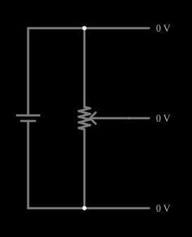

# Divisor de tensão com potenciômetro

<!-- navegacao:inicio -->
[Índice](README.md) · [Anterior: Potentiometer](pot.md) · [Próximo: Thevenin's Theorem](thevenin.md)
<!-- navegacao:fim -->

## Objetivo

Mostrar o potenciômetro como divisor de tensão ajustável: a tensão no cursor varia de 0 a $V$ conforme a posição.

## O circuito

<!-- esquema:inicio -->

<!-- esquema:fim -->

Uma fonte de 5 V é ligada às duas extremidades de um potenciômetro de $1\ \text{k}\Omega$. Marcadores de saída mostram a tensão da extremidade superior (5 V), do cursor e da extremidade inferior (0 V). O *slider* move o cursor (posição inicial 0,5).

<!-- componentes:inicio -->
| N.º | Tipo | Elemento | Valores |
|----:|------|----------|---------|
| 0 | `PotElm` | potentiometer | Resistance (ohms) = 1k; Slider Text = Resistance; Show Values = sim; Group Number (for linking) = 0 |
| 1 | `VoltageElm` | voltage source | Voltage = 5; Waveform = D/C; DC Offset (V) = 0; Internal Resistance (ohms) = 0; Show Voltage = não; Circle Symbol = não |
| 4 | `OutputElm` | output | Show Voltage = sim; Scale = Auto |
| 5 | `OutputElm` | output | Show Voltage = sim; Scale = Auto |
| 6 | `OutputElm` | output | Show Voltage = sim; Scale = Auto |
<!-- componentes:fim -->

## Teoria

Entre as extremidades do potenciômetro passa a corrente $I=V/R$, e a tensão no cursor, medida em vazio a partir da extremidade inferior, é

$$V_{out} = V\,\frac{(1-x)R}{R} = V\,(1-x).$$

Se uma carga $R_L$ for ligada ao cursor, ela fica em paralelo com o trecho inferior e a saída cai (efeito de carga):

$$V_{out} = V\,\frac{R_b\,\|\,R_L}{R_a + R_b\,\|\,R_L}.$$

## Resultados esperados

Com $x=0{,}5$, $V_{out}=2{,}5\ \text{V}$ e a corrente do potenciômetro é $5\ \text{V}/1\ \text{k}\Omega=5\ \text{mA}$. As verificações conferem a tensão do cursor, a da extremidade superior e a corrente.

## O que observar

- Mova o cursor: a tensão de saída varia linearmente de 0 a 5 V.
- Para que o efeito de carga seja pequeno, a carga deve ser muito maior que $R$.

## Limites do modelo

Potenciômetro e fonte ideais; saída em vazio.

## Referências

- J. W. Nilsson e S. A. Riedel, *Circuitos Elétricos*, Pearson.
- P. Horowitz e W. Hill, *The Art of Electronics*, Cambridge University Press.

O circuito deste exemplo faz parte da coleção do simulador original de Paul Falstad e Iain Sharp (CircuitJS1); a explicação é deste projeto.
