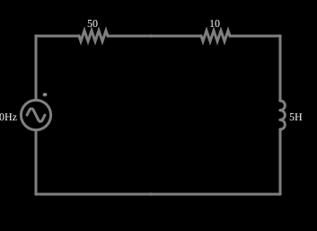

# Fator de potência

<!-- navegacao:inicio -->
[Índice](README.md) · [Anterior: Blocking Inductive Kickback](inductkick-snub.md) · [Próximo: Power Factor Correction](powerfactor2.md)
<!-- navegacao:fim -->

## Objetivo

Mostrar o que é o fator de potência e por que ele importa: uma carga indutiva tira da rede uma corrente grande, da qual só uma pequena parte realiza trabalho, e a resistência da linha dissipa muito mais potência que a própria carga.

## O circuito

<!-- esquema:inicio -->

<!-- esquema:fim -->

Uma fonte de $120\ \text{V}$ eficazes ($60\ \text{Hz}$) alimenta, através de um resistor de $50\ \Omega$ (a resistência da linha), uma carga formada por um resistor de $10\ \Omega$ em série com um indutor de $5\ \text{H}$. A fonte começa no pico (fase de $90^\circ$), o que evita o transitório inicial. Três osciloscópios mostram as tensões e a corrente.

<!-- componentes:inicio -->
| N.º | Tipo | Elemento | Valores |
|----:|------|----------|---------|
| 0 | `VoltageElm` | A/C source | Max Voltage = 169.7; Waveform = A/C; DC Offset (V) = 0; Internal Resistance (ohms) = 0; Show Voltage = não; Frequency (Hz) = 60; Phase Offset (degrees) = 90 |
| 1 | `ResistorElm` | resistor | Resistance (ohms) = 10 |
| 3 | `InductorElm` | inductor | Inductance (H) = 5; Trapezoidal Approximation = sim; Initial Current (on Reset) (A) = 0; Saturation Current (A) (0=none) = 0 |
| 5 | `ResistorElm` | resistor | Resistance (ohms) = 50 |
<!-- componentes:fim -->

## Teoria

Numa carga com impedância $Z = R + jX$, a tensão e a corrente eficazes $V$ e $I$ definem:

- a potência **aparente** $S = V I$ (em VA);
- a potência **ativa** (que realiza trabalho ou vira calor) $P = V I\cos\varphi$ (em W);
- a potência **reativa** $Q = V I\sin\varphi$ (em var), que vai e volta entre a fonte e o campo do indutor;

com $S^2 = P^2 + Q^2$ e o **fator de potência** $\text{FP} = \cos\varphi = P/S$, em que $\varphi$ é o ângulo entre a tensão e a corrente. Uma carga indutiva tem $\varphi > 0$ (a corrente atrasa).

A linha de resistência $R_l$ dissipa $P_l = R_l I^2$ qualquer que seja o fator de potência: para uma dada potência ativa $P$, uma corrente $I = P/(V\cos\varphi)$ maior (fator de potência menor) significa perdas maiores na linha.

## Resultados esperados

Aqui $X_L = \omega L = 2\pi\cdot 60\cdot 5 = 1885\ \Omega$, a resistência total é $50 + 10 = 60\ \Omega$ e $|Z| = \sqrt{60^2 + 1885^2} = 1885{,}9\ \Omega$. Então

$$I = \frac{120}{1885{,}9} = 63{,}63\ \text{mA},\qquad \text{FP} = \cos\varphi = \frac{60}{1885{,}9} = 0{,}032\ (\varphi = 88{,}2^\circ).$$

| grandeza | valor |
|:---------|------:|
| potência aparente $S$ | $7{,}64\ \text{VA}$ |
| potência reativa $Q$ | $7{,}63\ \text{var}$ |
| potência ativa na carga ($10\ \Omega$) | $0{,}0405\ \text{W}$ |
| potência perdida na linha ($50\ \Omega$) | $0{,}2024\ \text{W}$ |
| potência ativa total da fonte | $0{,}2429\ \text{W}$ |

A carga recebe só $17\%$ da potência ativa que a fonte entrega; o resto é perdido na linha. As verificações conferem a corrente eficaz da fonte e as tensões eficazes dos dois resistores ($0{,}636\ \text{V}$ no de $10\ \Omega$ e $3{,}18\ \text{V}$ no de $50\ \Omega$), numa janela de um ciclo em regime (de $1$ a $1{,}0167\ \text{s}$), com tolerância de 1% (o simulador fica a menos de 0,1% da teoria).

## O que observar

- Veja nos osciloscópios a corrente atrasada de quase $90^\circ$ em relação à tensão da fonte.
- A potência aparente é muito maior que a potência que o resistor de carga realmente dissipa: $7{,}64\ \text{VA}$ contra $0{,}04\ \text{W}$.
- No próximo exemplo um capacitor corrige o fator de potência e a corrente da linha cai a menos de 1% do valor daqui.

## Limites do modelo

O exemplo usa valores didáticos (indutância de $5\ \text{H}$, muito maior que a de um motor comum, para que o ângulo fique perto de $90^\circ$). A resistência da linha é concentrada num único resistor, e a carga é um indutor ideal em série com um resistor, sem perdas no ferro nem não linearidades. A fonte começa no pico para que o regime seja atingido logo; a janela de medição começa em $1\ \text{s}$, depois de o transitório (de constante $L/R \approx 83\ \text{ms}$) ter desaparecido.

## Referências

- C. K. Alexander e M. N. O. Sadiku, *Fundamentos de Circuitos Elétricos*, AMGH.
- J. W. Nilsson e S. A. Riedel, *Circuitos Elétricos*, Pearson.

O circuito deste exemplo faz parte da coleção do simulador original de Paul Falstad e Iain Sharp (CircuitJS1); a explicação é deste projeto.
