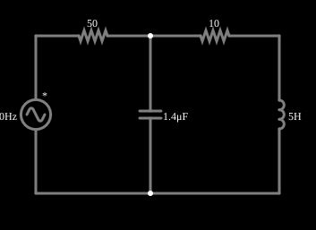

# Correção do fator de potência

<!-- navegacao:inicio -->
[Índice](README.md) · [Anterior: Power Factor](powerfactor1.md) · [Próximo: Resistor Grid](grid.md)
<!-- navegacao:fim -->

## Objetivo

Mostrar a correção do fator de potência: um capacitor em paralelo com a carga indutiva fornece a corrente reativa que a carga precisa, de modo que a linha só carrega a parte ativa e as perdas caem a quase zero.

## O circuito

<!-- esquema:inicio -->

<!-- esquema:fim -->

É o circuito do exemplo anterior (fonte de $120\ \text{V}$ eficazes, linha de $50\ \Omega$, carga de $10\ \Omega$ em série com $5\ \text{H}$), com um **capacitor de $1{,}4\ \mu\text{F}$ ligado em paralelo com a carga**, depois da resistência da linha.

<!-- componentes:inicio -->
| N.º | Tipo | Elemento | Valores |
|----:|------|----------|---------|
| 0 | `VoltageElm` | A/C source | Max Voltage = 169.7; Waveform = A/C; DC Offset (V) = 0; Internal Resistance (ohms) = 0; Show Voltage = não; Frequency (Hz) = 60; Phase Offset (degrees) = 90 |
| 1 | `ResistorElm` | resistor | Resistance (ohms) = 10 |
| 3 | `InductorElm` | inductor | Inductance (H) = 5; Trapezoidal Approximation = sim; Initial Current (on Reset) (A) = 0; Saturation Current (A) (0=none) = 0 |
| 5 | `ResistorElm` | resistor | Resistance (ohms) = 50 |
| 6 | `CapacitorElm` | capacitor | Capacitance (F) = 1.4μ; Trapezoidal Approximation = sim; Initial Voltage (on Reset) = 1m; Series Resistance = 0 |
<!-- componentes:fim -->

## Teoria

A corrente do indutor atrasa $90^\circ$ da tensão e a do capacitor adianta $90^\circ$; elas têm sentidos opostos e **se cancelam** no nó onde estão ligadas, de modo que a corrente que a fonte precisa fornecer pela linha cai. Para uma carga com $R + jX_L$ e um capacitor $C$ em paralelo, a corrente reativa se anula (fator de potência unitário na carga) quando

$$C = \frac{X_L}{R^2 + X_L^2}\cdot\frac{1}{\omega} = \frac{L}{R^2 + (\omega L)^2} = 1{,}407\ \mu\text{F}.$$

É o mesmo que dizer que a carga indutiva e o capacitor formam um circuito ressonante paralelo na frequência da rede: $f_0 = \dfrac{1}{2\pi\sqrt{LC}} = 60{,}15\ \text{Hz}$ para $C = 1{,}4\ \mu\text{F}$.

## Resultados esperados

Resolvendo o circuito em regime senoidal com $C = 1{,}4\ \mu\text{F}$ (impedância da carga em paralelo com o capacitor, em série com a linha):

| grandeza | sem capacitor | com capacitor |
|:---------|--------------:|--------------:|
| corrente da fonte (linha), eficaz | $63{,}63\ \text{mA}$ | $0{,}469\ \text{mA}$ |
| corrente da carga ($R + L$), eficaz | $63{,}63\ \text{mA}$ | $63{,}65\ \text{mA}$ |
| corrente do capacitor, eficaz | — | $63{,}33\ \text{mA}$ |
| potência perdida na linha | $0{,}2024\ \text{W}$ | $11\ \mu\text{W}$ |
| potência aparente da fonte | $7{,}64\ \text{VA}$ | $0{,}056\ \text{VA}$ |
| potência ativa na carga | $0{,}0405\ \text{W}$ | $0{,}0405\ \text{W}$ |

A carga continua com a mesma corrente e a mesma potência ativa, mas a corrente na linha caiu 136 vezes e a perda na linha, quase 20 mil vezes. (O fator de potência visto pela fonte não é exatamente $1$, $\cos\varphi = 0{,}72$, porque o capacitor de $1{,}4\ \mu\text{F}$ não é exatamente o ideal de $1{,}407\ \mu\text{F}$ e a linha tem resistência, mas a corrente é tão pequena que isso quase não importa.) As verificações conferem as três correntes eficazes com o capacitor, numa janela de um ciclo em regime (de $3$ a $3{,}0167\ \text{s}$), com tolerância de 1% a 2%.

## O que observar

- Compare a corrente da fonte (pequena) com a da carga (a mesma de antes): é o que o capacitor fornece, em oposição de fase à do indutor.
- Varie o capacitor (duplo clique): o ponto ótimo é próximo de $1{,}4\ \mu\text{F}$; com valores muito maiores o circuito fica capacitivo e a corrente da linha volta a subir.
- Nas indústrias, bancos de capacitores fazem exatamente isto para reduzir a corrente e as perdas na rede (e as multas por baixo fator de potência).

## Limites do modelo

Com um capacitor sintonizado, o circuito fica sensível a variações de frequência e de carga (a ressonância paralela é aguda): um pequeno desvio de frequência muda muito a corrente da linha. Num sistema real a carga varia e o banco de capacitores é comutado em degraus. Os valores deste exemplo são didáticos.

## Referências

- C. K. Alexander e M. N. O. Sadiku, *Fundamentos de Circuitos Elétricos*, AMGH.
- J. W. Nilsson e S. A. Riedel, *Circuitos Elétricos*, Pearson.

O circuito deste exemplo faz parte da coleção do simulador original de Paul Falstad e Iain Sharp (CircuitJS1); a explicação é deste projeto.
