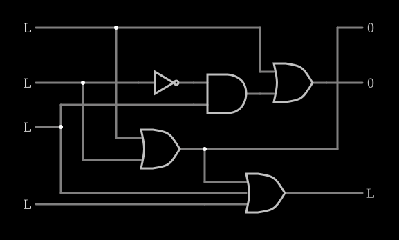

# Codificador de prioridade

<!-- navegacao:inicio -->
[Índice](README.md) · [Anterior: 1-of-4 Decoder](decoder.md) · [Próximo: 2-to-1 Mux](mux3state.md)
<!-- navegacao:fim -->

## Objetivo

Mostrar o **codificador de prioridade**: de quatro entradas, ele dá o número (em binário) da de **maior prioridade** que estiver ativa, e uma saída que indica se alguma está ativa. É o circuito que decide qual pedido de interrupção um processador atende primeiro.

## O circuito

<!-- esquema:inicio -->

<!-- esquema:fim -->

Quatro entradas lógicas, de cima para baixo $I_3$ (elemento 10), $I_2$ (elemento 9), $I_1$ (elemento 13) e $I_0$ (elemento 15), alimentam portas OR, uma AND e um inversor. As saídas são o código de dois bits $Y_1$ (elemento 23, o mais significativo) e $Y_0$ (elemento 20), mostrados como $0$ ou $1$, e a saída "válido" $V$ (elemento 19), que fica em $1$ quando alguma entrada está ativa. O exemplo abre com as quatro entradas em $0$.

<!-- componentes:inicio -->
| N.º | Tipo | Elemento | Valores |
|----:|------|----------|---------|
| 0 | `OrGateElm` | OR gate | # of Inputs = 2; High Logic Voltage = 5; Schmitt Inputs = não; Invert Inputs = não; Propagation Delay (s) = 0; DeMorgan's Symbol = não |
| 1 | `AndGateElm` | AND gate | # of Inputs = 2; High Logic Voltage = 5; Schmitt Inputs = não; Invert Inputs = não; Propagation Delay (s) = 0; DeMorgan's Symbol = não |
| 2 | `InverterElm` | inverter | Slew Rate (V/ns) = 500m; High Logic Voltage = 5; DeMorgan's Symbol = não |
| 4 | `OrGateElm` | OR gate | # of Inputs = 2; High Logic Voltage = 5; Schmitt Inputs = não; Invert Inputs = não; Propagation Delay (s) = 0; DeMorgan's Symbol = não |
| 9 | `LogicInputElm` | logic input | Momentary Switch = não; High Logic Voltage = 5; Low Voltage = 0; Numeric = não; Ternary = não; Keyboard Shortcut =  |
| 10 | `LogicInputElm` | logic input | Momentary Switch = não; High Logic Voltage = 5; Low Voltage = 0; Numeric = não; Ternary = não; Keyboard Shortcut =  |
| 13 | `LogicInputElm` | logic input | Momentary Switch = não; High Logic Voltage = 5; Low Voltage = 0; Numeric = não; Ternary = não; Keyboard Shortcut =  |
| 14 | `OrGateElm` | OR gate | # of Inputs = 3; High Logic Voltage = 5; Schmitt Inputs = não; Invert Inputs = não; Propagation Delay (s) = 0; DeMorgan's Symbol = não |
| 15 | `LogicInputElm` | logic input | Momentary Switch = não; High Logic Voltage = 5; Low Voltage = 0; Numeric = não; Ternary = não; Keyboard Shortcut =  |
| 19 | `LogicOutputElm` | logic output | Threshold = 2.5; Current Required = não; Numeric = não; Ternary = não |
| 20 | `LogicOutputElm` | logic output | Threshold = 2.5; Current Required = não; Numeric = sim; Ternary = não |
| 23 | `LogicOutputElm` | logic output | Threshold = 2.5; Current Required = não; Numeric = sim; Ternary = não |
<!-- componentes:fim -->

## Teoria

A entrada de maior índice tem prioridade, e as de menor índice são ignoradas quando uma de maior índice está ativa. As equações são

$$Y_1 = I_3 + I_2, \qquad Y_0 = I_3 + \overline{I_2}\,I_1, \qquad V = I_3 + I_2 + I_1 + I_0.$$

O termo $\overline{I_2}\,I_1$ é o que dá a prioridade: $I_1$ só pode pôr o bit $Y_0$ em $1$ se $I_2$ não estiver ativa. A saída $V$ é necessária porque o código $00$ aparece tanto para "só $I_0$ ativa" quanto para "nenhuma ativa".

## Resultados esperados

O simulador dá, entre outras combinações:

| Entradas ativas | $Y_1\,Y_0$ | $V$ |
|------|----:|----:|
| nenhuma | 00 | 0 |
| $I_0$ | 00 | 1 |
| $I_1$ | 01 | 1 |
| $I_2$ | 10 | 1 |
| $I_1$ e $I_2$ | 10 | 1 |
| $I_3$ (com quaisquer outras) | 11 | 1 |

As dezesseis combinações seguem a regra: o código é sempre o da entrada ativa mais alta.

## O que observar

Ative uma entrada baixa e depois uma mais alta: o código passa à mais alta e volta à baixa quando a alta é desligada. O circuito faz o inverso do [1-of-4 Decoder](decoder.md).

## Limites do modelo

- Portas ideais, sem atraso.
- Os codificadores integrados (como o 74148) têm entradas e saídas ativas em nível baixo e entradas de habilitação para ligar vários em cascata.

## Referências

Mano e Ciletti, *Digital Design*, capítulo sobre codificadores; Wakerly, *Digital Design: Principles and Practices*, capítulo sobre codificadores de prioridade.

O circuito deste exemplo faz parte da coleção do simulador original de Paul Falstad e Iain Sharp (CircuitJS1); a explicação é deste projeto.
