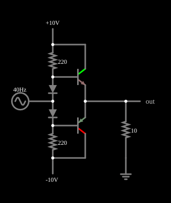

# Seguidor push-pull melhorado (classe AB)

<!-- navegacao:inicio -->
[Índice](README.md) · [Anterior: Simple, with distortion](pushpullxover.md)
<!-- navegacao:fim -->

## Objetivo

Mostrar como dois diodos eliminam a distorção de cruzamento do seguidor *push-pull*: eles polarizam os transistores logo acima do limiar de condução, de modo que a saída segue a entrada também perto de zero (estágio de classe AB). Compare com [Simple, with distortion](pushpullxover.md).

## O circuito

<!-- esquema:inicio -->

<!-- esquema:fim -->

É o par NPN/PNP ($\beta = 100$) do exemplo simples, com $\pm 10\ \text{V}$ nos coletores e carga de $10\ \Omega$, mas com duas diferenças: a fonte do sinal ($5\ \text{V}$, $40\ \text{Hz}$) está ligada ao ponto entre **dois diodes** em série, e cada diodo está ligado a uma base; um resistor de $220\ \Omega$ liga a base do NPN a $+10\ \text{V}$ e outro de $220\ \Omega$ liga a base do PNP a $-10\ \text{V}$. Os diodes usam o modelo padrão do simulador.

<!-- componentes:inicio -->
| N.º | Tipo | Elemento | Valores |
|----:|------|----------|---------|
| 0 | `NTransistorElm` | transistor | Beta/hFE = 100; Swap E/C = não; Draw Circle = não; Model = default |
| 1 | `PTransistorElm` | transistor | Beta/hFE = 100; Swap E/C = não; Draw Circle = não; Model = default |
| 5 | `ResistorElm` | resistor | Resistance (ohms) = 220 |
| 6 | `ResistorElm` | resistor | Resistance (ohms) = 220 |
| 7 | `DiodeElm` | diode | Model = default |
| 8 | `RailElm` | A/C source | Max Voltage = 5; Waveform = A/C; DC Offset (V) = 0; Internal Resistance (ohms) = 0; Show Voltage = não; Frequency (Hz) = 40; Phase Offset (degrees) = 0 |
| 12 | `RailElm` | voltage source | Voltage = 10; Waveform = D/C; DC Offset (V) = 0; Internal Resistance (ohms) = 0 |
| 13 | `RailElm` | voltage source | Voltage = -10; Waveform = D/C; DC Offset (V) = 0; Internal Resistance (ohms) = 0 |
| 14 | `DiodeElm` | diode | Model = default |
| 16 | `ResistorElm` | resistor | Resistance (ohms) = 10 |
| 17 | `GroundElm` | ground | Symbol = Earth |
| 18 | `OutputElm` | output | Show Voltage = não |
<!-- componentes:fim -->

## Teoria

Os resistores de $220\ \Omega$ e os dois diodes formam uma cadeia entre as fontes de $\pm 10\ \text{V}$ que mantém uma corrente de polarização, mesmo sem sinal:

$$I_{pol} = \frac{(+10) - (-10) - 2V_D}{2R} = \frac{20 - 2 \cdot 0{,}6425}{440} \approx 42{,}5\ \text{mA}.$$

Cada diodo cai $V_D \approx 0{,}64\ \text{V}$, e esse valor, somado à tensão do sinal, aparece entre a base de cada transistor e a entrada: as bases ficam em $v_i + V_D$ (NPN) e $v_i - V_D$ (PNP). Como a tensão base-emissor tem a mesma ordem de $V_D$, os transistores ficam **ligeiramente conduzindo** em repouso e a zona morta ($|v_i| < V_{BE}$) praticamente desaparece:

$$v_o \approx v_i + V_D - V_{BE}\quad (\text{NPN}),\qquad v_o \approx v_i - V_D + V_{EB}\quad (\text{PNP}).$$

O que resta é a diferença $V_D - V_{BE}$, que varia com as correntes ($V = V_T\ln(I/I_s)$): os diodos conduzem uma corrente de dezenas de $\text{mA}$ e, no pico, os transistores, centenas.

## Resultados esperados

Em repouso ($t = 12{,}5\ \text{ms}$, entrada de $6\ \text{mV}$) a corrente em cada diodo é $42{,}5\ \text{mA}$ e cada resistor de $220\ \Omega$ também conduz $42{,}6\ \text{mA}$, concordando com a previsão de $42{,}5\ \text{mA}$; a saída é $5{,}2\ \text{mV}$ (corrente de $0{,}52\ \text{mA}$ na carga): não há zona morta. No pico positivo a saída é $4{,}834\ \text{V}$ para $5\ \text{V}$ na entrada, uma diferença de $0{,}166\ \text{V}$, que vem de os dois diodos terem quedas diferentes ($0{,}665\ \text{V}$ no que leva $65\ \text{mA}$ e $0{,}590\ \text{V}$ no de $15\ \text{mA}$) enquanto o transistor tem $0{,}755\ \text{V}$ a $0{,}48\ \text{A}$. A saída vai de $-4{,}834\ \text{V}$ a $4{,}834\ \text{V}$ com valor eficaz de $3{,}407\ \text{V}$, quase igual a $5/\sqrt{2} \cdot 0{,}967 = 3{,}42\ \text{V}$ (um seguidor de ganho $0{,}967$). Por Fourier, o terceiro harmônico ($120\ \text{Hz}$) é $0{,}025\ \text{V}$ para $4{,}818\ \text{V}$ de fundamental, isto é, $0{,}52\%$, contra $7{,}1\%$ do circuito simples. As verificações conferem as correntes de repouso, a saída e as quedas dos dois diodes no pico e o máximo, o mínimo e o valor eficaz da saída (tolerância de $1\%$ nas correntes e $0{,}5\%$ nas tensões).

## O que observar

A saída é agora uma senoide quase perfeita, sem o degrau no cruzamento por zero. Para testar: troque os resistores de $220\ \Omega$ por valores maiores e veja a corrente de repouso cair e a zona morta voltar; troque um diodo por um fio e veja a distorção reaparecer, com assimetria entre os semiciclos.

## Limites do modelo

- Em um circuito real, a corrente de repouso aumenta com a temperatura dos transistores e pode fugir ao controle, a menos que haja resistores de emissor ou os diodos estejam em contato térmico com os transistores; o modelo não tem temperatura.
- Os diodos e os transistores têm características parecidas por construção no simulador; num circuito real o descasamento entre $V_D$ e $V_{BE}$ muda a corrente de repouso.
- A corrente de repouso aqui ($42{,}5\ \text{mA}$ nos diodos) é alta; em estágios de potência reais costuma ser de poucos $\text{mA}$ a dezenas de $\text{mA}$ nos transistores.

## Referências

Sedra e Smith, *Microelectronic Circuits*, capítulo sobre estágios de saída (classes A, B e AB); Horowitz e Hill, *The Art of Electronics*, seção 2.2 (seguidor de emissor *push-pull*).

O circuito deste exemplo faz parte da coleção do simulador original de Paul Falstad e Iain Sharp (CircuitJS1); a explicação é deste projeto.
