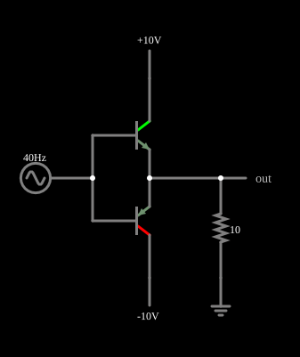

# Seguidor push-pull simples, com distorção de cruzamento

<!-- navegacao:inicio -->
[Índice](README.md) · [Próximo: Improved](pushpull.md)
<!-- navegacao:fim -->

## Objetivo

Mostrar o seguidor de emissor *push-pull* mais simples (classe B): um NPN conduz nos semiciclos positivos e um PNP, nos negativos, e a carga recebe a corrente de um ou do outro. O exemplo mostra o seu defeito, a **distorção de cruzamento**: enquanto a entrada está entre $-0{,}6\ \text{V}$ e $+0{,}6\ \text{V}$ nenhum transistor conduz e a saída fica em zero.

## O circuito

<!-- esquema:inicio -->

<!-- esquema:fim -->

Um NPN ($\beta = 100$) tem o coletor em $+10\ \text{V}$ e um PNP ($\beta = 100$) tem o coletor em $-10\ \text{V}$; as bases estão ligadas entre si e à fonte do sinal ($5\ \text{V}$ de pico, $40\ \text{Hz}$), e os emissores estão ligados entre si e a uma carga de $10\ \Omega$ ligada à terra. A saída é o nó dos emissores. Dois osciloscópios mostram a entrada e a saída.

<!-- componentes:inicio -->
| N.º | Tipo | Elemento | Valores |
|----:|------|----------|---------|
| 0 | `NTransistorElm` | transistor | Beta/hFE = 100; Swap E/C = não; Draw Circle = não; Model = default |
| 1 | `PTransistorElm` | transistor | Beta/hFE = 100; Swap E/C = não; Draw Circle = não; Model = default |
| 5 | `RailElm` | A/C source | Max Voltage = 5; Waveform = A/C; DC Offset (V) = 0; Internal Resistance (ohms) = 0; Show Voltage = não; Frequency (Hz) = 40; Phase Offset (degrees) = 0 |
| 7 | `RailElm` | voltage source | Voltage = 10; Waveform = D/C; DC Offset (V) = 0; Internal Resistance (ohms) = 0 |
| 8 | `RailElm` | voltage source | Voltage = -10; Waveform = D/C; DC Offset (V) = 0; Internal Resistance (ohms) = 0 |
| 10 | `ResistorElm` | resistor | Resistance (ohms) = 10 |
| 11 | `GroundElm` | ground | Symbol = Earth |
| 12 | `OutputElm` | output | Show Voltage = não |
<!-- componentes:fim -->

## Teoria

O transistor segue o modelo de Ebers–Moll de [Transistor NPN](npn.md). Um seguidor de emissor tem ganho de tensão próximo de $1$ e a saída segue a entrada menos a tensão base-emissor:

$$v_o = v_i - V_{BE}\quad (\text{NPN conduzindo}),\qquad v_o = v_i + V_{EB}\quad (\text{PNP conduzindo}).$$

Cada transistor só conduz quando $|v_i|$ supera cerca de $V_{BE} \approx 0{,}6$ a $0{,}75\ \text{V}$ (a tensão exata cresce com a corrente: $V_{BE} = V_T \ln(I_C/I_s)$). No intervalo $|v_i| < V_{BE}$ os dois estão cortados, a corrente na carga é nula e $v_o = 0$: é a **zona morta**. Fora dela, a corrente de carga é fornecida por um só transistor, com corrente de base $I_B = I_E/(\beta + 1)$ tirada da fonte de sinal.

## Resultados esperados

No pico positivo ($v_i = 5\ \text{V}$) a corrente de carga é $0{,}4248\ \text{A}$ e a saída, $4{,}248\ \text{V}$: a queda base-emissor é de $0{,}752\ \text{V}$ (a fórmula acima dá $V_T \ln(0{,}421/10^{-13}) = 0{,}752\ \text{V}$ para a corrente de coletor de $0{,}421\ \text{A}$), e a corrente de base é $4{,}21\ \text{mA}$, que é $0{,}4248/101$. No pico negativo tudo se repete com sinais trocados. Com $v_i$ perto de zero ($t = 12{,}5\ \text{ms}$) a saída é nula. Ao longo de um período a saída é nula (com menos de $10\ \text{mV}$ de módulo) em $7{,}7\%$ do tempo, o que concorda com a zona morta: $4 \cdot \arcsin(0{,}6/5)/360^\circ \approx 7{,}7\%$. O valor eficaz da entrada é $3{,}536\ \text{V}$ ($5/\sqrt{2}$) e o da saída, $2{,}881\ \text{V}$, abaixo dos $3{,}004\ \text{V}$ de uma senoide de $4{,}248\ \text{V}$ de pico. Por Fourier, a saída tem $4{,}059\ \text{V}$ no componente de $40\ \text{Hz}$, $0{,}287\ \text{V}$ em $120\ \text{Hz}$ (terceiro harmônico, $7{,}1\%$ do fundamental) e $0{,}157\ \text{V}$ em $200\ \text{Hz}$: a saída é distorcida. As verificações conferem a saída nos dois picos e perto de zero, a corrente de base no pico, os valores eficazes da entrada e da saída e a corrente máxima na carga (tolerância de $0{,}5\%$).

## O que observar

No osciloscópio da saída, a senoide é "achatada" no cruzamento por zero, com um degrau plano de cerca de $1{,}2\ \text{V}$ de largura ($2 \times 0{,}6\ \text{V}$), e os picos são $0{,}75\ \text{V}$ menores que os da entrada. Para testar: reduza a amplitude da fonte para $1\ \text{V}$ e veja a distorção ocupar uma fração muito maior do ciclo; aumente-a para $10\ \text{V}$ e veja a zona morta pesar menos. O exemplo [Improved](pushpull.md) mostra como corrigir o defeito.

## Limites do modelo

- O modelo do transistor não tem capacitâncias, e por isso não mostra a distorção de comutação que o cruzamento por zero causa em frequências altas; também não há efeito Early.
- Não há dissipação térmica no modelo: $V_{BE}$ não varia com a temperatura, mas num estágio real a corrente de repouso do estágio melhorado pode fugir ao controle (fuga térmica).
- Os valores de Fourier são calculados sobre a saída do simulador; não fazem parte das verificações automáticas.

## Referências

Sedra e Smith, *Microelectronic Circuits*, capítulo sobre estágios de saída (classes A, B e AB); Horowitz e Hill, *The Art of Electronics*, seção 2.2 (seguidor de emissor *push-pull*).

O circuito deste exemplo faz parte da coleção do simulador original de Paul Falstad e Iain Sharp (CircuitJS1); a explicação é deste projeto.
