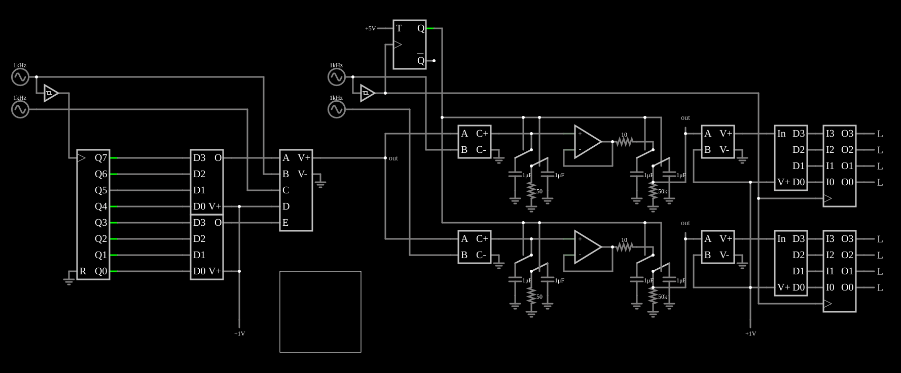

# Modulador e demodulador QAM-256

<!-- navegacao:inicio -->
[Índice](README.md) · [Anterior: Digital Sine Wave](digsine.md)
<!-- navegacao:fim -->

## Objetivo

Mostrar a **modulação de amplitude em quadratura** (QAM): cada símbolo transmite 8 bits, 4 na amplitude de uma portadora em cosseno e 4 na de uma portadora em seno da mesma frequência; o receptor separa as duas multiplicando pelas portadoras e integrando.

## O circuito

<!-- esquema:inicio -->

<!-- esquema:fim -->

**Transmissor.** Um contador de 8 bits é o dado a transmitir; o seu relógio é a portadora de $1\ \text{kHz}$ transformada em onda quadrada por um Schmitt trigger, de modo que cada símbolo dura um ciclo da portadora ($1\ \text{ms}$). Os 4 bits altos vão a um DAC e os 4 baixos a outro, com saídas de $0$ a $1\ \text{V}$. Uma fonte controlada calcula

$$s(t) = (2a - 1)\cos\omega t + (2e - 1)\sin\omega t,$$

onde $a$ e $e$ são as saídas dos DACs: cada amplitude vai de $-1$ a $+1$ em 16 níveis. O sinal QAM aparece no medidor 171.

**Receptor.** Para cada canal, fontes de corrente controladas multiplicam o sinal recebido pela portadora correspondente ($i = 2\,s \cdot p/1000$) e carregam capacitores de $1\ \mu\text{F}$, que integram o produto durante um símbolo. Há dois integradores por canal, alternados a cada símbolo por chaves analógicas comandadas por um flip-flop T: enquanto um integra, o outro é lido e zerado. Fontes controladas ajustam a escala e o deslocamento, e um ADC de 4 bits e um latch por canal recuperam os bits: os 4 bits altos nas saídas 148 (mais significativo) a 151, e os 4 baixos nas saídas 152 a 155.

<!-- componentes:inicio -->
| N.º | Tipo | Elemento | Valores |
|----:|------|----------|---------|
| 0 | `DACElm` | DAC | Bit Order = MSB First; # of Bits = 4 |
| 1 | `DACElm` | DAC | Bit Order = MSB First; # of Bits = 4 |
| 2 | `CounterElm` | Counter | High Logic Voltage = 5; Bit Order = MSB First; Invert reset pin = não; # of Bits = 8; Modulus = 0; Up/Down Pin = não; Negative Edge Triggered = não |
| 3 | `RailElm` | A/C source | Max Voltage = 1; Waveform = A/C; DC Offset (V) = 0; Internal Resistance (ohms) = 0; Show Voltage = não; Frequency (Hz) = 1k; Phase Offset (degrees) = 0 |
| 4 | `RailElm` | A/C source | Max Voltage = 1; Waveform = A/C; DC Offset (V) = 0; Internal Resistance (ohms) = 0; Show Voltage = não; Frequency (Hz) = 1k; Phase Offset (degrees) = 90 |
| 9 | `GroundElm` | ground | Symbol = Earth |
| 10 | `SchmittElm` | Schmitt Trigger | Lower threshold (V) = 0; Upper threshold (V) = 1μ; Slew Rate (V/ns) = 500m; High Logic Voltage = 5; Low Voltage (V) = 0 |
| 21 | `GroundElm` | ground | Symbol = Earth |
| 22 | `VCCSElm` | VCCS | Output Function = a*b*2/1000; # of Inputs = 2 |
| 23 | `ADCElm` | ADC | Bit Order = MSB First; # of Bits = 4 |
| 24 | `LatchElm` | Latch | High Logic Voltage = 5; Bit Order = MSB First; # of Bits = 4; Edge Triggered = sim; Reset Pin = não; Set Pin = não; Enable Pins = None |
| 31 | `AnalogSwitch2Elm` | analog switch (SPDT) | Swap NO/NC = não; On Resistance (ohms) = 10m; Off Resistance (ohms) = 10G; Pulldown Resistor = não; Threshold = 2.5 |
| 32 | `AnalogSwitch2Elm` | analog switch (SPDT) | Swap NO/NC = não; On Resistance (ohms) = 10m; Off Resistance (ohms) = 10G; Pulldown Resistor = não; Threshold = 2.5 |
| 33 | `CapacitorElm` | capacitor | Capacitance (F) = 1μ; Trapezoidal Approximation = não; Initial Voltage (on Reset) = 1m; Series Resistance = 0 |
| 34 | `GroundElm` | ground | Symbol = Earth |
| 35 | `GroundElm` | ground | Symbol = Earth |
| 36 | `CapacitorElm` | capacitor | Capacitance (F) = 1μ; Trapezoidal Approximation = não; Initial Voltage (on Reset) = 1m; Series Resistance = 0 |
| 43 | `TFlipFlopElm` | T flip-flop | High Logic Voltage = 5; Reset Pin = não; Set Pin = não |
| 49 | `RailElm` | voltage source | Voltage = 5; Waveform = D/C; DC Offset (V) = 0; Internal Resistance (ohms) = 0 |
| 50 | `VCVSElm` | VCVS | Output Function = (a*2-d)*b+(e*2-d)*c; # of Inputs = 5 |
| 53 | `GroundElm` | ground | Symbol = Earth |
| 57 | `RailElm` | voltage source | Voltage = 1; Waveform = D/C; DC Offset (V) = 0; Internal Resistance (ohms) = 0 |
| 72 | `ResistorElm` | resistor | Resistance (ohms) = 50 |
| 73 | `GroundElm` | ground | Symbol = Earth |
| 74 | `CapacitorElm` | capacitor | Capacitance (F) = 1μ; Trapezoidal Approximation = não; Initial Voltage (on Reset) = 1m; Series Resistance = 0 |
| 75 | `GroundElm` | ground | Symbol = Earth |
| 76 | `GroundElm` | ground | Symbol = Earth |
| 77 | `CapacitorElm` | capacitor | Capacitance (F) = 1μ; Trapezoidal Approximation = não; Initial Voltage (on Reset) = 1m; Series Resistance = 0 |
| 78 | `AnalogSwitch2Elm` | analog switch (SPDT) | Swap NO/NC = não; On Resistance (ohms) = 10m; Off Resistance (ohms) = 10G; Pulldown Resistor = não; Threshold = 2.5 |
| 79 | `AnalogSwitch2Elm` | analog switch (SPDT) | Swap NO/NC = não; On Resistance (ohms) = 10m; Off Resistance (ohms) = 10G; Pulldown Resistor = não; Threshold = 2.5 |
| 83 | `LatchElm` | Latch | High Logic Voltage = 5; Bit Order = MSB First; # of Bits = 4; Edge Triggered = sim; Reset Pin = não; Set Pin = não; Enable Pins = None |
| 84 | `ADCElm` | ADC | Bit Order = MSB First; # of Bits = 4 |
| 85 | `VCCSElm` | VCCS | Output Function = a*b*2/1000; # of Inputs = 2 |
| 86 | `GroundElm` | ground | Symbol = Earth |
| 98 | `SchmittElm` | Schmitt Trigger | Lower threshold (V) = 0; Upper threshold (V) = 1μ; Slew Rate (V/ns) = 500m; High Logic Voltage = 5; Low Voltage (V) = 0 |
| 99 | `RailElm` | A/C source | Max Voltage = 1; Waveform = A/C; DC Offset (V) = 0; Internal Resistance (ohms) = 0; Show Voltage = não; Frequency (Hz) = 1k; Phase Offset (degrees) = 90 |
| 100 | `RailElm` | A/C source | Max Voltage = 1; Waveform = A/C; DC Offset (V) = 0; Internal Resistance (ohms) = 0; Show Voltage = não; Frequency (Hz) = 1k; Phase Offset (degrees) = 0 |
| 101 | `RailElm` | voltage source | Voltage = 1; Waveform = D/C; DC Offset (V) = 0; Internal Resistance (ohms) = 0 |
| 104 | `GroundElm` | ground | Symbol = Earth |
| 105 | `ResistorElm` | resistor | Resistance (ohms) = 50 |
| 107 | `AnalogSwitch2Elm` | analog switch (SPDT) | Swap NO/NC = não; On Resistance (ohms) = 10m; Off Resistance (ohms) = 10G; Pulldown Resistor = não; Threshold = 2.5 |
| 108 | `AnalogSwitch2Elm` | analog switch (SPDT) | Swap NO/NC = não; On Resistance (ohms) = 10m; Off Resistance (ohms) = 10G; Pulldown Resistor = não; Threshold = 2.5 |
| 109 | `CapacitorElm` | capacitor | Capacitance (F) = 1μ; Trapezoidal Approximation = não; Initial Voltage (on Reset) = 1m; Series Resistance = 0 |
| 110 | `GroundElm` | ground | Symbol = Earth |
| 111 | `GroundElm` | ground | Symbol = Earth |
| 112 | `CapacitorElm` | capacitor | Capacitance (F) = 1μ; Trapezoidal Approximation = não; Initial Voltage (on Reset) = 1m; Series Resistance = 0 |
| 113 | `ResistorElm` | resistor | Resistance (ohms) = 10 |
| 121 | `VCVSElm` | VCVS | Output Function = a/2+b/2+b/32; # of Inputs = 2 |
| 123 | `GroundElm` | ground | Symbol = Earth |
| 130 | `GroundElm` | ground | Symbol = Earth |
| 132 | `VCVSElm` | VCVS | Output Function = a/2+b/2+b/32; # of Inputs = 2 |
| 140 | `ResistorElm` | resistor | Resistance (ohms) = 10 |
| 141 | `CapacitorElm` | capacitor | Capacitance (F) = 1μ; Trapezoidal Approximation = não; Initial Voltage (on Reset) = 1m; Series Resistance = 0 |
| 142 | `GroundElm` | ground | Symbol = Earth |
| 143 | `GroundElm` | ground | Symbol = Earth |
| 144 | `CapacitorElm` | capacitor | Capacitance (F) = 1μ; Trapezoidal Approximation = não; Initial Voltage (on Reset) = 1m; Series Resistance = 0 |
| 145 | `AnalogSwitch2Elm` | analog switch (SPDT) | Swap NO/NC = não; On Resistance (ohms) = 10m; Off Resistance (ohms) = 10G; Pulldown Resistor = não; Threshold = 2.5 |
| 146 | `AnalogSwitch2Elm` | analog switch (SPDT) | Swap NO/NC = não; On Resistance (ohms) = 10m; Off Resistance (ohms) = 10G; Pulldown Resistor = não; Threshold = 2.5 |
| 148 | `LogicOutputElm` | logic output | Threshold = 2.5; Current Required = não; Numeric = não; Ternary = não |
| 149 | `LogicOutputElm` | logic output | Threshold = 2.5; Current Required = não; Numeric = não; Ternary = não |
| 150 | `LogicOutputElm` | logic output | Threshold = 2.5; Current Required = não; Numeric = não; Ternary = não |
| 151 | `LogicOutputElm` | logic output | Threshold = 2.5; Current Required = não; Numeric = não; Ternary = não |
| 152 | `LogicOutputElm` | logic output | Threshold = 2.5; Current Required = não; Numeric = não; Ternary = não |
| 153 | `LogicOutputElm` | logic output | Threshold = 2.5; Current Required = não; Numeric = não; Ternary = não |
| 154 | `LogicOutputElm` | logic output | Threshold = 2.5; Current Required = não; Numeric = não; Ternary = não |
| 155 | `LogicOutputElm` | logic output | Threshold = 2.5; Current Required = não; Numeric = não; Ternary = não |
| 156 | `OutputElm` | output | Show Voltage = não |
| 157 | `OutputElm` | output | Show Voltage = não |
| 158 | `OpAmpElm` | op-amp | Max Output (V) = 15; Min Output (V) = -15; Gain = 100k |
| 159 | `OpAmpElm` | op-amp | Max Output (V) = 15; Min Output (V) = -15; Gain = 100k |
| 166 | `ResistorElm` | resistor | Resistance (ohms) = 50k |
| 167 | `GroundElm` | ground | Symbol = Earth |
| 168 | `GroundElm` | ground | Symbol = Earth |
| 169 | `ResistorElm` | resistor | Resistance (ohms) = 50k |
| 170 | `ScopeElm` |  |  |
| 171 | `OutputElm` | output | Show Voltage = não |
<!-- componentes:fim -->

## Teoria

O cosseno e o seno da mesma frequência são **ortogonais** num período inteiro:

$$\int_0^T \cos^2\omega t\,dt = \int_0^T \sin^2\omega t\,dt = \frac{T}{2}, \qquad \int_0^T \cos\omega t \sin\omega t\,dt = 0.$$

Multiplicando $s(t)$ por $\cos\omega t$ e integrando sobre um símbolo, sobra só o termo em $(2a - 1)$; com $\sin\omega t$, só o termo em $(2e - 1)$. Os dois canais ocupam a mesma faixa de frequência sem se misturar. Os $16 \times 16 = 256$ pares de amplitudes formam a **constelação** do QAM-256, usado em modems de cabo, TV digital e Wi-Fi: 8 bits por símbolo, ao custo de exigir uma relação sinal-ruído alta, porque os pontos da constelação ficam muito próximos.

## Resultados esperados

O simulador transmite os valores do contador, um por milissegundo, e o receptor os devolve **dois símbolos depois** (um símbolo para integrar e outro para converter e guardar no latch):

| $t$ (ms) | Transmitido | Recebido |
|----:|----:|----:|
| 3 | 226 | 224 |
| 5 | 228 | 226 |
| 9 | 232 | 230 |
| 13 | 236 | 234 |

O sinal QAM tem pico de $1{,}414\ \text{V}$ ($\sqrt{2}$, quando as duas amplitudes são extremas) e o flip-flop T que alterna os integradores muda a cada símbolo ($500\ \text{Hz}$).

## O que observar

Os osciloscópios mostram o sinal modulado, com amplitude e fase mudando a cada ciclo da portadora, e o diagrama da constelação. Compare as saídas recebidas com o contador: a mesma sequência, atrasada de dois símbolos.

## Limites do modelo

- O canal é ideal: sem ruído, sem atenuação e com as portadoras do receptor em fase exata com as do transmissor. Um receptor real precisa recuperar a portadora e o relógio de símbolos (com um PLL) e corrigir a fase.
- Os símbolos não são filtrados; um transmissor real limita a banda com filtros de cosseno levantado.

## Referências

Proakis e Salehi, *Digital Communications*, capítulo sobre modulação em quadratura; Haykin, *Communication Systems*, capítulo sobre QAM.

O circuito deste exemplo faz parte da coleção do simulador original de Paul Falstad e Iain Sharp (CircuitJS1); a explicação é deste projeto.
