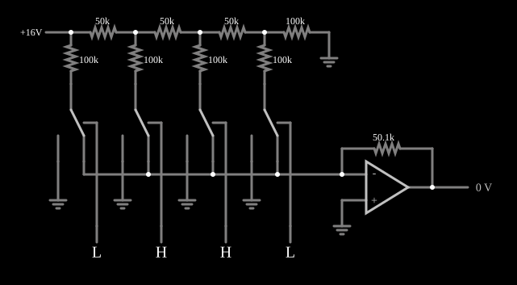

# Conversor D/A com escada R-2R

<!-- navegacao:inicio -->
[Índice](README.md) · [Anterior: Binary-Weighted DAC](dac.md) · [Próximo: Switch-Tree DAC](swtreedac.md)
<!-- navegacao:fim -->

## Objetivo

Mostrar a **escada R-2R**, o conversor digital-analógico que usa só dois valores de resistor, qualquer que seja o número de bits.

## O circuito

<!-- esquema:inicio -->

<!-- esquema:fim -->

Uma referência de $16\ \text{V}$ alimenta uma escada de resistores de $50\ \text{k}\Omega$ ($R$) em série, com um ramo de $100\ \text{k}\Omega$ ($2R$) em cada nó e um $2R$ para a terra no fim. Cada ramo $2R$ termina numa chave de duas posições, comandada por uma entrada lógica, que o liga ao nó de soma de um amp-op (terra virtual; realimentação de $50{,}1\ \text{k}\Omega$; saturação em $\pm 20\ \text{V}$) quando o bit é $1$ ou à terra quando é $0$. Da esquerda (perto da referência) para a direita, as entradas são o bit 3 (elemento 40), o bit 2 (17), o bit 1 (18) e o bit 0 (19). A saída vai a um medidor (elemento 29). O exemplo abre com os bits 2 e 1 em $1$.

<!-- componentes:inicio -->
| N.º | Tipo | Elemento | Valores |
|----:|------|----------|---------|
| 0 | `AnalogSwitch2Elm` | analog switch (SPDT) | Swap NO/NC = não; On Resistance (ohms) = 20; Off Resistance (ohms) = 10G; Pulldown Resistor = não; Threshold = 2.5 |
| 1 | `AnalogSwitch2Elm` | analog switch (SPDT) | Swap NO/NC = não; On Resistance (ohms) = 20; Off Resistance (ohms) = 10G; Pulldown Resistor = não; Threshold = 2.5 |
| 2 | `AnalogSwitch2Elm` | analog switch (SPDT) | Swap NO/NC = não; On Resistance (ohms) = 20; Off Resistance (ohms) = 10G; Pulldown Resistor = não; Threshold = 2.5 |
| 3 | `GroundElm` | ground | Symbol = Earth |
| 4 | `GroundElm` | ground | Symbol = Earth |
| 5 | `GroundElm` | ground | Symbol = Earth |
| 17 | `LogicInputElm` | logic input | Momentary Switch = não; High Logic Voltage = 5; Low Voltage = 0; Numeric = não; Ternary = não; Keyboard Shortcut =  |
| 18 | `LogicInputElm` | logic input | Momentary Switch = não; High Logic Voltage = 5; Low Voltage = 0; Numeric = não; Ternary = não; Keyboard Shortcut =  |
| 19 | `LogicInputElm` | logic input | Momentary Switch = não; High Logic Voltage = 5; Low Voltage = 0; Numeric = não; Ternary = não; Keyboard Shortcut =  |
| 20 | `ResistorElm` | resistor | Resistance (ohms) = 100k |
| 21 | `ResistorElm` | resistor | Resistance (ohms) = 100k |
| 22 | `ResistorElm` | resistor | Resistance (ohms) = 100k |
| 23 | `ResistorElm` | resistor | Resistance (ohms) = 50k |
| 24 | `ResistorElm` | resistor | Resistance (ohms) = 50k |
| 25 | `ResistorElm` | resistor | Resistance (ohms) = 100k |
| 26 | `GroundElm` | ground | Symbol = Earth |
| 29 | `OutputElm` | output | Show Voltage = sim; Scale = V; Fixed Precision = não |
| 31 | `ResistorElm` | resistor | Resistance (ohms) = 50.1k |
| 32 | `GroundElm` | ground | Symbol = Earth |
| 33 | `OpAmpElm` | op-amp | Max Output (V) = 20; Min Output (V) = -20; Gain = 100k |
| 34 | `ResistorElm` | resistor | Resistance (ohms) = 50k |
| 35 | `ResistorElm` | resistor | Resistance (ohms) = 100k |
| 36 | `AnalogSwitch2Elm` | analog switch (SPDT) | Swap NO/NC = não; On Resistance (ohms) = 20; Off Resistance (ohms) = 10G; Pulldown Resistor = não; Threshold = 2.5 |
| 39 | `GroundElm` | ground | Symbol = Earth |
| 40 | `LogicInputElm` | logic input | Momentary Switch = não; High Logic Voltage = 5; Low Voltage = 0; Numeric = não; Ternary = não; Keyboard Shortcut =  |
| 41 | `RailElm` | voltage source | Voltage = 16; Waveform = D/C; DC Offset (V) = 0; Internal Resistance (ohms) = 0 |
<!-- componentes:fim -->

## Teoria

Os dois lados de cada ramo $2R$ estão sempre em $0\ \text{V}$ (a terra ou a terra virtual), então a escada não depende das chaves. Olhando para a direita de cada nó, vê-se $2R$ em paralelo com $2R$, isto é, $R$: cada nó tem a metade da tensão do anterior, $16$, $8$, $4$ e $2\ \text{V}$, e cada ramo conduz metade da corrente do anterior:

$$I_k = \frac{V_{ref}}{2R} \cdot 2^{k-3}, \qquad V_{out} = -R_f \sum_k b_k I_k = -\frac{R_f\, V_{ref}}{16 R} N \approx -1{,}002\, N\ \text{V}.$$

Com só dois valores de resistor, o casamento entre eles é fácil num circuito integrado, e a escada pode ser estendida a muitos bits. As correntes dos ramos são constantes (só mudam de destino), o que torna o conversor rápido.

## Resultados esperados

O simulador dá, para todos os $16$ códigos, $V_{out} \approx -1{,}002\, N$; por exemplo, $-6{,}011\ \text{V}$ para $N = 6$ (o estado inicial), $-14{,}025\ \text{V}$ para $N = 14$, $-15{,}027\ \text{V}$ para $N = 15$, $-1{,}002\ \text{V}$ para $N = 1$, $-8{,}014\ \text{V}$ para $N = 8$ e $0$ para $N = 0$. As tensões dos nós são $16$, $8{,}0$, $4{,}0$ e $2{,}0\ \text{V}$ (as quedas de $8{,}0\ \text{V}$ no primeiro $R$ e de $2{,}0\ \text{V}$ no último $R$ série), independentemente das chaves.

## O que observar

Mude os bits e veja que as tensões da escada não se alteram: só o destino das correntes muda.

## Limites do modelo

- As chaves analógicas têm $20\ \Omega$ ligadas; numa escada real, essa resistência em série com $2R$ é uma fonte de erro, por isso as chaves dos bits mais significativos são maiores.
- A realimentação de $50{,}1\ \text{k}\Omega$ (em vez de $50\ \text{k}\Omega$) faz o passo ser $1{,}002\ \text{V}$.

## Referências

Horowitz e Hill, *The Art of Electronics*, capítulo sobre conversão D/A; Kester (ed.), *Data Conversion Handbook*, Analog Devices, capítulo sobre arquiteturas de DAC.

O circuito deste exemplo faz parte da coleção do simulador original de Paul Falstad e Iain Sharp (CircuitJS1); a explicação é deste projeto.
