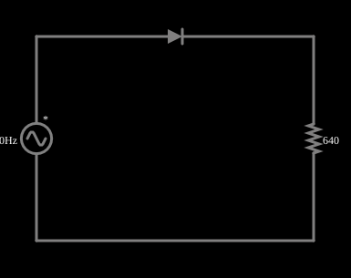

# Retificador de meia onda

<!-- navegacao:inicio -->
[Índice](README.md) · [Anterior: Diode I/V Curve](diodecurve.md) · [Próximo: Full-Wave Rectifier](fullrect.md)
<!-- navegacao:fim -->

## Objetivo

Mostrar a retificação de meia onda: um diodo em série com a carga só conduz nos semiciclos positivos, e transforma uma tensão alternada numa tensão que nunca é negativa.

## O circuito

<!-- esquema:inicio -->

<!-- esquema:fim -->

Uma fonte senoidal de $5\ \text{V}$ de pico e $40\ \text{Hz}$ alimenta, através de um diodo, um resistor de carga de $640\ \Omega$. Dois osciloscópios mostram a tensão da fonte e a da carga.

<!-- componentes:inicio -->
| N.º | Tipo | Elemento | Valores |
|----:|------|----------|---------|
| 0 | `VoltageElm` | A/C source | Max Voltage = 5; Waveform = A/C; DC Offset (V) = 0; Internal Resistance (ohms) = 0; Show Voltage = não; Frequency (Hz) = 40; Phase Offset (degrees) = 0 |
| 1 | `ResistorElm` | resistor | Resistance (ohms) = 640 |
| 2 | `DiodeElm` | diode | Model = default |
<!-- componentes:fim -->

## Teoria

O diodo do simulador (modelo "default") segue a equação de Shockley,

$$i = I_s\left(e^{v/(nV_T)} - 1\right),\qquad I_s = 1{,}714\cdot 10^{-7}\ \text{A},\quad n = 2,\quad V_T = 25{,}865\ \text{mV},$$

sem resistência série. Para uma corrente $i \gg I_s$ a tensão é $v = nV_T\ln(i/I_s + 1)$, que dá $0{,}806\ \text{V}$ em $1\ \text{A}$, $0{,}568\ \text{V}$ em $10\ \text{mA}$ e $0{,}449\ \text{V}$ em $1\ \text{mA}$: a tensão cresce $nV_T\ln 10 = 119\ \text{mV}$ a cada década de corrente. Para $v < 0$ a corrente tende a $-I_s = -0{,}17\ \mu\text{A}$.

## Resultados esperados

No semiciclo positivo o diodo conduz e a carga recebe a tensão da fonte menos a queda do diodo, $v_R = v_s - v_D(i)$; no negativo o diodo bloqueia e $v_R \approx 0$. No limite ideal ($v_D = 0$):

$$V_{med} = \frac{V_p}{\pi},\qquad V_{ef} = \frac{V_p}{2},$$

e o diodo precisa suportar uma tensão inversa de pico $V_p$ (PIV).

## O que observar

Com $V_p = 5\ \text{V}$ e $R = 640\ \Omega$, o diodo conduz uma corrente de pico de $6{,}96\ \text{mA}$ e sua queda no pico é $nV_T\ln(i/I_s + 1) = 0{,}549\ \text{V}$; a tensão de pico na carga é $5 - 0{,}549 = 4{,}451\ \text{V}$.

| grandeza | ideal | com o diodo |
|:---------|------:|------------:|
| pico na carga | $5{,}000\ \text{V}$ | $4{,}451\ \text{V}$ |
| valor médio | $1{,}592\ \text{V}$ | $1{,}343\ \text{V}$ |
| valor eficaz | $2{,}500\ \text{V}$ | $2{,}166\ \text{V}$ |
| tensão inversa de pico | $5{,}000\ \text{V}$ | $5{,}000\ \text{V}$ |

Os valores "com o diodo" vêm de uma integração numérica independente do circuito (diferença para o simulador menor que $10^{-5}$). As verificações conferem os seis valores da tabela e do diodo (o pico, o mínimo, a média, o valor eficaz, a queda máxima e a tensão inversa), em dois ciclos (de $0{,}1$ a $0{,}15\ \text{s}$), com tolerância de 1%.

## Limites do modelo

- A carga só recebe os semiciclos positivos: metade do tempo a tensão é zero.
- A queda de $0{,}55\ \text{V}$ do diodo faz o pico da carga ser menor que o da fonte; com uma fonte pequena a queda fica proporcionalmente grande.
- A média da tensão na carga é positiva, o que é a ideia da retificação (a fonte, simétrica, tem média zero).

## Referências

Retificador sem capacitor de filtro: a tensão na carga pulsa entre $0$ e o pico (veja o retificador com filtro mais adiante). O diodo não tem tempo de recuperação nem resistência série.

O circuito deste exemplo faz parte da coleção do simulador original de Paul Falstad e Iain Sharp (CircuitJS1); a explicação é deste projeto.
