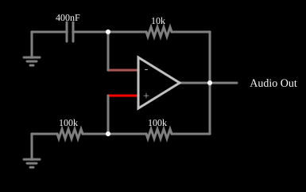

# Oscilador de relaxação

<!-- navegacao:inicio -->
[Índice](README.md) · [Próximo: Phase-Shift Oscillator](phaseshiftosc.md)
<!-- navegacao:fim -->

## Objetivo

Mostrar um oscilador de relaxação com amplificador operacional: um comparador com histerese (disparador de Schmitt) e um circuito RC que o faz comutar periodicamente, gerando uma onda quadrada. A frequência é determinada pelo resistor, pelo capacitor e pela razão do divisor de realimentação.

## O circuito

<!-- esquema:inicio -->

<!-- esquema:fim -->

A saída do amplificador operacional alimenta, por um lado, um divisor de $100\ \text{k}\Omega$ e $100\ \text{k}\Omega$ ligado à entrada não inversora (realimentação positiva) e, por outro, um resistor de $10\ \text{k}\Omega$ que carrega um capacitor de $400\ \text{nF}$ ligado à entrada inversora. Um elemento de saída de áudio (a $8\ \text{kHz}$) permite ouvir o sinal. Dois osciloscópios mostram a saída e a tensão no capacitor.

<!-- componentes:inicio -->
| N.º | Tipo | Elemento | Valores |
|----:|------|----------|---------|
| 0 | `OpAmpElm` | op-amp | Max Output (V) = 15; Min Output (V) = -15; Gain = 100k |
| 2 | `ResistorElm` | resistor | Resistance (ohms) = 10k |
| 5 | `ResistorElm` | resistor | Resistance (ohms) = 100k |
| 7 | `ResistorElm` | resistor | Resistance (ohms) = 100k |
| 8 | `GroundElm` | ground | Symbol = Earth |
| 9 | `CapacitorElm` | capacitor | Capacitance (F) = 400n; Trapezoidal Approximation = sim; Initial Voltage (on Reset) = 1m; Series Resistance = 0 |
| 10 | `GroundElm` | ground | Symbol = Earth |
| 11 | `AudioOutputElm` | audio output | Duration (s) = 1; Sampling Rate = 8000 |
<!-- componentes:fim -->

## Teoria

A realimentação positiva faz a entrada não inversora ficar em $\pm\beta V_\text{sat}$, com $\beta = R_7/(R_5 + R_7) = 0{,}5$ e $V_\text{sat} = 15\ \text{V}$: os limiares são $\pm 7{,}5\ \text{V}$. O capacitor carrega pelo resistor em direção à tensão de saída; quando sua tensão ultrapassa o limiar, a saída troca de sinal, o limiar também troca e o capacitor passa a carregar no sentido oposto.

O capacitor vai de $-\beta V_\text{sat}$ a $+\beta V_\text{sat}$ com constante de tempo $RC$, então o semiperíodo é

$$t_h = RC\,\ln\frac{V_\text{sat} + \beta V_\text{sat}}{V_\text{sat} - \beta V_\text{sat}} = RC\,\ln\frac{1+\beta}{1-\beta}, \qquad T = 2RC\ln\frac{1+\beta}{1-\beta}.$$

Com $R = 10\ \text{k}\Omega$, $C = 400\ \text{nF}$ e $\beta = 0{,}5$,

$$T = 2\cdot 4\ \text{ms}\cdot\ln 3 \approx 8{,}79\ \text{ms}, \qquad f \approx 113{,}8\ \text{Hz}.$$

## Resultados esperados

| Grandeza | Valor |
|----------|------:|
| Saída | onda quadrada entre $-15$ e $+15\ \text{V}$ |
| Tensão no capacitor | entre $-7{,}5$ e $+7{,}5\ \text{V}$ (exponenciais) |
| Frequência | $\approx 113{,}8\ \text{Hz}$ ($T \approx 8{,}79\ \text{ms}$) |

As verificações conferem a frequência (tolerância de 2%) e os extremos da saída e da tensão no capacitor numa janela de $0{,}1\ \text{s}$ depois do regime transitório.

## O que observar

- A tensão no capacitor sobe e desce exponencialmente entre os dois limiares, enquanto a saída é uma onda quadrada.
- O ciclo de trabalho é de $50\%$, porque os dois limiares são simétricos.
- Ao pôr o som para tocar, ouve-se um tom de cerca de $114\ \text{Hz}$.

## Limites do modelo

O operacional é ideal, com saída saturada em exatamente $\pm 15\ \text{V}$ e comutação instantânea; num componente real o *slew rate* limita as bordas e a saturação fica abaixo da alimentação. A frequência prevista supõe $\beta$ e $V_\text{sat}$ simétricos.

## Referências

- A. S. Sedra e K. C. Smith, *Microeletrônica*, Pearson.
- P. Horowitz e W. Hill, *The Art of Electronics*, Cambridge University Press.
- S. Franco, *Design with Operational Amplifiers and Analog Integrated Circuits*, McGraw-Hill.

O circuito deste exemplo faz parte da coleção do simulador original de Paul Falstad e Iain Sharp (CircuitJS1); a explicação é deste projeto.
