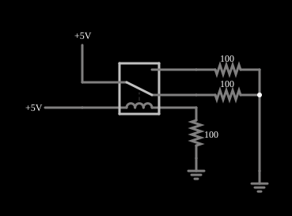

# O relé

<!-- navegacao:inicio -->
[Índice](README.md) · [Próximo: Relay AND](relayand.md)
<!-- navegacao:fim -->

## Objetivo

Mostrar como funciona um relé: uma corrente pequena na bobina move uma chave que comanda uma corrente separada, de outro circuito, e há um limiar de corrente abaixo do qual o relé não opera.

## O circuito

<!-- esquema:inicio -->

<!-- esquema:fim -->

Uma fonte de tensão variável (de $0$ a $5\ \text{V}$, com um *slider* chamado "Coil Voltage") alimenta a bobina do relé, que tem $20\ \Omega$ de resistência e $0{,}2\ \text{H}$ de indutância, em série com um resistor de $100\ \Omega$. Do outro lado, um circuito independente de $5\ \text{V}$ está ligado ao polo do relé; cada um dos dois contatos alimenta um resistor de carga de $100\ \Omega$ ligado à terra. O exemplo abre com o *slider* em $5\ \text{V}$: o relé está energizado e a carga do contato normalmente aberto recebe corrente.

<!-- componentes:inicio -->
| N.º | Tipo | Elemento | Valores |
|----:|------|----------|---------|
| 0 | `RelayElm` | relay (old-relay) | Model = old-relay |
| 1 | `VarRailElm` | voltage source | Min Voltage = 0; Max Voltage = 5; Slider Text = Coil Voltage |
| 2 | `GroundElm` | ground | Symbol = Earth |
| 3 | `RailElm` | voltage source | Voltage = 5; Waveform = D/C; DC Offset (V) = 0; Internal Resistance (ohms) = 0 |
| 4 | `ResistorElm` | resistor | Resistance (ohms) = 100 |
| 5 | `ResistorElm` | resistor | Resistance (ohms) = 100 |
| 6 | `ResistorElm` | resistor | Resistance (ohms) = 100 |
| 9 | `GroundElm` | ground | Symbol = Earth |
<!-- componentes:fim -->

## Teoria

Um relé é uma chave operada por um eletroímã. Seu modelo no simulador tem duas partes:

- a **bobina**, uma indutância $L$ em série com uma resistência $R_b$; com a corrente $i_b$ crescendo como $i_b(t) = \dfrac{V}{R_b}\left(1 - e^{-t/\tau_b}\right)$, $\tau_b = L/R_b$, o relé **opera** quando $i_b \ge I_{on}$ e **solta** quando $i_b \le I_{off}$;
- os **contatos**, com resistência $R_{on} = 0{,}05\ \Omega$ quando fechados e $R_{off} = 1\ \text{M}\Omega$ quando abertos (os terminais abertos são ligados à terra por essa resistência de $1\ \text{M}\Omega$), e um tempo de $5\ \text{ms}$ para a armadura mudar de posição.

Os relés destes exemplos têm um polo com dois contatos: **normalmente aberto** (liga o polo quando a bobina está energizada) e **normalmente fechado**. Com isso se constroem portas lógicas: contatos em **série** fazem E, contatos em **paralelo** fazem OU, e a ligação cruzada de dois relés faz OU exclusivo. Os níveis lógicos dos exemplos são $5\ \text{V}$ (nível 1) e $0\ \text{V}$ (nível 0); uma entrada em 1 aplica $5\ \text{V}$ à bobina e a energiza.

## Resultados esperados

**Limiar.** A corrente da bobina é $i_b = V/(R_b + 100)$, com $R_b + 100 = 120\ \Omega$. O relé opera em $i_b \ge 20\ \text{mA}$, isto é, com $V \ge 20\ \text{mA}\cdot 120\ \Omega = 2{,}4\ \text{V}$. Abaixo disso o contato permanece no repouso.

**Constante de tempo.** $\tau_b = L/R = 0{,}2/120 = 1{,}67\ \text{ms}$.

**Estado inicial** ($V = 5\ \text{V}$): $i_b = 5/120 = 41{,}67\ \text{mA}$, maior que o limiar, e o relé está energizado: a carga de $100\ \Omega$ do contato normalmente aberto recebe $5\cdot\dfrac{100}{100{,}05}/100 = 49{,}975\ \text{mA}$ e a do contato normalmente fechado, $0$. As verificações conferem essas três correntes (o limiar de $2{,}4\ \text{V}$ é consequência dos parâmetros do modelo e não é conferido, porque a verificação não move o *slider*).

## O que observar

- Arraste o *slider* "Coil Voltage" para baixo: perto de $2{,}4\ \text{V}$ o relé solta e a corrente passa de uma carga para a outra.
- A corrente que comanda é de $42\ \text{mA}$ e a comandada, de $50\ \text{mA}$ (poderia ser de ampères, com tensão diferente): os dois circuitos não têm ligação elétrica entre si, só magnética.
- Aumente e diminua o *slider* devagar e rápido; o relé tem um atraso de alguns milissegundos.

## Limites do modelo

O modelo é o de um relé com limiares de operação e soltura iguais ($20\ \text{mA}$); relés reais têm histerese (soltam com uma corrente menor do que a de operação, como no exemplo do oscilador). Os contatos são ideais, sem arco nem ricochete.

## Referências

- P. Horowitz e W. Hill, *The Art of Electronics*, Cambridge University Press.
- C. K. Alexander e M. N. O. Sadiku, *Fundamentos de Circuitos Elétricos*, AMGH.

O circuito deste exemplo faz parte da coleção do simulador original de Paul Falstad e Iain Sharp (CircuitJS1); a explicação é deste projeto.
