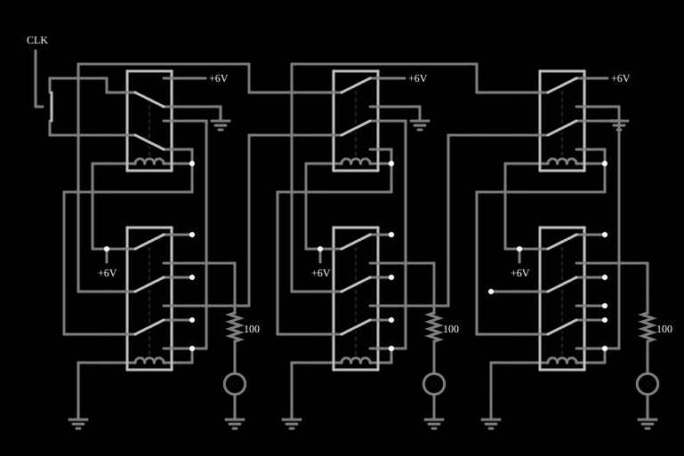

# Contador de relés

<!-- navegacao:inicio -->
[Índice](README.md) · [Anterior: Relay Oscillator](relayosc.md)
<!-- navegacao:fim -->

## Objetivo

Mostrar um contador binário de três bits feito com relés: três estágios em cadeia, cada um dividindo por dois a frequência do anterior, e três LEDs mostrando a contagem.

## O circuito

<!-- esquema:inicio -->

<!-- esquema:fim -->

Um gerador de onda quadrada de $10\ \text{Hz}$ ($0$ a $5\ \text{V}$, ciclo de $50\%$) é o relógio. Há três estágios idênticos, cada um com dois relés (um de dois polos e um de três polos) e um LED (com resistor de $100\ \Omega$) que indica o estado do estágio. Da esquerda para a direita, os LEDs são o bit menos significativo, o do meio e o mais significativo; todos os relés têm $L = 20\ \text{mH}$ e $R_b = 20\ \Omega$.

<!-- componentes:inicio -->
| N.º | Tipo | Elemento | Valores |
|----:|------|----------|---------|
| 0 | `RelayElm` | relay (old-relay-3) | Model = old-relay-3 |
| 1 | `RelayElm` | relay (old-relay-4) | Model = old-relay-4 |
| 2 | `RailElm` | voltage source | Voltage = 6; Waveform = D/C; DC Offset (V) = 0; Internal Resistance (ohms) = 0 |
| 7 | `GroundElm` | ground | Symbol = Earth |
| 14 | `GroundElm` | ground | Symbol = Earth |
| 25 | `LEDElm` | LED | Red Value (0-1) = 1; Green Value (0-1) = 0; Blue Value (0-1) = 0; Max Brightness Current (A) = 10m; Model = 1N4004 (general purpose) |
| 26 | `GroundElm` | ground | Symbol = Earth |
| 27 | `RailElm` | voltage source | Voltage = 6; Waveform = D/C; DC Offset (V) = 0; Internal Resistance (ohms) = 0 |
| 29 | `ResistorElm` | resistor | Resistance (ohms) = 100 |
| 30 | `ResistorElm` | resistor | Resistance (ohms) = 100 |
| 32 | `RailElm` | voltage source | Voltage = 6; Waveform = D/C; DC Offset (V) = 0; Internal Resistance (ohms) = 0 |
| 33 | `GroundElm` | ground | Symbol = Earth |
| 34 | `LEDElm` | LED | Red Value (0-1) = 1; Green Value (0-1) = 0; Blue Value (0-1) = 0; Max Brightness Current (A) = 10m; Model = 1N4004 (general purpose) |
| 46 | `GroundElm` | ground | Symbol = Earth |
| 53 | `GroundElm` | ground | Symbol = Earth |
| 58 | `RailElm` | voltage source | Voltage = 6; Waveform = D/C; DC Offset (V) = 0; Internal Resistance (ohms) = 0 |
| 59 | `RelayElm` | relay (old-relay-4) | Model = old-relay-4 |
| 60 | `RelayElm` | relay (old-relay-3) | Model = old-relay-3 |
| 63 | `ResistorElm` | resistor | Resistance (ohms) = 100 |
| 65 | `RailElm` | voltage source | Voltage = 6; Waveform = D/C; DC Offset (V) = 0; Internal Resistance (ohms) = 0 |
| 66 | `GroundElm` | ground | Symbol = Earth |
| 67 | `LEDElm` | LED | Red Value (0-1) = 1; Green Value (0-1) = 0; Blue Value (0-1) = 0; Max Brightness Current (A) = 10m; Model = 1N4004 (general purpose) |
| 73 | `GroundElm` | ground | Symbol = Earth |
| 80 | `GroundElm` | ground | Symbol = Earth |
| 85 | `RailElm` | voltage source | Voltage = 6; Waveform = D/C; DC Offset (V) = 0; Internal Resistance (ohms) = 0 |
| 86 | `RelayElm` | relay (old-relay-4) | Model = old-relay-4 |
| 87 | `RelayElm` | relay (old-relay-3) | Model = old-relay-3 |
| 93 | `AnalogSwitchElm` | analog switch | Normally closed = não; On Resistance (ohms) = 1; Off Resistance (ohms) = 10G; Pulldown Resistor = não; Threshold = 2.5 |
| 94 | `RailElm` | square wave gen | Max Voltage = 2.5; Waveform = Square Wave; DC Offset (V) = 2.5; Internal Resistance (ohms) = 0; Show Voltage = não; Specify As = Frequency/Duty Cycle; Frequency (Hz) = 10; Phase Offset (degrees) = 0; Duty Cycle = 50; Rise/Fall Time (s) = 0 |
<!-- componentes:fim -->

## Teoria

Um relé é uma chave operada por um eletroímã. Seu modelo no simulador tem duas partes:

- a **bobina**, uma indutância $L$ em série com uma resistência $R_b$; com a corrente $i_b$ crescendo como $i_b(t) = \dfrac{V}{R_b}\left(1 - e^{-t/\tau_b}\right)$, $\tau_b = L/R_b$, o relé **opera** quando $i_b \ge I_{on}$ e **solta** quando $i_b \le I_{off}$;
- os **contatos**, com resistência $R_{on} = 0{,}05\ \Omega$ quando fechados e $R_{off} = 1\ \text{M}\Omega$ quando abertos (os terminais abertos são ligados à terra por essa resistência de $1\ \text{M}\Omega$), e um tempo de $5\ \text{ms}$ para a armadura mudar de posição.

Os relés destes exemplos têm um polo com dois contatos: **normalmente aberto** (liga o polo quando a bobina está energizada) e **normalmente fechado**. Com isso se constroem portas lógicas: contatos em **série** fazem E, contatos em **paralelo** fazem OU, e a ligação cruzada de dois relés faz OU exclusivo. Os níveis lógicos dos exemplos são $5\ \text{V}$ (nível 1) e $0\ \text{V}$ (nível 0); uma entrada em 1 aplica $5\ \text{V}$ à bobina e a energiza.

**Divisão de frequência.** Um flip-flop T inverte seu estado a cada pulso; portanto sua saída tem frequência igual à metade da do pulso de entrada. Com três estágios em cadeia (a saída de cada um aciona o seguinte), as frequências são $f$, $f/2$ e $f/4$, e os estados dos três bits percorrem os $2^3 = 8$ números binários, o que é um contador módulo 8:

$$f_k = \frac{f_{rel}}{2^{k}}\quad (k = 1, 2, 3).$$

Neste circuito a contagem é **decrescente** ($7, 6, 5, \dots, 0, 7, \dots$), uma por pulso do relógio.

## Resultados esperados

Com um relógio de $10\ \text{Hz}$, o bit menos significativo muda a cada pulso e tem frequência de $5\ \text{Hz}$ (período de $0{,}2\ \text{s}$), o do meio de $2{,}5\ \text{Hz}$ e o mais significativo de $1{,}25\ \text{Hz}$; o ciclo completo de oito contagens leva $0{,}8\ \text{s}$. Um LED aceso tem $1{,}9367\ \text{V}$ nos seus terminais.

| instante | LED 2 (MSB) | LED 1 | LED 0 (LSB) | contagem |
|---------:|:-----------:|:-----:|:-----------:|:--------:|
| $0{,}05\ \text{s}$ | 1 | 1 | 1 | 7 |
| $0{,}15\ \text{s}$ | 1 | 1 | 0 | 6 |
| $0{,}25\ \text{s}$ | 1 | 0 | 1 | 5 |
| $0{,}45\ \text{s}$ | 0 | 1 | 1 | 3 |

As verificações conferem as três frequências ($5$, $2{,}5$ e $1{,}25\ \text{Hz}$, tolerância de 3%, numa janela de $0{,}45$ a $3{,}25\ \text{s}$) e os estados em $0{,}05\ \text{s}$ (contagem 7) e $0{,}45\ \text{s}$ (contagem 3).

## O que observar

- Veja os três LEDs piscando em frequências que caem pela metade: o da direita é o mais lento.
- Leia os LEDs como um número binário: a contagem desce de 7 a 0 e recomeça.
- Compare as formas de onda nos osciloscópios: cada uma tem metade da frequência da anterior.

## Limites do modelo

O estado inicial salvo no arquivo tem os três LEDs apagados (contagem 0); o primeiro pulso do relógio faz a contagem passar a 7, depois de cerca de $10$–$20\ \text{ms}$ de atraso dos relés. Relés ideais, sem ricochete; num contador real de relés o tempo de resposta (alguns milissegundos por estágio) limita a frequência máxima do relógio.

## Referências

- P. Horowitz e W. Hill, *The Art of Electronics*, Cambridge University Press.
- C. K. Alexander e M. N. O. Sadiku, *Fundamentos de Circuitos Elétricos*, AMGH.

O circuito deste exemplo faz parte da coleção do simulador original de Paul Falstad e Iain Sharp (CircuitJS1); a explicação é deste projeto.
