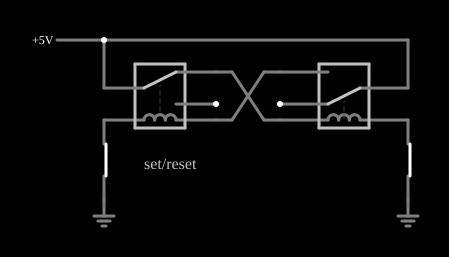

# Flip-flop de relés

<!-- navegacao:inicio -->
[Índice](README.md) · [Anterior: Relay Mux](relaymux.md) · [Próximo: Relay Toggle Flip-Flop](relaytff.md)
<!-- navegacao:fim -->

## Objetivo

Mostrar uma célula de memória de um bit (um *flip-flop* SR) feita com dois relés: o circuito tem dois estados estáveis e guarda o último comando mesmo depois de os botões serem soltos.

## O circuito

<!-- esquema:inicio -->

<!-- esquema:fim -->

Dois relés alimentam-se mutuamente: a fonte de $5\ \text{V}$ entra no polo dos dois; os contatos de um relé são ligados em cruz às bobinas do outro. Cada bobina vai a uma chave de pressão normalmente fechada (em repouso) para a terra; os botões estão rotulados "set/reset". Os relés têm $L = 0{,}2\ \text{H}$, $R_b = 20\ \Omega$ e correntes de operação e soltura de $20\ \text{mA}$.

<!-- componentes:inicio -->
| N.º | Tipo | Elemento | Valores |
|----:|------|----------|---------|
| 0 | `RelayElm` | relay (old-relay) | Model = old-relay |
| 1 | `RelayElm` | relay (old-relay) | Model = old-relay |
| 7 | `RailElm` | voltage source | Voltage = 5; Waveform = D/C; DC Offset (V) = 0; Internal Resistance (ohms) = 0 |
| 8 | `SwitchElm` | switch (SPST) | Momentary Switch = sim; IEC Symbol = não; Label (for linking) = ; Keyboard Shortcut = ; On Resistance (ohms) = 0 |
| 9 | `SwitchElm` | switch (SPST) | Momentary Switch = sim; IEC Symbol = não; Label (for linking) = ; Keyboard Shortcut = ; On Resistance (ohms) = 0 |
| 10 | `GroundElm` | ground | Symbol = Earth |
| 11 | `GroundElm` | ground | Symbol = Earth |
| 12 | `TextElm` | text | Text = set/reset; Size = 16; Draw Bar On Top = não; Color = #c0c0c0 |
<!-- componentes:fim -->

## Teoria

Um relé é uma chave operada por um eletroímã. Seu modelo no simulador tem duas partes:

- a **bobina**, uma indutância $L$ em série com uma resistência $R_b$; com a corrente $i_b$ crescendo como $i_b(t) = \dfrac{V}{R_b}\left(1 - e^{-t/\tau_b}\right)$, $\tau_b = L/R_b$, o relé **opera** quando $i_b \ge I_{on}$ e **solta** quando $i_b \le I_{off}$;
- os **contatos**, com resistência $R_{on} = 0{,}05\ \Omega$ quando fechados e $R_{off} = 1\ \text{M}\Omega$ quando abertos (os terminais abertos são ligados à terra por essa resistência de $1\ \text{M}\Omega$), e um tempo de $5\ \text{ms}$ para a armadura mudar de posição.

Os relés destes exemplos têm um polo com dois contatos: **normalmente aberto** (liga o polo quando a bobina está energizada) e **normalmente fechado**. Com isso se constroem portas lógicas: contatos em **série** fazem E, contatos em **paralelo** fazem OU, e a ligação cruzada de dois relés faz OU exclusivo. Os níveis lógicos dos exemplos são $5\ \text{V}$ (nível 1) e $0\ \text{V}$ (nível 0); uma entrada em 1 aplica $5\ \text{V}$ à bobina e a energiza.

**Realimentação.** Um relé energizado fecha o contato que alimenta a bobina do outro; um relé desenergizado fecha o contato que alimenta a própria bobina do outro lado. O circuito tem dois estados estáveis:

- **estado A:** o relé 1 está desenergizado, o relé 2 energizado. O contato de repouso do relé 1 alimenta a bobina do relé 2, que continua energizado (corrente $5/20 = 250\ \text{mA}$ pela chave da terra), e o contato do relé 2 mantém a bobina do relé 1 desligada;
- **estado B:** o simétrico.

Abrir a chave da bobina energizada (apertar o botão) interrompe a corrente, solta o relé e inverte o estado; o contato do outro relé passa a alimentá-lo, e o circuito se trava no estado oposto. Como o estado só muda quando o botão da bobina energizada é apertado, o circuito **guarda** a informação.

## Resultados esperados

No estado inicial (A): o relé 2 está energizado, com $4{,}9875\ \text{V}$ na sua bobina ($5\ \text{V}$ menos a queda de $12{,}5\ \text{mV}$ dos contatos, de $0{,}05\ \Omega$ cada, com a corrente de $250\ \text{mA}$) e o relé 1, desenergizado (bobina em $0\ \text{V}$).

- **Apertar e soltar o botão do relé 2** em $0{,}05$–$0{,}15\ \text{s}$ leva ao estado B: relé 1 energizado ($4{,}9875\ \text{V}$) e relé 2, desenergizado; o estado permanece depois de o botão ser solto.
- **Apertar e soltar em seguida o botão do relé 1** ($0{,}25$–$0{,}35\ \text{s}$) leva de volta ao estado A.

As verificações conferem a tensão da bobina de cada relé no estado inicial, depois da primeira sequência de botão e depois da segunda, às $0{,}3\ \text{s}$ ou $0{,}5\ \text{s}$ (a tolerância de 1% cobre as pequenas diferenças dos contatos).

## O que observar

- Aperte o botão do relé que está energizado: o estado muda. Aperte o botão do outro: nada acontece, porque não há corrente para interromper.
- Solte o botão e veja que o estado se mantém: é a memória do circuito.
- Compare com um flip-flop SR eletrônico, feito com duas portas realimentadas: a ideia é a mesma, com contatos no lugar de transistores.

## Limites do modelo

Relés ideais, sem ricochete dos contatos (que num circuito real pode inverter o estado ao apertar o botão) nem arco elétrico. Os botões são modelados como chaves ideais; a verificação os aciona em instantes definidos, fechando e reabrindo cada um uma vez.

## Referências

- P. Horowitz e W. Hill, *The Art of Electronics*, Cambridge University Press.
- C. K. Alexander e M. N. O. Sadiku, *Fundamentos de Circuitos Elétricos*, AMGH.

O circuito deste exemplo faz parte da coleção do simulador original de Paul Falstad e Iain Sharp (CircuitJS1); a explicação é deste projeto.
