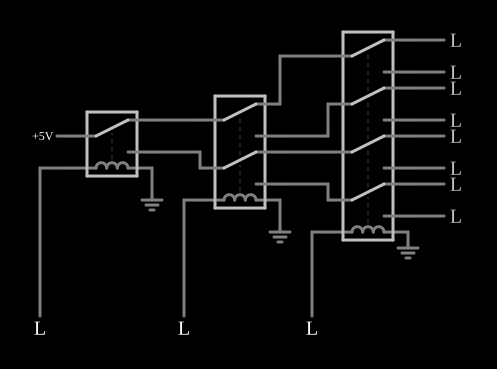

# Seletor de 1 para 8 com relés

<!-- navegacao:inicio -->
[Índice](README.md) · [Anterior: Relay XOR](relayxor.md) · [Próximo: Relay Flip-Flop](relayff.md)
<!-- navegacao:fim -->

## Objetivo

Mostrar um decodificador (ou demultiplexador) de 1 para 8 feito com relés: três entradas escolhem, em código binário, qual das oito saídas recebe os $5\ \text{V}$.

## O circuito

<!-- esquema:inicio -->

<!-- esquema:fim -->

Os relés estão em três níveis, formando uma árvore: um relé de um polo, um de dois polos e um de quatro polos. A fonte de $5\ \text{V}$ entra no polo do primeiro; cada contato leva a um polo do nível seguinte; os oito contatos do último nível levam às oito saídas (oito indicadores lógicos). Cada nível é comandado por uma entrada lógica (os três botões à esquerda, inicialmente em 0).

<!-- componentes:inicio -->
| N.º | Tipo | Elemento | Valores |
|----:|------|----------|---------|
| 0 | `RelayElm` | relay (old-relay-2) | Model = old-relay-2 |
| 1 | `RelayElm` | relay (old-relay-5) | Model = old-relay-5 |
| 2 | `RelayElm` | relay (old-relay-6) | Model = old-relay-6 |
| 3 | `GroundElm` | ground | Symbol = Earth |
| 4 | `GroundElm` | ground | Symbol = Earth |
| 5 | `GroundElm` | ground | Symbol = Earth |
| 9 | `LogicInputElm` | logic input | Momentary Switch = não; High Logic Voltage = 5; Low Voltage = 0; Numeric = não; Ternary = não; Keyboard Shortcut =  |
| 10 | `LogicInputElm` | logic input | Momentary Switch = não; High Logic Voltage = 5; Low Voltage = 0; Numeric = não; Ternary = não; Keyboard Shortcut =  |
| 11 | `LogicInputElm` | logic input | Momentary Switch = não; High Logic Voltage = 5; Low Voltage = 0; Numeric = não; Ternary = não; Keyboard Shortcut =  |
| 12 | `RailElm` | voltage source | Voltage = 5; Waveform = D/C; DC Offset (V) = 0; Internal Resistance (ohms) = 0 |
| 23 | `LogicOutputElm` | logic output | Threshold = 2.5; Current Required = sim; Numeric = não; Ternary = não |
| 24 | `LogicOutputElm` | logic output | Threshold = 2.5; Current Required = sim; Numeric = não; Ternary = não |
| 25 | `LogicOutputElm` | logic output | Threshold = 2.5; Current Required = sim; Numeric = não; Ternary = não |
| 26 | `LogicOutputElm` | logic output | Threshold = 2.5; Current Required = sim; Numeric = não; Ternary = não |
| 27 | `LogicOutputElm` | logic output | Threshold = 2.5; Current Required = sim; Numeric = não; Ternary = não |
| 28 | `LogicOutputElm` | logic output | Threshold = 2.5; Current Required = sim; Numeric = não; Ternary = não |
| 29 | `LogicOutputElm` | logic output | Threshold = 2.5; Current Required = sim; Numeric = não; Ternary = não |
| 30 | `LogicOutputElm` | logic output | Threshold = 2.5; Current Required = sim; Numeric = não; Ternary = não |
<!-- componentes:fim -->

## Teoria

Um relé é uma chave operada por um eletroímã. Seu modelo no simulador tem duas partes:

- a **bobina**, uma indutância $L$ em série com uma resistência $R_b$; com a corrente $i_b$ crescendo como $i_b(t) = \dfrac{V}{R_b}\left(1 - e^{-t/\tau_b}\right)$, $\tau_b = L/R_b$, o relé **opera** quando $i_b \ge I_{on}$ e **solta** quando $i_b \le I_{off}$;
- os **contatos**, com resistência $R_{on} = 0{,}05\ \Omega$ quando fechados e $R_{off} = 1\ \text{M}\Omega$ quando abertos (os terminais abertos são ligados à terra por essa resistência de $1\ \text{M}\Omega$), e um tempo de $5\ \text{ms}$ para a armadura mudar de posição.

Os relés destes exemplos têm um polo com dois contatos: **normalmente aberto** (liga o polo quando a bobina está energizada) e **normalmente fechado**. Com isso se constroem portas lógicas: contatos em **série** fazem E, contatos em **paralelo** fazem OU, e a ligação cruzada de dois relés faz OU exclusivo. Os níveis lógicos dos exemplos são $5\ \text{V}$ (nível 1) e $0\ \text{V}$ (nível 0); uma entrada em 1 aplica $5\ \text{V}$ à bobina e a energiza.

Cada relé tem dois contatos por polo: $5\ \text{V}$ vai a um deles (repouso) ou ao outro (operado). Em cada nível o número de caminhos dobra: 1, 2, 4 e 8 contatos. Com três entradas $A$, $B$, $C$ (o primeiro relé é o bit mais significativo, $A$), a saída ativa é a de número

$$k = 4A + 2B + C,\qquad k = 0,1,\dots,7,$$

e as outras sete ficam em $0$: é o decodificador $3 \to 8$ da eletrônica digital, com cada saída $Y_k = [A B C = k]$.

## Resultados esperados

| $A$ | $B$ | $C$ | $k$ | saída ativa |
|:--:|:--:|:--:|:--:|:-----------:|
| 0 | 0 | 0 | 0 | 1.ª |
| 0 | 0 | 1 | 1 | 2.ª |
| 0 | 1 | 0 | 2 | 3.ª |
| 0 | 1 | 1 | 3 | 4.ª |
| 1 | 0 | 0 | 4 | 5.ª |
| 1 | 0 | 1 | 5 | 6.ª |
| 1 | 1 | 0 | 6 | 7.ª |
| 1 | 1 | 1 | 7 | 8.ª |

As oito combinações são conferidas: em cada uma, a saída $k$ tem $5\ \text{V}$ (tolerância de 1%) e a saída seguinte tem $0\ \text{V}$.

## O que observar

- Percorra as oito combinações das entradas: exatamente uma das oito saídas acende em cada uma.
- Siga o caminho da corrente de cima para baixo: cada nível escolhe um dos dois ramos.
- Compare com um multiplexador comum (8 para 1), que faz o caminho inverso: oito entradas, uma saída.

## Limites do modelo

Relés ideais no sentido do modelo: resistência de contato fixa, sem arco elétrico, sem ricochete dos contatos e sem desgaste. Os tempos de resposta calculados (cerca de $5{,}5\ \text{ms}$ para operar e $8{,}2\ \text{ms}$ para soltar) vêm só da bobina e do tempo da armadura; num relé real dependem também da mola e da carga mecânica. As verificações fixam as entradas lógicas antes da simulação (ou em instantes dados).

## Referências

- P. Horowitz e W. Hill, *The Art of Electronics*, Cambridge University Press.
- C. K. Alexander e M. N. O. Sadiku, *Fundamentos de Circuitos Elétricos*, AMGH.

O circuito deste exemplo faz parte da coleção do simulador original de Paul Falstad e Iain Sharp (CircuitJS1); a explicação é deste projeto.
