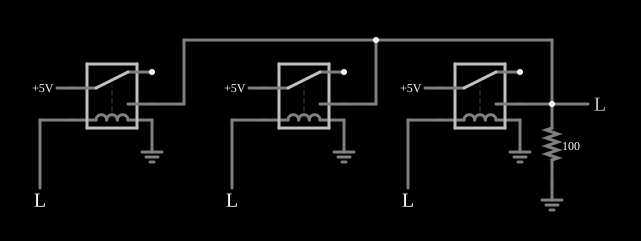

# Porta OU com relés

<!-- navegacao:inicio -->
[Índice](README.md) · [Anterior: Relay AND](relayand.md) · [Próximo: Relay XOR](relayxor.md)
<!-- navegacao:fim -->

## Objetivo

Mostrar uma porta lógica OU (OR) de três entradas feita só com relés: a saída vai a 1 quando qualquer entrada está em 1.

## O circuito

<!-- esquema:inicio -->

<!-- esquema:fim -->

Três relés têm seus contatos normalmente abertos ligados **em paralelo**: cada relé tem seu próprio polo ligado a uma fonte de $5\ \text{V}$ e os três contatos se encontram no nó de saída, que tem um resistor de $100\ \Omega$ para a terra e um indicador de nível lógico. Cada relé é comandado por uma entrada lógica (os três botões à esquerda, inicialmente em 0).

<!-- componentes:inicio -->
| N.º | Tipo | Elemento | Valores |
|----:|------|----------|---------|
| 0 | `RelayElm` | relay (old-relay-2) | Model = old-relay-2 |
| 1 | `RelayElm` | relay (old-relay-2) | Model = old-relay-2 |
| 2 | `RelayElm` | relay (old-relay-2) | Model = old-relay-2 |
| 3 | `RailElm` | voltage source | Voltage = 5; Waveform = D/C; DC Offset (V) = 0; Internal Resistance (ohms) = 0 |
| 4 | `GroundElm` | ground | Symbol = Earth |
| 5 | `GroundElm` | ground | Symbol = Earth |
| 6 | `GroundElm` | ground | Symbol = Earth |
| 10 | `LogicInputElm` | logic input | Momentary Switch = não; High Logic Voltage = 5; Low Voltage = 0; Numeric = não; Ternary = não; Keyboard Shortcut =  |
| 11 | `LogicInputElm` | logic input | Momentary Switch = não; High Logic Voltage = 5; Low Voltage = 0; Numeric = não; Ternary = não; Keyboard Shortcut =  |
| 12 | `LogicInputElm` | logic input | Momentary Switch = não; High Logic Voltage = 5; Low Voltage = 0; Numeric = não; Ternary = não; Keyboard Shortcut =  |
| 13 | `LogicOutputElm` | logic output | Threshold = 2.5; Current Required = não; Numeric = não; Ternary = não |
| 14 | `ResistorElm` | resistor | Resistance (ohms) = 100 |
| 15 | `GroundElm` | ground | Symbol = Earth |
| 16 | `RailElm` | voltage source | Voltage = 5; Waveform = D/C; DC Offset (V) = 0; Internal Resistance (ohms) = 0 |
| 17 | `RailElm` | voltage source | Voltage = 5; Waveform = D/C; DC Offset (V) = 0; Internal Resistance (ohms) = 0 |
<!-- componentes:fim -->

## Teoria

Um relé é uma chave operada por um eletroímã. Seu modelo no simulador tem duas partes:

- a **bobina**, uma indutância $L$ em série com uma resistência $R_b$; com a corrente $i_b$ crescendo como $i_b(t) = \dfrac{V}{R_b}\left(1 - e^{-t/\tau_b}\right)$, $\tau_b = L/R_b$, o relé **opera** quando $i_b \ge I_{on}$ e **solta** quando $i_b \le I_{off}$;
- os **contatos**, com resistência $R_{on} = 0{,}05\ \Omega$ quando fechados e $R_{off} = 1\ \text{M}\Omega$ quando abertos (os terminais abertos são ligados à terra por essa resistência de $1\ \text{M}\Omega$), e um tempo de $5\ \text{ms}$ para a armadura mudar de posição.

Os relés destes exemplos têm um polo com dois contatos: **normalmente aberto** (liga o polo quando a bobina está energizada) e **normalmente fechado**. Com isso se constroem portas lógicas: contatos em **série** fazem E, contatos em **paralelo** fazem OU, e a ligação cruzada de dois relés faz OU exclusivo. Os níveis lógicos dos exemplos são $5\ \text{V}$ (nível 1) e $0\ \text{V}$ (nível 0); uma entrada em 1 aplica $5\ \text{V}$ à bobina e a energiza.

Aqui as bobinas têm $L = 0{,}1\ \text{H}$ e $R_b = 50\ \Omega$, logo $\tau_b = 2\ \text{ms}$ e a corrente final é $5/50 = 100\ \text{mA}$, bem acima de $I_{on} = I_{off} = 20\ \text{mA}$. O relé opera depois de $t = -\tau_b \ln(1 - I_{on}R_b/V) = 2\ \text{ms}\cdot\ln(1/0{,}8) = 0{,}45\ \text{ms}$, mais os $5\ \text{ms}$ da armadura: a porta leva cerca de $5{,}5\ \text{ms}$ para responder. Para soltar, a corrente cai de $100\ \text{mA}$ a $20\ \text{mA}$ em $\tau_b\ln 5 = 3{,}2\ \text{ms}$, mais $5\ \text{ms}$: cerca de $8{,}2\ \text{ms}$.

## Resultados esperados

Basta um contato fechado para levar $5\ \text{V}$ à saída: $Y = A + B + C$. A saída é $0$ só quando as três entradas estão em 0. Com $k$ contatos fechados em paralelo a resistência de contato é $0{,}05/k\ \Omega$, e

$$V_{saida} = 5\cdot\frac{100}{100 + 0{,}05/k} = 4{,}9975\ \text{V}\ (k=1),\quad 4{,}99875\ \text{V}\ (k=2),\quad 4{,}99917\ \text{V}\ (k=3).$$

As verificações conferem cinco combinações: $000 \to 0$, três casos com um ou dois contatos fechados ($4{,}9975$ ou $4{,}99875\ \text{V}$) e $111 \to 4{,}99917\ \text{V}$, com tolerância de 1%.

## O que observar

- Clique em cada entrada: a saída acende com qualquer uma delas.
- Compare com a porta E: lá os contatos estão em série, aqui em paralelo.
- Ligar mais entradas quase não muda a tensão de saída; só abaixa um pouco a resistência de contato equivalente.

## Limites do modelo

Relés ideais no sentido do modelo: resistência de contato fixa, sem arco elétrico, sem ricochete dos contatos e sem desgaste. Os tempos de resposta calculados (cerca de $5{,}5\ \text{ms}$ para operar e $8{,}2\ \text{ms}$ para soltar) vêm só da bobina e do tempo da armadura; num relé real dependem também da mola e da carga mecânica. As verificações fixam as entradas lógicas antes da simulação (ou em instantes dados).

## Referências

- P. Horowitz e W. Hill, *The Art of Electronics*, Cambridge University Press.
- C. K. Alexander e M. N. O. Sadiku, *Fundamentos de Circuitos Elétricos*, AMGH.

O circuito deste exemplo faz parte da coleção do simulador original de Paul Falstad e Iain Sharp (CircuitJS1); a explicação é deste projeto.
