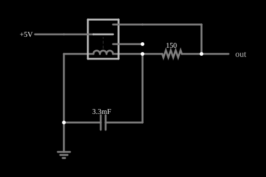

# Oscilador de relé

<!-- navegacao:inicio -->
[Índice](README.md) · [Anterior: Relay Toggle Flip-Flop](relaytff.md) · [Próximo: Relay Counter](relayctr.md)
<!-- navegacao:fim -->

## Objetivo

Mostrar um oscilador de relaxação: um relé, uma bobina e um capacitor formam um circuito que, sozinho, liga e desliga o relé repetidamente (como uma campainha), por causa da histerese do relé e do tempo de carga do capacitor.

## O circuito

<!-- esquema:inicio -->

<!-- esquema:fim -->

A fonte de $5\ \text{V}$ liga-se ao polo do relé; um dos contatos alimenta, por um resistor de $150\ \Omega$, um nó onde estão em paralelo a **bobina do próprio relé** ($20\ \Omega$, $0{,}2\ \text{H}$) e um capacitor de $3{,}3\ \text{mF}$. O relé opera com $20\ \text{mA}$ na bobina e solta com $15\ \text{mA}$ (histerese). Dois osciloscópios mostram a tensão do capacitor e a da saída.

<!-- componentes:inicio -->
| N.º | Tipo | Elemento | Valores |
|----:|------|----------|---------|
| 0 | `RelayElm` | relay (default) | Model = default |
| 1 | `CapacitorElm` | capacitor | Capacitance (F) = 3.3m; Trapezoidal Approximation = sim; Initial Voltage (on Reset) = 1m; Series Resistance = 0 |
| 3 | `GroundElm` | ground | Symbol = Earth |
| 4 | `ResistorElm` | resistor | Resistance (ohms) = 150 |
| 7 | `RailElm` | voltage source | Voltage = 5; Waveform = D/C; DC Offset (V) = 0; Internal Resistance (ohms) = 0 |
| 9 | `OutputElm` | output | Show Voltage = não |
<!-- componentes:fim -->

## Teoria

Um relé é uma chave operada por um eletroímã. Seu modelo no simulador tem duas partes:

- a **bobina**, uma indutância $L$ em série com uma resistência $R_b$; com a corrente $i_b$ crescendo como $i_b(t) = \dfrac{V}{R_b}\left(1 - e^{-t/\tau_b}\right)$, $\tau_b = L/R_b$, o relé **opera** quando $i_b \ge I_{on}$ e **solta** quando $i_b \le I_{off}$;
- os **contatos**, com resistência $R_{on} = 0{,}05\ \Omega$ quando fechados e $R_{off} = 1\ \text{M}\Omega$ quando abertos (os terminais abertos são ligados à terra por essa resistência de $1\ \text{M}\Omega$), e um tempo de $5\ \text{ms}$ para a armadura mudar de posição.

Os relés destes exemplos têm um polo com dois contatos: **normalmente aberto** (liga o polo quando a bobina está energizada) e **normalmente fechado**. Com isso se constroem portas lógicas: contatos em **série** fazem E, contatos em **paralelo** fazem OU, e a ligação cruzada de dois relés faz OU exclusivo. Os níveis lógicos dos exemplos são $5\ \text{V}$ (nível 1) e $0\ \text{V}$ (nível 0); uma entrada em 1 aplica $5\ \text{V}$ à bobina e a energiza.

**O ciclo.** Com o contato fechado, o capacitor carrega-se pela fonte através de $150\ \Omega$, e a bobina vê a mesma tensão $v_C$: a corrente da bobina é aproximadamente $v_C/20\ \Omega$. O contato fechado leva $v_C$ para o valor $V_\infty = 5\cdot 20/170 = 0{,}588\ \text{V}$ com constante de tempo $\tau_c = (150\,\|\,20)\,C = 58\ \text{ms}$. Quando a corrente da bobina passa de $20\ \text{mA}$ (isto é, $v_C \gtrsim 0{,}4\ \text{V}$), o relé opera e **abre** o contato que alimentava o circuito (o relé usa o contato normalmente fechado). Com o contato aberto, o capacitor se descarrega pela bobina, com $\tau_d = 20\cdot C = 66\ \text{ms}$, até a corrente cair a $15\ \text{mA}$ ($v_C \approx 0{,}3\ \text{V}$); o relé solta, o contato fecha, e o ciclo recomeça.

**Estimativa do período.** Com os limiares ideais, o tempo de carga de $0{,}3$ a $0{,}4\ \text{V}$ é $\tau_c\ln\dfrac{0{,}588 - 0{,}3}{0{,}588 - 0{,}4} = 25\ \text{ms}$ e o de descarga de $0{,}4$ a $0{,}3\ \text{V}$ é $\tau_d\ln\dfrac{0{,}4}{0{,}3} = 19\ \text{ms}$: período de cerca de $44\ \text{ms}$ ($23\ \text{Hz}$).

## Resultados esperados

O simulador dá uma frequência bem menor, $12{,}06\ \text{Hz}$ (período de $83\ \text{ms}$), e uma oscilação do capacitor entre $0{,}230$ e $0{,}437\ \text{V}$, mais larga que a ideal ($0{,}3$ a $0{,}4\ \text{V}$). A diferença vem de duas coisas que a estimativa ideal ignora: a bobina tem indutância (sua corrente atrasa em relação à tensão do capacitor) e a armadura leva $5\ \text{ms}$ para mudar de posição, tempo durante o qual o capacitor continua a se carregar (ou a se descarregar), ultrapassando os limiares, o que aumenta a excursão e o período. As verificações conferem a frequência ($12{,}06\ \text{Hz}$, tolerância de 3%) e o máximo e o mínimo da tensão do capacitor (2%), numa janela de $1$ a $3\ \text{s}$, já em regime.

## O que observar

- No osciloscópio, a tensão do capacitor é uma onda de relaxação: exponenciais de subida e de descida entre dois níveis.
- Troque o capacitor por um de valor maior: a frequência cai, porque o tempo de carga e de descarga cresce com $C$.
- O relé liga e desliga cerca de $12$ vezes por segundo: é o princípio da campainha e do vibrador de relé.

## Limites do modelo

A estimativa de período é apenas de ordem de grandeza, pelas razões acima; o valor de referência é o do simulador. O modelo de relé é o do simulador (histerese de corrente, atraso fixo da armadura, contatos ideais) e não representa o ricochete nem o arco dos contatos.

## Referências

- P. Horowitz e W. Hill, *The Art of Electronics*, Cambridge University Press.
- C. K. Alexander e M. N. O. Sadiku, *Fundamentos de Circuitos Elétricos*, AMGH.

O circuito deste exemplo faz parte da coleção do simulador original de Paul Falstad e Iain Sharp (CircuitJS1); a explicação é deste projeto.
