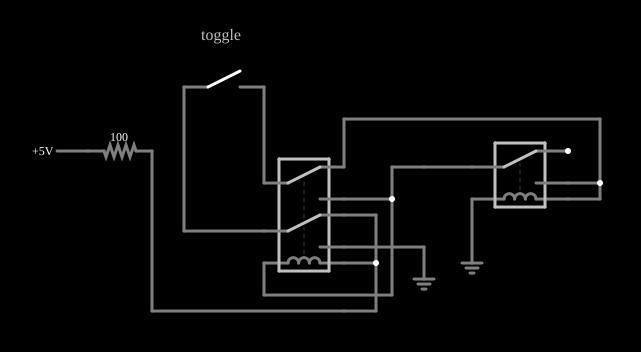

# Flip-flop T de relés

<!-- navegacao:inicio -->
[Índice](README.md) · [Anterior: Relay Flip-Flop](relayff.md) · [Próximo: Relay Oscillator](relayosc.md)
<!-- navegacao:fim -->

## Objetivo

Mostrar um flip-flop do tipo T ("toggle") feito com relés: cada vez que o botão é apertado e solto, o estado de saída se inverte (liga, desliga, liga, ...), como num interruptor de apertar e soltar.

## O circuito

<!-- esquema:inicio -->

<!-- esquema:fim -->

Um botão de pressão (rotulado "toggle") comanda um conjunto de dois relés, de um e de dois polos, ligados em realimentação. A fonte de $5\ \text{V}$ alimenta o conjunto por um resistor de $100\ \Omega$, que também mede a corrente do circuito: ela é praticamente zero quando o circuito está desligado e cerca de $36\ \text{mA}$ quando está ligado.

<!-- componentes:inicio -->
| N.º | Tipo | Elemento | Valores |
|----:|------|----------|---------|
| 0 | `RelayElm` | relay (old-relay-7) | Model = old-relay-7 |
| 1 | `RailElm` | voltage source | Voltage = 5; Waveform = D/C; DC Offset (V) = 0; Internal Resistance (ohms) = 0 |
| 11 | `SwitchElm` | switch (SPST) | Momentary Switch = sim; IEC Symbol = não; Label (for linking) = ; Keyboard Shortcut = ; On Resistance (ohms) = 0 |
| 13 | `ResistorElm` | resistor | Resistance (ohms) = 100 |
| 14 | `RelayElm` | relay (old-relay-8) | Model = old-relay-8 |
| 21 | `GroundElm` | ground | Symbol = Earth |
| 24 | `TextElm` | text | Text = toggle; Size = 16; Draw Bar On Top = não; Color = #c0c0c0 |
| 30 | `GroundElm` | ground | Symbol = Earth |
<!-- componentes:fim -->

## Teoria

Um relé é uma chave operada por um eletroímã. Seu modelo no simulador tem duas partes:

- a **bobina**, uma indutância $L$ em série com uma resistência $R_b$; com a corrente $i_b$ crescendo como $i_b(t) = \dfrac{V}{R_b}\left(1 - e^{-t/\tau_b}\right)$, $\tau_b = L/R_b$, o relé **opera** quando $i_b \ge I_{on}$ e **solta** quando $i_b \le I_{off}$;
- os **contatos**, com resistência $R_{on} = 0{,}05\ \Omega$ quando fechados e $R_{off} = 1\ \text{M}\Omega$ quando abertos (os terminais abertos são ligados à terra por essa resistência de $1\ \text{M}\Omega$), e um tempo de $5\ \text{ms}$ para a armadura mudar de posição.

Os relés destes exemplos têm um polo com dois contatos: **normalmente aberto** (liga o polo quando a bobina está energizada) e **normalmente fechado**. Com isso se constroem portas lógicas: contatos em **série** fazem E, contatos em **paralelo** fazem OU, e a ligação cruzada de dois relés faz OU exclusivo. Os níveis lógicos dos exemplos são $5\ \text{V}$ (nível 1) e $0\ \text{V}$ (nível 0); uma entrada em 1 aplica $5\ \text{V}$ à bobina e a energiza.

Um flip-flop T muda de estado a cada pulso de entrada: $Q_{n+1} = \overline{Q_n}$ quando $T = 1$. Como o estado só se inverte a cada pulso completo (apertar e soltar), a saída tem metade da frequência dos pulsos, e é isso que torna o flip-flop T a base dos contadores. Neste circuito os dois relés mantêm o estado por realimentação, como no flip-flop SR do exemplo anterior, e um único botão comanda a inversão; o que a simulação confirma é o comportamento externo, descrito a seguir.

## Resultados esperados

A corrente no resistor de $100\ \Omega$ identifica o estado:

| situação | corrente |
|:---------|---------:|
| desligado (estado inicial) | $\approx 0$ ($15\ \mu\text{A}$ de fuga) |
| depois de apertar e soltar uma vez | $35{,}7\ \text{mA}$ |
| depois de apertar e soltar duas vezes | $\approx 0$ |
| depois de três vezes | $35{,}7\ \text{mA}$ |
| com o botão apertado (durante o pulso) | $41{,}6\ \text{mA}$ |

As cinco linhas são conferidas (tolerância de 2%, ou $0{,}1\ \text{mA}$ absolutos para os valores nulos), com o botão acionado nos instantes indicados.

## O que observar

- Aperte e solte o botão várias vezes: o circuito alterna entre ligado e desligado a cada vez, e o estado se mantém entre os apertos.
- Compare a corrente com o botão apertado ($41{,}6\ \text{mA}$, a bobina sendo energizada) com a do estado travado ($35{,}7\ \text{mA}$).
- Veja o exemplo do contador de relés, que encadeia três estágios como este.

## Limites do modelo

Relés e botão ideais, sem ricochete. Num circuito real, o ricochete do botão causa vários pulsos e o estado final é imprevisível; os circuitos práticos incluem um filtro para isso. As correntes citadas são as do modelo (resistor de $100\ \Omega$, bobinas de $20\ \Omega$ e contatos ideais).

## Referências

- P. Horowitz e W. Hill, *The Art of Electronics*, Cambridge University Press.
- C. K. Alexander e M. N. O. Sadiku, *Fundamentos de Circuitos Elétricos*, AMGH.

O circuito deste exemplo faz parte da coleção do simulador original de Paul Falstad e Iain Sharp (CircuitJS1); a explicação é deste projeto.
