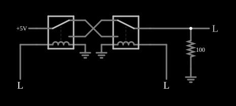

# Porta OU exclusivo com relés

<!-- navegacao:inicio -->
[Índice](README.md) · [Anterior: Relay OR](relayor.md) · [Próximo: Relay Mux](relaymux.md)
<!-- navegacao:fim -->

## Objetivo

Mostrar uma porta OU exclusivo (XOR) feita com dois relés: a saída vai a 1 quando as duas entradas são diferentes.

## O circuito

<!-- esquema:inicio -->

<!-- esquema:fim -->

Dois relés ficam frente a frente. A fonte de $5\ \text{V}$ entra no polo do primeiro; os contatos dos dois relés são ligados **em cruz** (o contato de cima de um com o de baixo do outro e vice-versa), e o polo do segundo é a saída, com um resistor de $100\ \Omega$ para a terra e um indicador. Cada relé é comandado por uma entrada lógica (inicialmente em 0).

<!-- componentes:inicio -->
| N.º | Tipo | Elemento | Valores |
|----:|------|----------|---------|
| 0 | `RelayElm` | relay (old-relay-2) | Model = old-relay-2 |
| 1 | `RelayElm` | relay (old-relay-2) | Model = old-relay-2 |
| 4 | `RailElm` | voltage source | Voltage = 5; Waveform = D/C; DC Offset (V) = 0; Internal Resistance (ohms) = 0 |
| 5 | `GroundElm` | ground | Symbol = Earth |
| 6 | `GroundElm` | ground | Symbol = Earth |
| 9 | `LogicInputElm` | logic input | Momentary Switch = não; High Logic Voltage = 5; Low Voltage = 0; Numeric = não; Ternary = não; Keyboard Shortcut =  |
| 10 | `LogicInputElm` | logic input | Momentary Switch = não; High Logic Voltage = 5; Low Voltage = 0; Numeric = não; Ternary = não; Keyboard Shortcut =  |
| 12 | `ResistorElm` | resistor | Resistance (ohms) = 100 |
| 13 | `GroundElm` | ground | Symbol = Earth |
| 14 | `LogicOutputElm` | logic output | Threshold = 2.5; Current Required = não; Numeric = não; Ternary = não |
<!-- componentes:fim -->

## Teoria

Um relé é uma chave operada por um eletroímã. Seu modelo no simulador tem duas partes:

- a **bobina**, uma indutância $L$ em série com uma resistência $R_b$; com a corrente $i_b$ crescendo como $i_b(t) = \dfrac{V}{R_b}\left(1 - e^{-t/\tau_b}\right)$, $\tau_b = L/R_b$, o relé **opera** quando $i_b \ge I_{on}$ e **solta** quando $i_b \le I_{off}$;
- os **contatos**, com resistência $R_{on} = 0{,}05\ \Omega$ quando fechados e $R_{off} = 1\ \text{M}\Omega$ quando abertos (os terminais abertos são ligados à terra por essa resistência de $1\ \text{M}\Omega$), e um tempo de $5\ \text{ms}$ para a armadura mudar de posição.

Os relés destes exemplos têm um polo com dois contatos: **normalmente aberto** (liga o polo quando a bobina está energizada) e **normalmente fechado**. Com isso se constroem portas lógicas: contatos em **série** fazem E, contatos em **paralelo** fazem OU, e a ligação cruzada de dois relés faz OU exclusivo. Os níveis lógicos dos exemplos são $5\ \text{V}$ (nível 1) e $0\ \text{V}$ (nível 0); uma entrada em 1 aplica $5\ \text{V}$ à bobina e a energiza.

Aqui as bobinas têm $L = 0{,}1\ \text{H}$ e $R_b = 50\ \Omega$, logo $\tau_b = 2\ \text{ms}$ e a corrente final é $5/50 = 100\ \text{mA}$, bem acima de $I_{on} = I_{off} = 20\ \text{mA}$. O relé opera depois de $t = -\tau_b \ln(1 - I_{on}R_b/V) = 2\ \text{ms}\cdot\ln(1/0{,}8) = 0{,}45\ \text{ms}$, mais os $5\ \text{ms}$ da armadura: a porta leva cerca de $5{,}5\ \text{ms}$ para responder. Para soltar, a corrente cai de $100\ \text{mA}$ a $20\ \text{mA}$ em $\tau_b\ln 5 = 3{,}2\ \text{ms}$, mais $5\ \text{ms}$: cerca de $8{,}2\ \text{ms}$.

## Resultados esperados

Com a ligação cruzada, a corrente só chega à saída quando os dois relés estão em estados **diferentes**: o primeiro leva o polo à posição "repouso" ou "operado" e o segundo, ligado ao contrário, só a recebe se estiver na posição oposta. Assim

$$Y = A \oplus B = A\bar B + \bar A B.$$

| $A$ | $B$ | $Y$ |
|:--:|:--:|:--:|
| 0 | 0 | 0 |
| 0 | 1 | 1 |
| 1 | 0 | 1 |
| 1 | 1 | 0 |

No estado 1 a corrente passa por dois contatos fechados em série ($0{,}1\ \Omega$): $V_{saida} = 5\cdot 100/100{,}1 = 4{,}995\ \text{V}$. As quatro linhas da tabela são conferidas, com tolerância de 1%.

## O que observar

- Percorra as quatro combinações das entradas e confira a tabela.
- Veja que um relé sozinho faz o papel de um inversor: ele tem um contato que liga no repouso e outro que liga quando operado.
- Compare com as portas E e OU, que usam apenas o contato normalmente aberto.

## Limites do modelo

Relés ideais no sentido do modelo: resistência de contato fixa, sem arco elétrico, sem ricochete dos contatos e sem desgaste. Os tempos de resposta calculados (cerca de $5{,}5\ \text{ms}$ para operar e $8{,}2\ \text{ms}$ para soltar) vêm só da bobina e do tempo da armadura; num relé real dependem também da mola e da carga mecânica. As verificações fixam as entradas lógicas antes da simulação (ou em instantes dados).

## Referências

- P. Horowitz e W. Hill, *The Art of Electronics*, Cambridge University Press.
- C. K. Alexander e M. N. O. Sadiku, *Fundamentos de Circuitos Elétricos*, AMGH.

O circuito deste exemplo faz parte da coleção do simulador original de Paul Falstad e Iain Sharp (CircuitJS1); a explicação é deste projeto.
