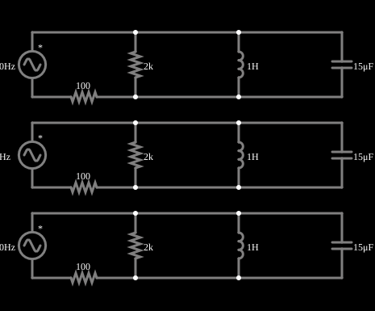

# Ressonância em paralelo

<!-- navegacao:inicio -->
[Índice](README.md) · [Anterior: Series Resonance](res-series.md)
<!-- navegacao:fim -->

## Objetivo

Mostrar a ressonância de um circuito RLC paralelo (circuito tanque): na frequência $f_0$ a corrente que a fonte fornece é mínima, porque as correntes do indutor e do capacitor se cancelam.

## O circuito

<!-- esquema:inicio -->

<!-- esquema:fim -->

Três circuitos iguais: uma fonte de 5 V de pico, um resistor de $100\ \Omega$ em série, e em paralelo um resistor de $2\ \text{k}\Omega$, um indutor de $1\ \text{H}$ e um capacitor de $15\ \mu\text{F}$. As fontes têm 41,1 Hz (na ressonância), 30 Hz e 50 Hz. Os osciloscópios mostram as correntes que as fontes fornecem.

<!-- componentes:inicio -->
| N.º | Tipo | Elemento | Valores |
|----:|------|----------|---------|
| 0 | `VoltageElm` | A/C source | Max Voltage = 5; Waveform = A/C; DC Offset (V) = 0; Internal Resistance (ohms) = 0; Show Voltage = não; Frequency (Hz) = 41.1; Phase Offset (degrees) = 0 |
| 1 | `CapacitorElm` | capacitor | Capacitance (F) = 15μ; Trapezoidal Approximation = sim; Initial Voltage (on Reset) = 1m; Series Resistance = 0 |
| 5 | `InductorElm` | inductor | Inductance (H) = 1; Trapezoidal Approximation = sim; Initial Current (on Reset) (A) = 0; Saturation Current (A) (0=none) = 0 |
| 6 | `ResistorElm` | resistor | Resistance (ohms) = 2k |
| 9 | `ResistorElm` | resistor | Resistance (ohms) = 100 |
| 10 | `VoltageElm` | A/C source | Max Voltage = 5; Waveform = A/C; DC Offset (V) = 0; Internal Resistance (ohms) = 0; Show Voltage = não; Frequency (Hz) = 30; Phase Offset (degrees) = 0 |
| 11 | `CapacitorElm` | capacitor | Capacitance (F) = 15μ; Trapezoidal Approximation = sim; Initial Voltage (on Reset) = 1m; Series Resistance = 0 |
| 15 | `InductorElm` | inductor | Inductance (H) = 1; Trapezoidal Approximation = sim; Initial Current (on Reset) (A) = 0; Saturation Current (A) (0=none) = 0 |
| 16 | `ResistorElm` | resistor | Resistance (ohms) = 2k |
| 19 | `ResistorElm` | resistor | Resistance (ohms) = 100 |
| 20 | `VoltageElm` | A/C source | Max Voltage = 5; Waveform = A/C; DC Offset (V) = 0; Internal Resistance (ohms) = 0; Show Voltage = não; Frequency (Hz) = 50; Phase Offset (degrees) = 0 |
| 21 | `CapacitorElm` | capacitor | Capacitance (F) = 15μ; Trapezoidal Approximation = sim; Initial Voltage (on Reset) = 1m; Series Resistance = 0 |
| 25 | `InductorElm` | inductor | Inductance (H) = 1; Trapezoidal Approximation = sim; Initial Current (on Reset) (A) = 0; Saturation Current (A) (0=none) = 0 |
| 26 | `ResistorElm` | resistor | Resistance (ohms) = 2k |
| 29 | `ResistorElm` | resistor | Resistance (ohms) = 100 |
<!-- componentes:fim -->

## Teoria

A admitância do bloco paralelo é

$$Y = \frac{1}{R_p} + j\left(\omega C - \frac{1}{\omega L}\right).$$

Na frequência $\omega_0 = 1/\sqrt{LC}$ a parte imaginária se anula: $Y(\omega_0) = 1/R_p$ (admitância mínima, impedância máxima $R_p$). A corrente da fonte é

$$I = \frac{V}{R_s + 1/Y}.$$

Na ressonância as correntes do indutor e do capacitor têm a mesma amplitude e sentidos opostos, circulando dentro do tanque; o fator de qualidade do tanque é $Q = R_p\sqrt{C/L}$.

## Resultados esperados

$f_0 = 41{,}09\ \text{Hz}$. As correntes de pico da fonte:

| $f$ | $I_{pico}$ |
|----:|-----------:|
| 41,1 Hz | $2{,}381\ \text{mA}$ ($= 5/2100$) |
| 30 Hz | $11{,}71\ \text{mA}$ |
| 50 Hz | $7{,}58\ \text{mA}$ |

Fora da ressonância o bloco L-C deixa passar mais corrente, por isso a corrente da fonte é maior. O transitório decai em dezenas de milissegundos; as verificações medem de 0,5 s a 0,6 s.

## O que observar

- Compare com a ressonância em série: aqui a corrente da fonte é **mínima** na ressonância (em série é máxima).
- A tensão sobre o tanque é máxima na ressonância.
- Esse circuito é usado como filtro seletivo (circuitos sintonizados de rádio).

## Limites do modelo

Componentes ideais; num tanque real o indutor tem resistência série, o que reduz $Q$.

## Referências

- J. W. Nilsson e S. A. Riedel, *Circuitos Elétricos*, Pearson.
- P. Horowitz e W. Hill, *The Art of Electronics*, Cambridge University Press.

O circuito deste exemplo faz parte da coleção do simulador original de Paul Falstad e Iain Sharp (CircuitJS1); a explicação é deste projeto.
