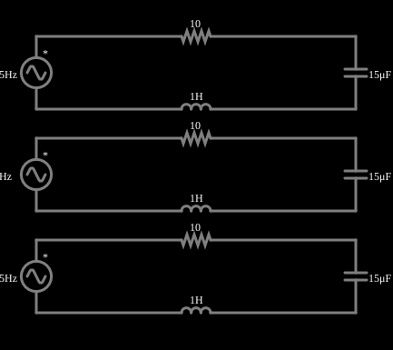

# Ressonância em série

<!-- navegacao:inicio -->
[Índice](README.md) · [Anterior: Impedances of Same Magnitude](impedance.md) · [Próximo: Parallel Resonance](res-par.md)
<!-- navegacao:fim -->

## Objetivo

Mostrar a ressonância de um circuito RLC série: na frequência $f_0$ as reatâncias se cancelam e a corrente é máxima, limitada só pela resistência.

## O circuito

<!-- esquema:inicio -->

<!-- esquema:fim -->

Três circuitos RLC série iguais ($R=10\ \Omega$, $L=1\ \text{H}$, $C=15\ \mu\text{F}$) são alimentados por fontes de 5 V de pico com frequências 35 Hz (abaixo da ressonância), 41,09 Hz (na ressonância) e 45 Hz (acima). Três osciloscópios mostram as correntes.

<!-- componentes:inicio -->
| N.º | Tipo | Elemento | Valores |
|----:|------|----------|---------|
| 0 | `VoltageElm` | A/C source | Max Voltage = 5; Waveform = A/C; DC Offset (V) = 0; Internal Resistance (ohms) = 0; Show Voltage = não; Frequency (Hz) = 35; Phase Offset (degrees) = 0 |
| 1 | `VoltageElm` | A/C source | Max Voltage = 5; Waveform = A/C; DC Offset (V) = 0; Internal Resistance (ohms) = 0; Show Voltage = não; Frequency (Hz) = 41.1; Phase Offset (degrees) = 0 |
| 2 | `VoltageElm` | A/C source | Max Voltage = 5; Waveform = A/C; DC Offset (V) = 0; Internal Resistance (ohms) = 0; Show Voltage = não; Frequency (Hz) = 45; Phase Offset (degrees) = 0 |
| 3 | `ResistorElm` | resistor | Resistance (ohms) = 10 |
| 4 | `CapacitorElm` | capacitor | Capacitance (F) = 15μ; Trapezoidal Approximation = sim; Initial Voltage (on Reset) = 1m; Series Resistance = 0 |
| 5 | `InductorElm` | inductor | Inductance (H) = 1; Trapezoidal Approximation = sim; Initial Current (on Reset) (A) = 0; Saturation Current (A) (0=none) = 0 |
| 6 | `ResistorElm` | resistor | Resistance (ohms) = 10 |
| 7 | `CapacitorElm` | capacitor | Capacitance (F) = 15μ; Trapezoidal Approximation = sim; Initial Voltage (on Reset) = 1m; Series Resistance = 0 |
| 8 | `InductorElm` | inductor | Inductance (H) = 1; Trapezoidal Approximation = sim; Initial Current (on Reset) (A) = 0; Saturation Current (A) (0=none) = 0 |
| 9 | `ResistorElm` | resistor | Resistance (ohms) = 10 |
| 10 | `CapacitorElm` | capacitor | Capacitance (F) = 15μ; Trapezoidal Approximation = sim; Initial Voltage (on Reset) = 1m; Series Resistance = 0 |
| 11 | `InductorElm` | inductor | Inductance (H) = 1; Trapezoidal Approximation = sim; Initial Current (on Reset) (A) = 0; Saturation Current (A) (0=none) = 0 |
<!-- componentes:fim -->

## Teoria

A impedância do circuito RLC série é

$$Z = R + j\left(\omega L - \frac{1}{\omega C}\right),\qquad |Z| = \sqrt{R^2 + \left(\omega L - \frac{1}{\omega C}\right)^2}.$$

Na **frequência de ressonância** $\omega_0 L = 1/(\omega_0 C)$:

$$f_0 = \frac{1}{2\pi\sqrt{LC}},\qquad Z(\omega_0) = R,\qquad I_{max} = \frac{V}{R}.$$

O **fator de qualidade** $Q = \dfrac{\omega_0 L}{R} = \dfrac{1}{R}\sqrt{\dfrac{L}{C}}$ mede a seletividade; a largura de banda de meia potência é $B = f_0/Q$. Na ressonância a tensão sobre o indutor e a do capacitor valem $Q\,V$ cada uma (em sentidos opostos).

## Resultados esperados

$f_0 = 41{,}09\ \text{Hz}$, $Q = 25{,}8$, $B = 1{,}6\ \text{Hz}$. As amplitudes de corrente nas três frequências são

| $f$ | $\|Z\|$ | $I_{pico}$ |
|----:|--------:|-----------:|
| 35 Hz | $83{,}8\ \Omega$ | $59{,}6\ \text{mA}$ |
| 41,09 Hz | $10{,}0\ \Omega$ | $500\ \text{mA}$ |
| 45 Hz | $48{,}0\ \Omega$ | $104{,}1\ \text{mA}$ |

O transitório decai com $e^{-\alpha t}$, $\alpha=R/2L=5\ \text{s}^{-1}$ ($\tau = 0{,}2\ \text{s}$), por isso as verificações medem de 0,8 s a 1,0 s, e a tolerância é de 4%.

## O que observar

- A corrente na ressonância é cerca de 8 vezes a de 35 Hz e 5 vezes a de 45 Hz: a curva de ressonância é estreita.
- Diminua $R$ pelo *slider*: o pico fica mais alto e mais estreito ($Q$ maior).
- Use o osciloscópio para ver a tensão do capacitor, que na ressonância é $Q$ vezes a da fonte.

## Limites do modelo

Componentes ideais; num circuito real a resistência do indutor e as perdas do capacitor limitam $Q$. O amortecimento lento do transitório faz o exemplo demorar a estabilizar.

## Referências

- J. W. Nilsson e S. A. Riedel, *Circuitos Elétricos*, Pearson.
- C. K. Alexander e M. N. O. Sadiku, *Fundamentos de Circuitos Elétricos*, AMGH.

O circuito deste exemplo faz parte da coleção do simulador original de Paul Falstad e Iain Sharp (CircuitJS1); a explicação é deste projeto.
