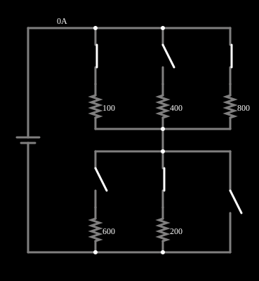

# Resistores em série e em paralelo

<!-- navegacao:inicio -->
[Índice](README.md) · [Anterior: Ohm's Law](ohms.md) · [Próximo: Capacitor](cap.md)
<!-- navegacao:fim -->

## Objetivo

Mostrar como resistores se combinam: a resistência equivalente de ligações em série e em paralelo, o divisor de tensão e o divisor de corrente. Chaves permitem escolher quais resistores entram no circuito.

## O circuito

<!-- esquema:inicio -->

<!-- esquema:fim -->

Uma fonte de 5 V alimenta dois blocos em série. O bloco de cima tem três ramos em paralelo, de $100\ \Omega$, $400\ \Omega$ e $800\ \Omega$, cada um com uma chave em série. O bloco de baixo tem três ramos em paralelo com $600\ \Omega$ e $200\ \Omega$ e um terceiro ramo só com a chave. Na posição em que o exemplo abre, estão fechadas as chaves de $100\ \Omega$ e $800\ \Omega$ em cima, e a de $200\ \Omega$ embaixo; as demais estão abertas. Clicando numa chave, ela muda de estado.

<!-- componentes:inicio -->
| N.º | Tipo | Elemento | Valores |
|----:|------|----------|---------|
| 0 | `VoltageElm` | voltage source | Voltage = 5; Waveform = D/C; DC Offset (V) = 0; Internal Resistance (ohms) = 0; Show Voltage = não; Circle Symbol = não |
| 4 | `SwitchElm` | switch (SPST) | Momentary Switch = não; IEC Symbol = não; Label (for linking) = ; Keyboard Shortcut = ; On Resistance (ohms) = 0 |
| 5 | `SwitchElm` | switch (SPST) | Momentary Switch = não; IEC Symbol = não; Label (for linking) = ; Keyboard Shortcut = ; On Resistance (ohms) = 0 |
| 6 | `SwitchElm` | switch (SPST) | Momentary Switch = não; IEC Symbol = não; Label (for linking) = ; Keyboard Shortcut = ; On Resistance (ohms) = 0 |
| 7 | `ResistorElm` | resistor | Resistance (ohms) = 100 |
| 8 | `ResistorElm` | resistor | Resistance (ohms) = 400 |
| 9 | `ResistorElm` | resistor | Resistance (ohms) = 800 |
| 15 | `SwitchElm` | switch (SPST) | Momentary Switch = não; IEC Symbol = não; Label (for linking) = ; Keyboard Shortcut = ; On Resistance (ohms) = 0 |
| 16 | `SwitchElm` | switch (SPST) | Momentary Switch = não; IEC Symbol = não; Label (for linking) = ; Keyboard Shortcut = ; On Resistance (ohms) = 0 |
| 17 | `ResistorElm` | resistor | Resistance (ohms) = 600 |
| 18 | `ResistorElm` | resistor | Resistance (ohms) = 200 |
| 19 | `SwitchElm` | switch (SPST) | Momentary Switch = não; IEC Symbol = não; Label (for linking) = ; Keyboard Shortcut = ; On Resistance (ohms) = 0 |
<!-- componentes:fim -->

## Teoria

**Resistores em série** conduzem a mesma corrente e suas resistências se somam; **em paralelo** têm a mesma tensão e suas condutâncias se somam:

$$R_{s} = \sum_k R_k, \qquad \frac{1}{R_{p}} = \sum_k \frac{1}{R_k}.$$

Para dois resistores em paralelo, $R_p = \dfrac{R_1 R_2}{R_1+R_2}$.

Com $R_t$ e $R_b$ os blocos de cima e de baixo, a corrente total é $I = V/(R_t+R_b)$, e a tensão se divide em proporção às resistências (divisor de tensão):

$$V_t = V\,\frac{R_t}{R_t+R_b}, \qquad V_b = V\,\frac{R_b}{R_t+R_b}.$$

Dentro de um bloco em paralelo a corrente se divide em proporção às condutâncias (divisor de corrente): $I_k = I\,\dfrac{G_k}{\sum_j G_j}$.

## Resultados esperados

Na posição inicial: $R_t = 100\,\|\,800 = \dfrac{100\cdot 800}{900} = 88{,}89\ \Omega$ e $R_b = 200\ \Omega$, logo $R_{eq} = 288{,}89\ \Omega$ e

$$I = \frac{5}{288{,}89} = 17{,}31\ \text{mA},\qquad V_b = 5\,\frac{200}{288{,}89} = 3{,}462\ \text{V},\qquad V_t = 1{,}538\ \text{V}.$$

A corrente se divide em cima em $I_{100} = V_t/100 = 15{,}38\ \text{mA}$ e $I_{800} = V_t/800 = 1{,}923\ \text{mA}$ (soma: $17{,}31\ \text{mA}$). As verificações conferem a corrente total, essas duas correntes e a tensão do resistor de $200\ \Omega$.

## O que observar

- Clique nas chaves e veja a resistência equivalente mudar: com mais ramos em paralelo, a corrente total aumenta; ligar um resistor em série com um bloco aumenta a resistência total.
- Abra a chave de um ramo: a corrente dele cai a zero, a resistência do bloco aumenta e a tensão sobre o bloco muda, o que muda as correntes dos outros ramos.
- Passe o ponteiro sobre os resistores para ler tensão e corrente de cada um.

## Limites do modelo

Resistores e chaves ideais: a chave fechada tem resistência nula e a aberta, resistência infinita. Num circuito real as chaves têm resistência de contato e os resistores têm tolerância.

## Referências

- J. W. Nilsson e S. A. Riedel, *Circuitos Elétricos*, Pearson.
- C. K. Alexander e M. N. O. Sadiku, *Fundamentos de Circuitos Elétricos*, AMGH.

O circuito deste exemplo faz parte da coleção do simulador original de Paul Falstad e Iain Sharp (CircuitJS1); a explicação é deste projeto.
