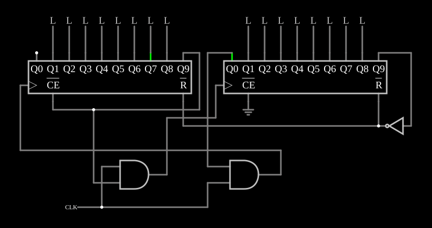

# Contadores em anel em cascata

<!-- navegacao:inicio -->
[Índice](README.md) · [Anterior: Johnson Counter](johnsonctr.md)
<!-- navegacao:fim -->

## Objetivo

Mostrar como dois contadores em anel podem ser encadeados para que um único bit percorra as saídas dos dois, formando um anel mais longo.

## O circuito

<!-- esquema:inicio -->

<!-- esquema:fim -->

Dois contadores em anel de 10 saídas (elementos 0 e 1) e um relógio de $100\ \text{Hz}$. Oito saídas de cada contador (as posições $1$ a $8$) acionam saídas lógicas: do primeiro, os elementos 28 a 35; do segundo, os elementos 36 a 43. Duas portas AND deixam o relógio chegar a cada contador conforme o estado do outro, e um inversor, ligado à última saída do segundo contador, aciona as entradas de *reset* (ativas em nível baixo) dos dois.

<!-- componentes:inicio -->
| N.º | Tipo | Elemento | Valores |
|----:|------|----------|---------|
| 0 | `RingCounterElm` | ring counter | High Logic Voltage = 5; Invert reset pin = sim; # of Bits = 10 |
| 1 | `RingCounterElm` | ring counter | High Logic Voltage = 5; Invert reset pin = sim; # of Bits = 10 |
| 2 | `AndGateElm` | AND gate | # of Inputs = 2; High Logic Voltage = 5; Schmitt Inputs = não; Invert Inputs = não; Propagation Delay (s) = 0; DeMorgan's Symbol = não |
| 3 | `AndGateElm` | AND gate | # of Inputs = 2; High Logic Voltage = 5; Schmitt Inputs = não; Invert Inputs = não; Propagation Delay (s) = 0; DeMorgan's Symbol = não |
| 11 | `RailElm` | square wave gen | Max Voltage = 2.5; Waveform = Square Wave; DC Offset (V) = 2.5; Internal Resistance (ohms) = 0; Show Voltage = não; Specify As = Frequency/Duty Cycle; Frequency (Hz) = 100; Phase Offset (degrees) = 0; Duty Cycle = 50; Rise/Fall Time (s) = 0 |
| 25 | `InverterElm` | inverter | Slew Rate (V/ns) = 500m; High Logic Voltage = 5; DeMorgan's Symbol = não |
| 28 | `LogicOutputElm` | logic output | Threshold = 2.5; Current Required = não; Numeric = não; Ternary = não |
| 29 | `LogicOutputElm` | logic output | Threshold = 2.5; Current Required = não; Numeric = não; Ternary = não |
| 30 | `LogicOutputElm` | logic output | Threshold = 2.5; Current Required = não; Numeric = não; Ternary = não |
| 31 | `LogicOutputElm` | logic output | Threshold = 2.5; Current Required = não; Numeric = não; Ternary = não |
| 32 | `LogicOutputElm` | logic output | Threshold = 2.5; Current Required = não; Numeric = não; Ternary = não |
| 33 | `LogicOutputElm` | logic output | Threshold = 2.5; Current Required = não; Numeric = não; Ternary = não |
| 34 | `LogicOutputElm` | logic output | Threshold = 2.5; Current Required = não; Numeric = não; Ternary = não |
| 35 | `LogicOutputElm` | logic output | Threshold = 2.5; Current Required = não; Numeric = não; Ternary = não |
| 36 | `LogicOutputElm` | logic output | Threshold = 2.5; Current Required = não; Numeric = não; Ternary = não |
| 37 | `LogicOutputElm` | logic output | Threshold = 2.5; Current Required = não; Numeric = não; Ternary = não |
| 38 | `LogicOutputElm` | logic output | Threshold = 2.5; Current Required = não; Numeric = não; Ternary = não |
| 39 | `LogicOutputElm` | logic output | Threshold = 2.5; Current Required = não; Numeric = não; Ternary = não |
| 40 | `LogicOutputElm` | logic output | Threshold = 2.5; Current Required = não; Numeric = não; Ternary = não |
| 41 | `LogicOutputElm` | logic output | Threshold = 2.5; Current Required = não; Numeric = não; Ternary = não |
| 42 | `LogicOutputElm` | logic output | Threshold = 2.5; Current Required = não; Numeric = não; Ternary = não |
| 43 | `LogicOutputElm` | logic output | Threshold = 2.5; Current Required = não; Numeric = não; Ternary = não |
| 45 | `GroundElm` | ground | Symbol = Earth |
<!-- componentes:fim -->

## Teoria

Num contador em anel, um único $1$ circula pelas saídas, uma posição por borda do relógio: com $n$ saídas, há $n$ estados, e cada estado já está "decodificado" (uma saída por estado). Para fazer um anel mais longo sem um contador maior, os dois anéis passam o "bastão" um ao outro: as portas AND só deixam o relógio chegar a um contador enquanto o outro está parado no seu estado de espera, e o *reset* devolve os dois ao estado inicial no fim da volta. As posições de espera não acionam saídas, e o resultado é um anel de $16$ posições visíveis, $8$ de cada contador.

## Resultados esperados

O simulador avança uma posição a cada $10\ \text{ms}$ e percorre as $16$ saídas em ordem: a última do primeiro contador (elemento 35) está acesa no início; a primeira do segundo (elemento 36) de $10$ a $20\ \text{ms}$; a última do segundo (elemento 43) de $80$ a $90\ \text{ms}$; a primeira do primeiro (elemento 28) de $90$ a $100\ \text{ms}$; e de novo a primeira do segundo de $170$ a $180\ \text{ms}$. O ciclo dura $160\ \text{ms}$: cada saída acende com frequência de $6{,}25\ \text{Hz}$, $1/16$ do relógio.

## O que observar

Veja a luz correr pelas oito saídas do primeiro contador, passar para as do segundo e voltar, sem nunca haver duas acesas ao mesmo tempo.

## Limites do modelo

- A passagem de um contador ao outro depende da ordem em que as portas e os contadores reagem à mesma borda; num circuito real, os atrasos teriam de ser verificados para não perder nem duplicar o bit.

## Referências

Wakerly, *Digital Design: Principles and Practices*, capítulo sobre contadores em anel; Horowitz e Hill, *The Art of Electronics*, capítulo sobre lógica sequencial.

O circuito deste exemplo faz parte da coleção do simulador original de Paul Falstad e Iain Sharp (CircuitJS1); a explicação é deste projeto.
