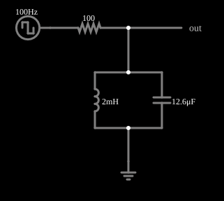

# Filtro passa-faixa com oscilação amortecida

<!-- navegacao:inicio -->
[Índice](README.md) · [Anterior: Bessel vs Butterworth](besselbutter.md) · [Próximo: Comb Filter](comb.md)
<!-- navegacao:fim -->

## Objetivo

Mostrar que um filtro passa-faixa de alto $Q$ "toca" depois de cada transição da entrada: a saída oscila na frequência de ressonância e decai exponencialmente.

## O circuito

<!-- esquema:inicio -->

<!-- esquema:fim -->

Um resistor de $100\ \Omega$ em série com a entrada e, em paralelo para a terra, um indutor de $2\ \text{mH}$ e um capacitor de $12{,}6\ \mu\text{F}$ (o mesmo circuito tanque do filtro passa-faixa). A entrada é uma onda quadrada de 100 Hz e $\pm5\ \text{V}$; o osciloscópio mostra a saída.

<!-- componentes:inicio -->
| N.º | Tipo | Elemento | Valores |
|----:|------|----------|---------|
| 6 | `InductorElm` | inductor | Inductance (H) = 2m; Trapezoidal Approximation = sim; Initial Current (on Reset) (A) = 0; Saturation Current (A) (0=none) = 0 |
| 7 | `CapacitorElm` | capacitor | Capacitance (F) = 12.6μ; Trapezoidal Approximation = sim; Initial Voltage (on Reset) = 1m; Series Resistance = 0 |
| 8 | `ResistorElm` | resistor | Resistance (ohms) = 100 |
| 9 | `OutputElm` | output | Show Voltage = não |
| 10 | `GroundElm` | ground | Symbol = Earth |
| 11 | `RailElm` | square wave gen | Max Voltage = 5; Waveform = Square Wave; DC Offset (V) = 0; Internal Resistance (ohms) = 0; Show Voltage = não; Specify As = Frequency/Duty Cycle; Frequency (Hz) = 100; Phase Offset (degrees) = 0; Duty Cycle = 50; Rise/Fall Time (s) = 0 |
<!-- componentes:fim -->

## Teoria

O tanque ligado a uma fonte por um resistor $R$ tem a equação

$$\frac{d^2 v}{dt^2} + 2\alpha\,\frac{dv}{dt} + \omega_0^2\,v = \frac{1}{RC}\frac{du}{dt},\qquad \alpha = \frac{1}{2RC},\quad \omega_0=\frac{1}{\sqrt{LC}},\quad Q = R\sqrt{\frac CL}.$$

Depois de cada degrau da entrada a saída oscila na frequência amortecida $\omega_d=\sqrt{\omega_0^2-\alpha^2}$ com envoltória $e^{-\alpha t}$. Como o espectro de uma onda quadrada de 100 Hz tem harmônicos de ordem ímpar, o 11.º (1100 Hz) e o 9.º (900 Hz) caem perto de $f_0$ e são fortemente realçados.

## Resultados esperados

$f_0 = 1001\ \text{Hz}$, $Q = 7{,}95$, $B = f_0/Q = 126\ \text{Hz}$, $\alpha = 396\ \text{s}^{-1}$ (constante de tempo $1/\alpha = 2{,}5\ \text{ms}$) e $f_d = 999\ \text{Hz}$. A saída oscila a cerca de 999 Hz e quase se extingue antes da transição seguinte (a 5 ms). A verificação mede a frequência da oscilação no intervalo de 0,3 ms a 4,5 ms depois da transição (tolerância de 4%).

## O que observar

- Cada transição da onda quadrada excita uma oscilação decrescente de cerca de 1 kHz (período de 1 ms) que dura alguns milissegundos.
- Diminua $R$: $Q$ diminui e o "toque" some mais depressa; aumente $R$: o toque dura mais.

## Limites do modelo

Componentes ideais. O indutor real tem resistência, que amortece mais a oscilação.

## Referências

- J. W. Nilsson e S. A. Riedel, *Circuitos Elétricos*, Pearson.
- A. S. Sedra e K. C. Smith, *Microeletrônica*, Pearson.

O circuito deste exemplo faz parte da coleção do simulador original de Paul Falstad e Iain Sharp (CircuitJS1); a explicação é deste projeto.
