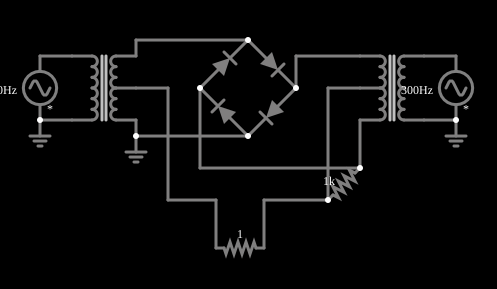

# Modulador em anel

<!-- navegacao:inicio -->
[Índice](README.md) · [Anterior: Triangle-to-Sine Converter](sinediode.md)
<!-- navegacao:fim -->

## Objetivo

Mostrar um modulador em anel: quatro diodos em anel, entre dois transformadores, multiplicam dois sinais, o que gera frequências de soma e de diferença e suprime as originais.

## O circuito

<!-- esquema:inicio -->

<!-- esquema:fim -->

Duas fontes senoidais, de $2{,}4\ \text{V}$ e $300\ \text{Hz}$ (a do sinal) e de $2\ \text{V}$ e $200\ \text{Hz}$ (a da portadora, que chaveia os diodos; essa atribuição é a que reproduz o espectro medido, descrito adiante), alimentam dois transformadores com derivação central, cada um com $100\ \text{mH}$ no primário e razão $1{:}1$. Quatro diodos formam um anel entre os secundários; a saída é um resistor de $1\ \text{k}\Omega$.

<!-- componentes:inicio -->
| N.º | Tipo | Elemento | Valores |
|----:|------|----------|---------|
| 0 | `DiodeElm` | diode | Model = default |
| 1 | `DiodeElm` | diode | Model = default |
| 2 | `DiodeElm` | diode | Model = default |
| 3 | `DiodeElm` | diode | Model = default |
| 4 | `TappedTransformerElm` | transformer | Primary Inductance (H) = 100m; Ratio (N1/N2) = 1; Coupling Coefficient = 990m; Trapezoidal Approximation = sim |
| 6 | `TappedTransformerElm` | transformer | Primary Inductance (H) = 100m; Ratio (N1/N2) = 1; Coupling Coefficient = 990m; Trapezoidal Approximation = sim |
| 21 | `VoltageElm` | A/C source | Max Voltage = 2.4; Waveform = A/C; DC Offset (V) = 0; Internal Resistance (ohms) = 0; Show Voltage = não; Frequency (Hz) = 300; Phase Offset (degrees) = 0 |
| 22 | `VoltageElm` | A/C source | Max Voltage = 2; Waveform = A/C; DC Offset (V) = 0; Internal Resistance (ohms) = 0; Show Voltage = não; Frequency (Hz) = 200; Phase Offset (degrees) = 0 |
| 25 | `ResistorElm` | resistor | Resistance (ohms) = 1 |
| 30 | `ResistorElm` | resistor | Resistance (ohms) = 1k |
| 31 | `GroundElm` | ground | Symbol = Earth |
| 32 | `GroundElm` | ground | Symbol = Earth |
| 33 | `GroundElm` | ground | Symbol = Earth |
<!-- componentes:fim -->

## Teoria

O diodo do simulador (modelo "default") segue a equação de Shockley,

$$i = I_s\left(e^{v/(nV_T)} - 1\right),\qquad I_s = 1{,}714\cdot 10^{-7}\ \text{A},\quad n = 2,\quad V_T = 25{,}865\ \text{mV},$$

sem resistência série. Para uma corrente $i \gg I_s$ a tensão é $v = nV_T\ln(i/I_s + 1)$, que dá $0{,}806\ \text{V}$ em $1\ \text{A}$, $0{,}568\ \text{V}$ em $10\ \text{mA}$ e $0{,}449\ \text{V}$ em $1\ \text{mA}$: a tensão cresce $nV_T\ln 10 = 119\ \text{mV}$ a cada década de corrente. Para $v < 0$ a corrente tende a $-I_s = -0{,}17\ \mu\text{A}$.

## Resultados esperados

Com uma portadora de frequência $f_c$ e amplitude suficiente para ligar e desligar os diodos, o anel multiplica o sinal $s(t)$ (frequência $f_s$) por $\pm 1$, conforme o sinal da portadora: a saída é $s(t)\,\mathrm{sgn}\,c(t)$. A função $\mathrm{sgn}\,c(t)$ é uma onda quadrada, cuja série de Fourier só tem harmônicos ímpares da portadora:

$$\mathrm{sgn}\,\cos\omega_c t = \frac{4}{\pi}\left(\cos\omega_c t - \frac{1}{3}\cos 3\omega_c t + \frac{1}{5}\cos 5\omega_c t - \dots\right).$$

Multiplicando por $\cos\omega_s t$, a saída tem componentes nas frequências

$$f = |f_s \pm (2k+1)\,f_c|,\qquad k = 0, 1, 2, \dots$$

e **não** tem a portadora $f_c$ nem (idealmente) o sinal $f_s$: os dois são suprimidos pela simetria do anel (o "balanceamento").

## O que observar

Com $f_s = 300\ \text{Hz}$ e $f_c = 200\ \text{Hz}$, as componentes esperadas estão em $|300 \pm 200| = 100$ e $500\ \text{Hz}$, $|300 \pm 600| = 300$ e $900\ \text{Hz}$, $|300 \pm 1000| = 700$ e $1300\ \text{Hz}$, e assim por diante. A análise de Fourier do sinal simulado na saída, em $10$ ciclos de $100\ \text{Hz}$ (de $0{,}1$ a $0{,}2\ \text{s}$), tem linhas apenas em múltiplos ímpares de $100\ \text{Hz}$:

| frequência | amplitude |
|-----------:|----------:|
| $100\ \text{Hz}$ | $0{,}032\ \text{V}$ |
| $300\ \text{Hz}$ | $0{,}879\ \text{V}$ |
| $500\ \text{Hz}$ | $0{,}128\ \text{V}$ |
| $700\ \text{Hz}$ | $0{,}064\ \text{V}$ |
| $900\ \text{Hz}$ | $0{,}133\ \text{V}$ |
| $1100$, $1300$, $1500\ \text{Hz}$ | $0{,}030$, $0{,}048$, $0{,}057\ \text{V}$ |

Todas as linhas esperadas aparecem (a de $300\ \text{Hz}$ coincide com o sinal, e também com $3f_c - f_s$, de modo que não se pode separar a parte "vazada" do sinal da parte modulada; o forte nível dela mostra que o anel simulado não está perfeitamente balanceado). A de $100\ \text{Hz}$ é pequena porque a indutância de $100\ \text{mH}$ dos transformadores atenua as frequências baixas. A tensão de saída tem valor médio nulo, pico de $0{,}874\ \text{V}$ e valor eficaz de $0{,}643\ \text{V}$; as verificações conferem esses três valores, em dez ciclos de $100\ \text{Hz}$ (tolerância de 1%). São valores do simulador, e o espectro é uma análise à parte (o circuito, com os transformadores de derivação central, não tem integrador independente neste conjunto de exemplos).

## Limites do modelo

- A saída não é senoidal: tem várias linhas de frequência, e nenhuma delas é a portadora de $200\ \text{Hz}$.
- Compare, no espectro, as linhas laterais (múltiplos ímpares da portadora mais ou menos o sinal) com as frequências originais.
- Troque a frequência da portadora: as linhas laterais se deslocam em múltiplos ímpares dela.

## Referências

O anel simulado não é perfeitamente balanceado, e o sinal "vaza" para a saída em $300\ \text{Hz}$; transformadores e diodos reais exigem casamento cuidadoso para suprimir bem as originais. O modelo de transformador usa um acoplamento de $0{,}99$, o que atenua frequências baixas e causa uma pequena distorção.

O circuito deste exemplo faz parte da coleção do simulador original de Paul Falstad e Iain Sharp (CircuitJS1); a explicação é deste projeto.
