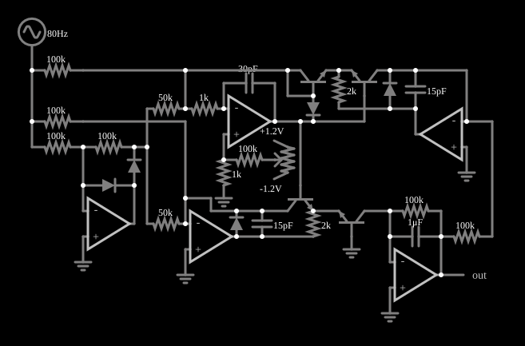

# Conversor de valor eficaz verdadeiro

<!-- navegacao:inicio -->
[Índice](README.md) · [Anterior: Gilbert Cell Multiplier](gilbertcell.md) · [Próximo: Joule Thief](joule-thief.md)
<!-- navegacao:fim -->

## Objetivo

Mostrar um conversor de **valor eficaz verdadeiro** (*true RMS*): um circuito cuja saída contínua é o valor eficaz do sinal de entrada, seja qual for a sua forma de onda, e não só para senoides. Aqui a entrada é uma senoide de $5\ \text{V}$ de pico e $80\ \text{Hz}$, e a saída deve ser $5/\sqrt{2} = 3{,}536\ \text{V}$.

## O circuito

<!-- esquema:inicio -->

<!-- esquema:fim -->

O circuito reúne, em linhas gerais, amplificadores operacionais ideais (ganho de $100\,000$, saída de $\pm 15\ \text{V}$), diodos, transistores NPN ($\beta = 100$), resistores de $1\ \text{k}\Omega$ a $100\ \text{k}\Omega$ e capacitores de $15\ \text{pF}$ a $1\ \mu\text{F}$. Há na entrada uma parte de **retificação de precisão** (dois amplificadores, dois diodos e resistores de $100\ \text{k}\Omega$ e $50\ \text{k}\Omega$), um grupo de transistores que faz o cálculo **translinear** (a relação exponencial entre corrente e tensão do transistor é usada para elevar ao quadrado e extrair a raiz) e um **filtro** de $1\ \mu\text{F}$ com resistor de $100\ \text{k}\Omega$ que faz a média. Duas fontes de $\pm 1{,}2\ \text{V}$ ligadas às pontas de um potenciômetro de $10\ \text{k}\Omega$ ("trimmer 1") injetam, por um resistor de $100\ \text{k}\Omega$, uma tensão de ajuste: é o ajuste de calibração do conversor. A saída é um osciloscópio de tensão contínua.

<!-- componentes:inicio -->
| N.º | Tipo | Elemento | Valores |
|----:|------|----------|---------|
| 0 | `OpAmpElm` | op-amp | Max Output (V) = 15; Min Output (V) = -15; Gain = 100k |
| 1 | `OpAmpElm` | op-amp | Max Output (V) = 15; Min Output (V) = -15; Gain = 100k |
| 2 | `DiodeElm` | diode | Model = default |
| 3 | `DiodeElm` | diode | Model = default |
| 7 | `ResistorElm` | resistor | Resistance (ohms) = 100k |
| 8 | `ResistorElm` | resistor | Resistance (ohms) = 100k |
| 9 | `ResistorElm` | resistor | Resistance (ohms) = 50k |
| 12 | `OpAmpElm` | op-amp | Max Output (V) = 15; Min Output (V) = -15; Gain = 100k |
| 13 | `CapacitorElm` | capacitor | Capacitance (F) = 30p; Trapezoidal Approximation = sim; Initial Voltage (on Reset) = 1m; Series Resistance = 0 |
| 16 | `ResistorElm` | resistor | Resistance (ohms) = 1k |
| 17 | `ResistorElm` | resistor | Resistance (ohms) = 50k |
| 19 | `GroundElm` | ground | Symbol = Earth |
| 20 | `GroundElm` | ground | Symbol = Earth |
| 21 | `GroundElm` | ground | Symbol = Earth |
| 22 | `ResistorElm` | resistor | Resistance (ohms) = 1k |
| 24 | `ResistorElm` | resistor | Resistance (ohms) = 100k |
| 25 | `PotElm` | potentiometer | Resistance (ohms) = 10k; Slider Text = trimmer 1; Show Values = não; Group Number (for linking) = 0 |
| 26 | `RailElm` | voltage source | Voltage = 1.2; Waveform = D/C; DC Offset (V) = 0; Internal Resistance (ohms) = 0 |
| 27 | `RailElm` | voltage source | Voltage = -1.2; Waveform = D/C; DC Offset (V) = 0; Internal Resistance (ohms) = 0 |
| 28 | `ResistorElm` | resistor | Resistance (ohms) = 100k |
| 29 | `ResistorElm` | resistor | Resistance (ohms) = 100k |
| 36 | `CapacitorElm` | capacitor | Capacitance (F) = 15p; Trapezoidal Approximation = sim; Initial Voltage (on Reset) = 1m; Series Resistance = 0 |
| 42 | `DiodeElm` | diode | Model = default |
| 44 | `NTransistorElm` | transistor | Beta/hFE = 100; Swap E/C = sim; Draw Circle = não; Model = default |
| 45 | `ResistorElm` | resistor | Resistance (ohms) = 2k |
| 50 | `NTransistorElm` | transistor | Beta/hFE = 100; Swap E/C = sim; Draw Circle = não; Model = default |
| 51 | `NTransistorElm` | transistor | Beta/hFE = 100; Swap E/C = não; Draw Circle = não; Model = default |
| 56 | `DiodeElm` | diode | Model = default |
| 62 | `ResistorElm` | resistor | Resistance (ohms) = 2k |
| 63 | `CapacitorElm` | capacitor | Capacitance (F) = 15p; Trapezoidal Approximation = sim; Initial Voltage (on Reset) = 1m; Series Resistance = 0 |
| 64 | `DiodeElm` | diode | Model = default |
| 69 | `OpAmpElm` | op-amp | Max Output (V) = 15; Min Output (V) = -15; Gain = 100k |
| 70 | `OpAmpElm` | op-amp | Max Output (V) = 15; Min Output (V) = -15; Gain = 100k |
| 74 | `NTransistorElm` | transistor | Beta/hFE = 100; Swap E/C = não; Draw Circle = não; Model = default |
| 77 | `ResistorElm` | resistor | Resistance (ohms) = 100k |
| 78 | `CapacitorElm` | capacitor | Capacitance (F) = 1μ; Trapezoidal Approximation = sim; Initial Voltage (on Reset) = 1m; Series Resistance = 0 |
| 83 | `GroundElm` | ground | Symbol = Earth |
| 84 | `GroundElm` | ground | Symbol = Earth |
| 85 | `GroundElm` | ground | Symbol = Earth |
| 86 | `ResistorElm` | resistor | Resistance (ohms) = 100k |
| 89 | `OutputElm` | output | Show Voltage = não |
| 90 | `RailElm` | A/C source | Max Voltage = 5; Waveform = A/C; DC Offset (V) = 0; Internal Resistance (ohms) = 0; Show Voltage = não; Frequency (Hz) = 80; Phase Offset (degrees) = 0 |
<!-- componentes:fim -->

## Teoria

O valor eficaz de um sinal periódico $v(t)$ de período $T$ é

$$V_{rms} = \sqrt{\frac{1}{T}\int_0^T v^2(t)\,dt}.$$

Para uma senoide de pico $V_p$ vale $V_p/\sqrt{2}$; para outras formas de onda, outro número. Um voltímetro que responde ao valor **médio** retificado ($2V_p/\pi$ para uma senoide) e é calibrado para exibir $V_p/\sqrt{2}$ erra para qualquer outra forma (razão de $1{,}11$ entre os dois, o *fator de forma* da senoide).

**Cálculo implícito.** O conversor calcula o valor eficaz de modo *implícito*: ele ajusta a saída $V_o$ até que $V_o = \overline{v^2}/V_o$, isto é,

$$V_o^2 = \overline{v^2} \quad\Rightarrow\quad V_o = \sqrt{\overline{v^2}},$$

em que $\overline{v^2}$ é a média de $v^2$, obtida pelo filtro passa-baixas. A divisão por $V_o$ e o quadrado são feitos pelo bloco translinear: a corrente de coletor é exponencial na tensão base-emissor, e a soma de tensões de junção equivale ao produto de correntes.

**Resposta e ondulação.** O quadrado de uma senoide tem componente contínua $V_p^2/2$ e uma componente em $2f$ de mesma amplitude. O filtro (constante de tempo $RC = 100\ \text{k}\Omega \cdot 1\ \mu\text{F} = 0{,}1\ \text{s}$) atenua a de $2f$ mas não a elimina, e deixa uma pequena **ondulação a $2f$** na saída. O mesmo filtro faz a saída levar algumas dezenas de milissegundos para se estabelecer.

## Resultados esperados

Em regime ($t \ge 0{,}9\ \text{s}$) o simulador dá a saída em $3{,}5000\ \text{V}$ (média), contra $3{,}5355\ \text{V}$ do valor eficaz ideal: $1{,}0\%$ abaixo; o valor eficaz da entrada é $3{,}5355\ \text{V}$. A ondulação é de $3{,}4644$ a $3{,}5355\ \text{V}$ ($0{,}071\ \text{V}$ pico a pico) e está em $160\ \text{Hz}$, o dobro da frequência da entrada, com amplitude de $0{,}035\ \text{V}$ ($1\%$ do nível); a componente de $80\ \text{Hz}$ vale só $0{,}0008\ \text{V}$. A saída tem esta evolução: $2{,}786\ \text{V}$ em $50\ \text{ms}$, $3{,}255\ \text{V}$ em $100\ \text{ms}$, $3{,}467\ \text{V}$ em $200\ \text{ms}$ e $3{,}499\ \text{V}$ em $500\ \text{ms}$, praticamente estável a partir de $0{,}9\ \text{s}$. As verificações conferem o nível, os extremos da ondulação, o valor eficaz da entrada e os quatro instantes da subida (tolerância de $0{,}2\%$ a $0{,}5\%$).

## O que observar

Na tela, a saída sobe a partir de zero em alguns décimos de segundo e se fixa em torno de $3{,}5\ \text{V}$ com uma ondulação pequena. Para testar (valores medidos no simulador, em regime): mude a amplitude da fonte para $2\ \text{V}$ e veja a saída ir para $1{,}389\ \text{V}$ ($2/\sqrt{2} = 1{,}414\ \text{V}$, com o mesmo erro de cerca de $1\%$ a $2\%$); troque a forma de onda por uma quadrada de $5\ \text{V}$ e veja a saída ir para $4{,}95\ \text{V}$, quase o valor de pico: o valor eficaz de uma onda quadrada é o seu pico, e um instrumento calibrado para senoides leria outro valor; mova o potenciômetro "trimmer 1", que o arquivo deixa em $0{,}5$ (saída de $3{,}500\ \text{V}$): em $0$ a saída é $2{,}780\ \text{V}$, em $0{,}25$, $3{,}126\ \text{V}$, em $0{,}75$, $3{,}919\ \text{V}$ e em $1$, $4{,}406\ \text{V}$; o valor ideal de $3{,}536\ \text{V}$ fica logo acima de $0{,}5$.

## Limites do modelo

- Os amplificadores operacionais são ideais (ganho finito de $100\,000$ e saída limitada a $\pm 15\ \text{V}$, sem largura de banda); os transistores não têm capacitâncias, e por isso o circuito não mostra o limite de frequência de um conversor real.
- A descrição dos blocos é feita em linhas gerais: o exemplo é grande, e este documento não deduz a função de cada transistor.
- A diferença de $1\%$ entre a saída e o valor eficaz ideal (e a ondulação de $1\%$ a $2f$) depende da calibração do trimmer e do filtro; um conversor real traz um erro adicional que depende da temperatura.
- Os valores de ondulação e das componentes de Fourier são medidas do simulador; as verificações automáticas cobrem o nível, os extremos e a subida.

## Referências

Analog Devices, *Analog Dialogue* e as notas de aplicação sobre conversores RMS-CC (técnicas implícitas e translineares); Horowitz e Hill, *The Art of Electronics*, seção 7.x (conversão de valor eficaz); Gilbert, B., "Translinear circuits: a proposed classification", *Electronics Letters*, 1975.

O circuito deste exemplo faz parte da coleção do simulador original de Paul Falstad e Iain Sharp (CircuitJS1); a explicação é deste projeto.
