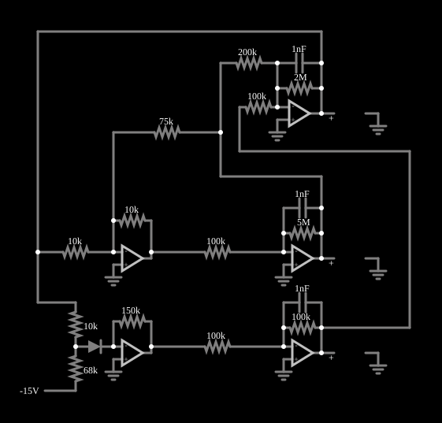

# Atrator de Rössler

<!-- navegacao:inicio -->
[Índice](README.md) · [Próximo: Vilnius](vilnius.md)
<!-- navegacao:fim -->

## Objetivo

Mostrar a realização eletrônica do atrator de Rössler, um dos sistemas caóticos mais simples: três variáveis de estado, uma única não linearidade, e uma trajetória que espirala para fora e é "dobrada" de volta, sem nunca se repetir.

## O circuito

<!-- esquema:inicio -->

<!-- esquema:fim -->

O circuito é um computador analógico: cinco amplificadores operacionais, três capacitores de $1\ \text{nF}$, um diodo e resistores de $10\ \text{k}\Omega$ a $5\ \text{M}\Omega$ implementam as equações de Rössler, e três sondas de tensão (*voltmeters*) medem as variáveis de estado. Dois osciloscópios XY mostram os retratos de fase *z* contra *y* e *y* contra *x*.

<!-- componentes:inicio -->
| N.º | Tipo | Elemento | Valores |
|----:|------|----------|---------|
| 0 | `OpAmpElm` | op-amp | Max Output (V) = 15; Min Output (V) = -15; Gain = 100k |
| 1 | `ResistorElm` | resistor | Resistance (ohms) = 5M |
| 2 | `CapacitorElm` | capacitor | Capacitance (F) = 1n; Trapezoidal Approximation = sim; Initial Voltage (on Reset) = 1m; Series Resistance = 0 |
| 7 | `GroundElm` | ground | Symbol = Earth |
| 8 | `CapacitorElm` | capacitor | Capacitance (F) = 1n; Trapezoidal Approximation = sim; Initial Voltage (on Reset) = 1m; Series Resistance = 0 |
| 9 | `ResistorElm` | resistor | Resistance (ohms) = 100k |
| 10 | `OpAmpElm` | op-amp | Max Output (V) = 15; Min Output (V) = -15; Gain = 100k |
| 15 | `GroundElm` | ground | Symbol = Earth |
| 17 | `OpAmpElm` | op-amp | Max Output (V) = 15; Min Output (V) = -15; Gain = 100k |
| 18 | `GroundElm` | ground | Symbol = Earth |
| 19 | `ResistorElm` | resistor | Resistance (ohms) = 2M |
| 20 | `CapacitorElm` | capacitor | Capacitance (F) = 1n; Trapezoidal Approximation = sim; Initial Voltage (on Reset) = 1m; Series Resistance = 0 |
| 25 | `ResistorElm` | resistor | Resistance (ohms) = 100k |
| 31 | `OpAmpElm` | op-amp | Max Output (V) = 15; Min Output (V) = -15; Gain = 100k |
| 32 | `OpAmpElm` | op-amp | Max Output (V) = 15; Min Output (V) = -15; Gain = 100k |
| 34 | `ResistorElm` | resistor | Resistance (ohms) = 100k |
| 35 | `ResistorElm` | resistor | Resistance (ohms) = 100k |
| 38 | `ResistorElm` | resistor | Resistance (ohms) = 10k |
| 40 | `ResistorElm` | resistor | Resistance (ohms) = 10k |
| 41 | `DiodeElm` | diode | Model = default |
| 42 | `ResistorElm` | resistor | Resistance (ohms) = 10k |
| 43 | `ResistorElm` | resistor | Resistance (ohms) = 68k |
| 48 | `ResistorElm` | resistor | Resistance (ohms) = 200k |
| 50 | `ResistorElm` | resistor | Resistance (ohms) = 75k |
| 52 | `GroundElm` | ground | Symbol = Earth |
| 53 | `GroundElm` | ground | Symbol = Earth |
| 54 | `ResistorElm` | resistor | Resistance (ohms) = 150k |
| 59 | `RailElm` | voltage source | Voltage = -15; Waveform = D/C; DC Offset (V) = 0; Internal Resistance (ohms) = 0 |
| 60 | `ProbeElm` | voltmeter | Show Voltage = não; Value = Voltage; Scale = Auto; Use Circle Symbol = não; Series Resistance (0 = infinite) = 0 |
| 61 | `ProbeElm` | voltmeter | Show Voltage = não; Value = Voltage; Scale = Auto; Use Circle Symbol = não; Series Resistance (0 = infinite) = 0 |
| 62 | `ProbeElm` | voltmeter | Show Voltage = não; Value = Voltage; Scale = Auto; Use Circle Symbol = não; Series Resistance (0 = infinite) = 0 |
| 63 | `GroundElm` | ground | Symbol = Earth |
| 64 | `GroundElm` | ground | Symbol = Earth |
| 65 | `GroundElm` | ground | Symbol = Earth |
<!-- componentes:fim -->

## Teoria

O sistema de Rössler (1976) é

$$\dot x = -y - z,\qquad \dot y = x + a\,y,\qquad \dot z = b + z\,(x - c).$$

A parte linear em $x$ e $y$ gira e, com $a > 0$, expande em espiral; o termo não linear $z\,(x-c)$ lança a trajetória para cima quando $x$ passa de $c$ e a recoloca perto do plano $xy$, onde ela volta a espiralar. Num circuito, cada derivada vira um integrador (um operacional com capacitor), os termos lineares viram somadores com resistores, e a não linearidade é feita por um diodo, que liga e desliga um caminho conforme a tensão. As constantes de tempo do exemplo ficam entre $0{,}1$ e $5\ \text{ms}$ ($1\ \text{nF}$ com resistores de $100\ \text{k}\Omega$ a $5\ \text{M}\Omega$).

Um sistema caótico tem três propriedades: é determinístico, é limitado (as tensões ficam dentro de uma faixa) e é sensível às condições iniciais (dois estados quase iguais divergem exponencialmente, com expoente de Lyapunov positivo).

## Resultados esperados

O sistema não tem um valor de regime permanente: as três tensões oscilam de forma irregular, sem repetição, dentro de uma faixa limitada pelos $\pm 15\ \text{V}$ dos operacionais. Pela teoria do sistema, no retrato de fase *y* contra *x* esperam-se espirais que se afastam da origem e voltam a ser dobradas, e no de *z* contra *y* a excursão abrupta de $z$ que ocorre quando $x$ passa do limiar da não linearidade.

Este documento não traz verificações numéricas (`sem-verificacao`): nenhum valor de uma trajetória caótica é reprodutível de forma confiável.

## O que observar

- Nos dois osciloscópios XY, a trajetória preenche aos poucos uma figura em forma de fita dobrada: o atrator.
- Deixe o circuito rodar por um tempo longo e use o botão de reinício: a trajetória nunca se repete, mas a figura é a mesma.
- Interrompa e reinicie com outras condições iniciais (mude uma tensão de capacitor de $1\ \text{mV}$ para $2\ \text{mV}$): o atrator tem a mesma forma, mas a sequência é outra.

## Limites do modelo

O comportamento caótico é extremamente sensível às condições iniciais, ao passo de tempo e à precisão numérica: uma trajetória simulada **não** é reprodutível ponto a ponto, nem em outro simulador nem em outra versão deste, e só as propriedades estatísticas e geométricas do atrator (a forma do retrato de fase, as faixas de tensão) têm significado. Os retratos de fase descritos neste documento são os esperados pela teoria destes sistemas e pela estrutura do circuito; não foram comparados, aqui, com uma captura do simulador. Os componentes (operacionais, diodos) são ideais, sem ruído, que num circuito real é parte do que alimenta o caos.

## Referências

- S. H. Strogatz, *Nonlinear Dynamics and Chaos*, Westview Press.
- J. C. Sprott, *Elegant Chaos: Algebraically Simple Chaotic Flows*, World Scientific.
- O. E. Rössler, "An equation for continuous chaos", *Physics Letters A*, 57, 1976.

O circuito deste exemplo faz parte da coleção do simulador original de Paul Falstad e Iain Sharp (CircuitJS1); a explicação é deste projeto.
