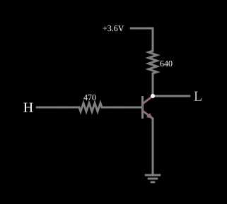

# Inversor RTL

<!-- navegacao:inicio -->
[Índice](README.md) · [Próximo: RTL NOR](rtlnor.md)
<!-- navegacao:fim -->

## Objetivo

Mostrar a porta mais simples da **lógica resistor-transistor (RTL)**, a primeira família lógica integrada: um único transistor NPN, com um resistor na base e outro no coletor, faz a função NÃO (inversor).

## O circuito

<!-- esquema:inicio -->

<!-- esquema:fim -->

A entrada lógica (que alterna entre $0$ e $3{,}6\ \text{V}$ com um clique) alimenta a base de um NPN ($\beta = 100$) através de $R_B = 470\ \Omega$. O coletor vai à alimentação de $3{,}6\ \text{V}$ através de $R_C = 640\ \Omega$ e é a saída, lida por uma saída lógica com limiar de $2{,}5\ \text{V}$. O emissor está na terra. Os valores e a tensão de $3{,}6\ \text{V}$ são os da família RTL clássica. O exemplo abre com a entrada em $3{,}6\ \text{V}$.

<!-- componentes:inicio -->
| N.º | Tipo | Elemento | Valores |
|----:|------|----------|---------|
| 0 | `ResistorElm` | resistor | Resistance (ohms) = 470 |
| 1 | `NTransistorElm` | transistor | Beta/hFE = 100; Swap E/C = não; Draw Circle = não; Model = default |
| 2 | `ResistorElm` | resistor | Resistance (ohms) = 640 |
| 4 | `LogicInputElm` | logic input | Momentary Switch = não; High Logic Voltage = 3.6; Low Voltage = 0; Numeric = não; Ternary = não; Keyboard Shortcut =  |
| 5 | `RailElm` | voltage source | Voltage = 3.6; Waveform = D/C; DC Offset (V) = 0; Internal Resistance (ohms) = 0 |
| 6 | `LogicOutputElm` | logic output | Threshold = 2.5; Current Required = não; Numeric = não; Ternary = não |
| 7 | `GroundElm` | ground | Symbol = Earth |
<!-- componentes:fim -->

## Teoria

O transistor trabalha como chave, entre o **corte** e a **saturação** (ver [Transistor como chave](transswitch.md)):

- **Entrada baixa ($0\ \text{V}$):** não há corrente de base, o transistor corta e $R_C$ puxa a saída para $V_{CC} = 3{,}6\ \text{V}$ (um lógico).
- **Entrada alta ($3{,}6\ \text{V}$):** a corrente de base é

$$I_B = \frac{V_{in} - V_{BE}}{R_B} \approx \frac{3{,}6 - 0{,}67}{470} \approx 6{,}2\ \text{mA},$$

muito maior que a necessária para a corrente de coletor que o resistor permite, $I_C \le V_{CC}/R_C \approx 5{,}6\ \text{mA}$ (bastaria $I_C/\beta \approx 56\ \mu\text{A}$). O transistor está profundamente saturado e a saída cai para $V_{CE(sat)}$, algumas dezenas de milivolts (zero lógico).

A saída é, portanto, $Y = \overline{A}$. O excesso de corrente de base é o que dá margem para a porta acionar outras entradas RTL (*fan-out*), mas é também a razão da lentidão da RTL: a carga armazenada na base saturada tem de ser retirada antes de o transistor cortar.

## Resultados esperados

Com a entrada em $3{,}6\ \text{V}$, o simulador dá a saída em $27{,}7\ \text{mV}$, a corrente de base em $6{,}23\ \text{mA}$ e a de coletor em $5{,}58\ \text{mA}$ (o sinal negativo nas verificações é só o sentido de referência do resistor de coletor). A alimentação fornece então $5{,}58\ \text{mA}$, cerca de $20\ \text{mW}$. Com a entrada em $0$, a saída sobe para $3{,}6\ \text{V}$ e a corrente da alimentação cai para a fuga do transistor cortado (picoampères).

| Entrada | Saída | Estado |
|--------:|------:|--------|
| $0$ | $3{,}6\ \text{V}$ | 1 |
| $3{,}6\ \text{V}$ | $27{,}7\ \text{mV}$ | 0 |

## O que observar

Clique na entrada e veja a saída inverter; repare na grande corrente de base comparada à de coletor, sinal de saturação profunda. As portas [RTL NOR](rtlnor.md) e [RTL NAND](rtlnand.md) usam a mesma célula com mais transistores.

## Limites do modelo

- A saída não tem carga: numa cadeia de portas RTL, o nível alto cai bastante, porque cada entrada ligada à saída puxa corrente pelo seu $R_B$.
- O modelo de transistor não tem capacitâncias nem tempo de armazenamento: a comutação aqui é instantânea, ao contrário da RTL real, cuja lentidão vem justamente da saturação.
- A porta consome corrente de forma estática quando a saída está baixa, o que é próprio da RTL.

## Referências

Sedra e Smith, *Microelectronic Circuits*, capítulo sobre famílias lógicas bipolares; Hodges, Jackson e Saleh, *Analysis and Design of Digital Integrated Circuits*, capítulo sobre lógica bipolar.

O circuito deste exemplo faz parte da coleção do simulador original de Paul Falstad e Iain Sharp (CircuitJS1); a explicação é deste projeto.
