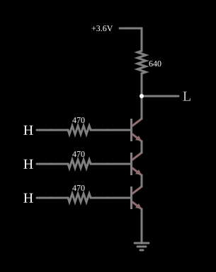

# Porta NAND RTL

<!-- navegacao:inicio -->
[Índice](README.md) · [Anterior: RTL NOR](rtlnor.md)
<!-- navegacao:fim -->

## Objetivo

Mostrar a porta **NAND** em RTL: três transistores **em série** entre a saída e a terra, de modo que a saída só desce quando todos conduzem.

## O circuito

<!-- esquema:inicio -->

<!-- esquema:fim -->

Três NPN ($\beta = 100$) estão empilhados: o coletor do de cima é a saída, ligada a $3{,}6\ \text{V}$ por $640\ \Omega$; o emissor de cada um vai ao coletor do de baixo, e o emissor do último vai à terra. Cada base recebe uma entrada lógica ($0$ ou $3{,}6\ \text{V}$) por um resistor de $470\ \Omega$. O exemplo abre com as três entradas em $3{,}6\ \text{V}$.

<!-- componentes:inicio -->
| N.º | Tipo | Elemento | Valores |
|----:|------|----------|---------|
| 0 | `RailElm` | voltage source | Voltage = 3.6; Waveform = D/C; DC Offset (V) = 0; Internal Resistance (ohms) = 0 |
| 1 | `GroundElm` | ground | Symbol = Earth |
| 2 | `NTransistorElm` | transistor | Beta/hFE = 100; Swap E/C = não; Draw Circle = não; Model = default |
| 4 | `ResistorElm` | resistor | Resistance (ohms) = 640 |
| 5 | `NTransistorElm` | transistor | Beta/hFE = 100; Swap E/C = não; Draw Circle = não; Model = default |
| 6 | `NTransistorElm` | transistor | Beta/hFE = 100; Swap E/C = não; Draw Circle = não; Model = default |
| 10 | `ResistorElm` | resistor | Resistance (ohms) = 470 |
| 11 | `ResistorElm` | resistor | Resistance (ohms) = 470 |
| 12 | `ResistorElm` | resistor | Resistance (ohms) = 470 |
| 13 | `LogicInputElm` | logic input | Momentary Switch = não; High Logic Voltage = 3.6; Low Voltage = 0; Numeric = não; Ternary = não; Keyboard Shortcut =  |
| 14 | `LogicInputElm` | logic input | Momentary Switch = não; High Logic Voltage = 3.6; Low Voltage = 0; Numeric = não; Ternary = não; Keyboard Shortcut =  |
| 15 | `LogicInputElm` | logic input | Momentary Switch = não; High Logic Voltage = 3.6; Low Voltage = 0; Numeric = não; Ternary = não; Keyboard Shortcut =  |
| 16 | `LogicOutputElm` | logic output | Threshold = 2.5; Current Required = não; Numeric = não; Ternary = não |
<!-- componentes:fim -->

## Teoria

Um caminho em série só conduz se **todas** as chaves estiverem fechadas. Basta uma entrada baixa para cortar o seu transistor, interromper o caminho e deixar o resistor puxar a saída para $3{,}6\ \text{V}$:

$$Y = \overline{A \cdot B \cdot C}.$$

Com as três entradas altas, a saída fica na soma das três tensões de saturação. Isso é o defeito da NAND em RTL: o nível baixo sobe com o número de entradas, e os transistores de cima têm o emissor acima da terra, o que reduz a sua corrente de base. Por isso a NOR, e não a NAND, era a porta natural da RTL.

## Resultados esperados

Com as três entradas altas, o simulador dá a saída em $0{,}105\ \text{V}$, cerca de quatro vezes o nível baixo de um único transistor ($27{,}7\ \text{mV}$ no [Inversor RTL](rtlinverter.md)), e a alimentação fornece $5{,}46\ \text{mA}$. Com qualquer entrada baixa a saída vai a $3{,}6\ \text{V}$:

| Entradas | Saída |
|----------|------:|
| as três altas | $0{,}105\ \text{V}$ |
| qualquer uma baixa | $3{,}6\ \text{V}$ |

## O que observar

Clique em qualquer entrada e veja a saída subir; só a combinação "todas altas" a faz descer. Compare o nível baixo com o da [RTL NOR](rtlnor.md).

## Limites do modelo

- O nível baixo de $0{,}105\ \text{V}$ ainda está longe do limiar, mas com mais entradas ou com carga a margem de ruído encolhe.
- O modelo não tem capacitâncias: a pilha de transistores saturados seria lenta numa porta real.
- As entradas são fontes ideais.

## Referências

Sedra e Smith, *Microelectronic Circuits*, capítulo sobre famílias lógicas bipolares; Hodges, Jackson e Saleh, *Analysis and Design of Digital Integrated Circuits*.

O circuito deste exemplo faz parte da coleção do simulador original de Paul Falstad e Iain Sharp (CircuitJS1); a explicação é deste projeto.
