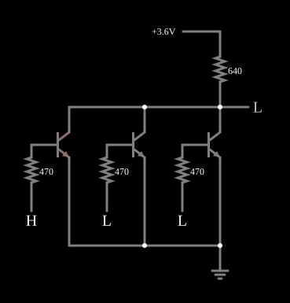

# Porta NOR RTL

<!-- navegacao:inicio -->
[Índice](README.md) · [Anterior: RTL Inverter](rtlinverter.md) · [Próximo: RTL NAND](rtlnand.md)
<!-- navegacao:fim -->

## Objetivo

Mostrar como a lógica RTL faz a porta **NOR**: vários transistores em paralelo dividem o mesmo resistor de coletor, e qualquer um deles que conduza puxa a saída para baixo. A NOR foi a porta básica da RTL (o computador de navegação da Apollo foi construído só com NORs de três entradas, numa família parente desta).

## O circuito

<!-- esquema:inicio -->

<!-- esquema:fim -->

Três entradas lógicas ($0$ ou $3{,}6\ \text{V}$) alimentam, cada uma por um resistor de $470\ \Omega$, a base de um NPN ($\beta = 100$). Os três coletores estão ligados entre si e à alimentação de $3{,}6\ \text{V}$ por um único resistor de $640\ \Omega$; os três emissores estão na terra. O nó dos coletores é a saída. O exemplo abre com a primeira entrada (elemento 11) em $3{,}6\ \text{V}$ e as outras duas em $0$.

<!-- componentes:inicio -->
| N.º | Tipo | Elemento | Valores |
|----:|------|----------|---------|
| 0 | `NTransistorElm` | transistor | Beta/hFE = 100; Swap E/C = não; Draw Circle = não; Model = default |
| 1 | `NTransistorElm` | transistor | Beta/hFE = 100; Swap E/C = não; Draw Circle = não; Model = default |
| 2 | `NTransistorElm` | transistor | Beta/hFE = 100; Swap E/C = não; Draw Circle = não; Model = default |
| 8 | `ResistorElm` | resistor | Resistance (ohms) = 470 |
| 9 | `ResistorElm` | resistor | Resistance (ohms) = 470 |
| 10 | `ResistorElm` | resistor | Resistance (ohms) = 470 |
| 11 | `LogicInputElm` | logic input | Momentary Switch = não; High Logic Voltage = 3.6; Low Voltage = 0; Numeric = não; Ternary = não; Keyboard Shortcut =  |
| 12 | `LogicInputElm` | logic input | Momentary Switch = não; High Logic Voltage = 3.6; Low Voltage = 0; Numeric = não; Ternary = não; Keyboard Shortcut =  |
| 13 | `LogicInputElm` | logic input | Momentary Switch = não; High Logic Voltage = 3.6; Low Voltage = 0; Numeric = não; Ternary = não; Keyboard Shortcut =  |
| 19 | `ResistorElm` | resistor | Resistance (ohms) = 640 |
| 20 | `GroundElm` | ground | Symbol = Earth |
| 21 | `RailElm` | voltage source | Voltage = 3.6; Waveform = D/C; DC Offset (V) = 0; Internal Resistance (ohms) = 0 |
| 22 | `LogicOutputElm` | logic output | Threshold = 2.5; Current Required = não; Numeric = não; Ternary = não |
<!-- componentes:fim -->

## Teoria

Cada transistor é o mesmo da célula do [Inversor RTL](rtlinverter.md): com a entrada alta ele satura, com a entrada baixa ele corta. Como os transistores estão em **paralelo** entre a saída e a terra, basta um saturado para a saída ficar em $V_{CE(sat)}$:

$$Y = \overline{A + B + C}.$$

Só com as três entradas baixas os três transistores cortam e o resistor puxa a saída para $3{,}6\ \text{V}$. Quando mais de um transistor conduz, a mesma corrente de coletor ($\approx V_{CC}/R_C$) é dividida entre eles; cada um fica ainda mais saturado e a tensão de saída diminui um pouco.

## Resultados esperados

O simulador dá:

| Entradas altas | Saída |
|---------------:|------:|
| nenhuma | $3{,}6\ \text{V}$ |
| uma | $27{,}7\ \text{mV}$ |
| duas | $23{,}3\ \text{mV}$ |
| três | $21{,}6\ \text{mV}$ |

O resultado depende só de quantas entradas estão altas, não de quais. Com uma entrada alta, a alimentação fornece $5{,}58\ \text{mA}$ ao coletor, a mesma corrente do inversor.

## O que observar

Clique nas entradas e confirme a tabela da NOR. Compare com a [RTL NAND](rtlnand.md), que põe os transistores em série em vez de em paralelo.

## Limites do modelo

- As entradas são fontes ideais; numa cadeia RTL real, as entradas são saídas de outras portas, e o nível alto cai com a carga.
- Transistores com bases ligadas diretamente (sem resistor) sofreriam de *current hogging*; aqui cada base tem o seu resistor, e o modelo não tem a dispersão de $V_{BE}$ que torna o problema real.
- Sem capacitâncias, a comutação é instantânea.

## Referências

Sedra e Smith, *Microelectronic Circuits*, capítulo sobre famílias lógicas bipolares; Hodges, Jackson e Saleh, *Analysis and Design of Digital Integrated Circuits*.

O circuito deste exemplo faz parte da coleção do simulador original de Paul Falstad e Iain Sharp (CircuitJS1); a explicação é deste projeto.
