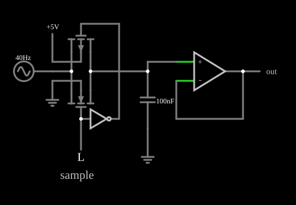

# Amostrador-retentor (sample-and-hold)

<!-- navegacao:inicio -->
[Índice](README.md) · [Anterior: CMOS Multiplexer](mux.md) · [Próximo: Delayed Buffer](delayrc.md)
<!-- navegacao:fim -->

## Objetivo

Mostrar o **amostrador-retentor** (*sample-and-hold*), o circuito que "congela" o valor de um sinal que varia: durante a amostragem, um capacitor acompanha a entrada; ao final, a chave abre e o capacitor mantém a tensão, que um amplificador seguidor entrega à saída sem descarregá-lo.

## O circuito

<!-- esquema:inicio -->

<!-- esquema:fim -->

Uma porta de transmissão CMOS (um PMOS e um NMOS, com diodo de corpo) liga uma fonte senoidal de $0$ a $5\ \text{V}$ ($40\ \text{Hz}$) a um capacitor de $100\ \text{nF}$. A porta é controlada por um botão (entrada lógica momentânea) e, por um inversor, pelo sinal complementar. A tensão do capacitor entra num amplificador operacional ligado como seguidor (ganho $1$, impedância de entrada infinita), cuja saída é a saída do circuito. Dois osciloscópios mostram a entrada e a saída.

<!-- componentes:inicio -->
| N.º | Tipo | Elemento | Valores |
|----:|------|----------|---------|
| 0 | `PMosfetElm` | MOSFET | Model = default-body; Swap D/S = não |
| 1 | `NMosfetElm` | MOSFET | Model = default-body; Swap D/S = não |
| 4 | `InverterElm` | inverter | Slew Rate (V/ns) = 500m; High Logic Voltage = 5; DeMorgan's Symbol = não |
| 5 | `LogicInputElm` | logic input | Momentary Switch = sim; High Logic Voltage = 5; Low Voltage = 0; Numeric = não; Ternary = não; Keyboard Shortcut =  |
| 7 | `CapacitorElm` | capacitor | Capacitance (F) = 100n; Trapezoidal Approximation = sim; Initial Voltage (on Reset) = 1m; Series Resistance = 0 |
| 8 | `GroundElm` | ground | Symbol = Earth |
| 9 | `OpAmpElm` | op-amp | Max Output (V) = 15; Min Output (V) = -15; Gain = 100k |
| 15 | `OutputElm` | output | Show Voltage = não |
| 16 | `RailElm` | A/C source | Max Voltage = 2.5; Waveform = A/C; DC Offset (V) = 2.5; Internal Resistance (ohms) = 0; Show Voltage = não; Frequency (Hz) = 40; Phase Offset (degrees) = 0 |
| 18 | `TextElm` | text | Text = sample; Size = 20; Draw Bar On Top = não; Color = #c0c0c0 |
| 24 | `GroundElm` | ground | Symbol = Earth |
| 26 | `RailElm` | voltage source | Voltage = 5; Waveform = D/C; DC Offset (V) = 0; Internal Resistance (ohms) = 0 |
<!-- componentes:fim -->

## Teoria

**Amostragem.** Com o botão apertado, a porta de transmissão fica ligada com resistência $R_{on} \approx 15$ a $25\ \Omega$ (veja [Porta de transmissão CMOS](cmostransgate.md)) e o capacitor segue a entrada com a constante de tempo $\tau = R_{on}C \approx 2{,}5\ \mu\text{s}$. O erro de acompanhamento de um sinal que varia é

$$\varepsilon \approx \tau\,\frac{dv_{in}}{dt}, \qquad \left|\frac{dv_{in}}{dt}\right|_{max} = 2\pi f A = 2\pi \cdot 40 \cdot 2{,}5 \approx 628\ \text{V/s} \ \Rightarrow\ \varepsilon_{max} \approx 1{,}6\ \text{mV}.$$

**Retenção.** Soltando o botão, a porta abre e o capacitor mantém a carga: $V_C$ fica quase constante, pois o seguidor tem corrente de entrada nula. A única perda é a fuga da porta aberta (no modelo, uma condutância de $10^{-8}\ \text{S}$ por transistor), que faz a tensão cair a uma taxa

$$\frac{dV_C}{dt} = -\frac{I_{fuga}}{C} \approx -\frac{g_{fuga}\,\Delta V}{C}.$$

Há também um erro no instante em que a porta abre (injeção de carga e atraso de abertura), que o modelo sem capacitâncias não tem.

## Resultados esperados

No estado inicial (botão solto), o capacitor guarda $3{,}640\ \text{V}$ (valor do arquivo) e a saída o repete, enquanto a entrada oscila. Apertando o botão em $6{,}25\ \text{ms}$ e soltando-o em $10\ \text{ms}$ (as verificações reproduzem os dois cliques com `alterna`): em $9{,}9\ \text{ms}$ o capacitor tem $4{,}0233\ \text{V}$ contra $4{,}0223\ \text{V}$ da entrada: o erro de acompanhamento é de $1{,}0\ \text{mV}$, abaixo do máximo previsto de $1{,}6\ \text{mV}$ (a inclinação é de cerca de $500\ \text{V/s}$ nesse instante, que dá $1{,}25\ \text{mV}$ com $2{,}5\ \mu\text{s}$). Depois de solto, a saída fica em $3{,}9714\ \text{V}$ em $12{,}5\ \text{ms}$, quando a entrada já desceu a $2{,}503\ \text{V}$; em $20\ \text{ms}$ vale $3{,}9666\ \text{V}$ (a entrada está em $0{,}12\ \text{V}$) e em $50\ \text{ms}$, $3{,}9564\ \text{V}$: uma queda de $17\ \text{mV}$ em $40\ \text{ms}$, ou $0{,}41\ \text{V/s}$, que corresponde a uma corrente de fuga de $C \cdot dV/dt = 41\ \text{nA}$, a ordem do $10^{-8}\ \text{S} \cdot 4\ \text{V}$ previsto. As verificações conferem a tensão inicial, o acompanhamento e a retenção em quatro instantes.

## O que observar

Nos osciloscópios, a entrada oscila e a saída fica horizontal depois de o botão ser solto. Clique no botão (aperte e solte) em instantes diferentes do ciclo e veja a saída guardar a tensão que a entrada tinha ao soltar. Para testar: reduza o capacitor para $10\ \text{nF}$ e veja o erro de acompanhamento cair e a queda por fuga aumentar (dez vezes); aumente-o e veja o contrário. Essa é a troca básica do projeto de um amostrador: um capacitor pequeno acompanha rápido e mantém mal.

## Limites do modelo

- Sem capacitâncias nos transistores, o modelo não tem a **injeção de carga** nem a **transferência de clock** (*clock feedthrough*) que, num circuito real, causam um salto na tensão retida (*pedestal*) quando a chave abre.
- O amplificador operacional é ideal (largura de banda infinita); num circuito real o seguidor limita a taxa de variação.
- A fuga de $10^{-8}\ \text{S}$ do modelo é muito maior do que a de uma chave CMOS real e é a única causa do *droop* aqui.
- O erro de acompanhamento depende da resistência de ligado, que varia com a tensão de entrada.

## Referências

Sedra e Smith, *Microelectronic Circuits*, capítulos sobre o MOSFET, a lógica CMOS e os circuitos de capacitor chaveado; Weste e Harris, *CMOS VLSI Design*.

O circuito deste exemplo faz parte da coleção do simulador original de Paul Falstad e Iain Sharp (CircuitJS1); a explicação é deste projeto.
