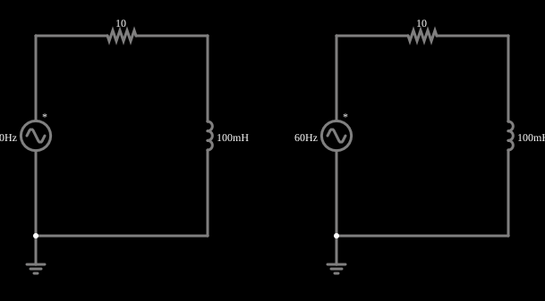

# Excitação baixa e alta num indutor saturável

<!-- navegacao:inicio -->
[Índice](README.md) · [Anterior: Saturable vs Linear Inductor (DC)](satcore-inductor.md) · [Próximo: Transformer with Saturable Core](satcore-transformer.md)
<!-- navegacao:fim -->

## Objetivo

Mostrar que a saturação só aparece quando a excitação é grande: o mesmo indutor saturável, ligado a uma fonte alternada de $2\ \text{V}$, se comporta como um indutor linear; ligado a uma de $20\ \text{V}$, sua corrente se deforma e passa de três vezes o valor linear.

## O circuito

<!-- esquema:inicio -->

<!-- esquema:fim -->

Dois circuitos iguais, cada um com uma fonte senoidal de $60\ \text{Hz}$, um resistor de $10\ \Omega$ e um indutor saturável de $100\ \text{mH}$ ($I_{sat} = 0{,}3\ \text{A}$). A fonte da esquerda tem $2\ \text{V}$ de pico; a da direita, $20\ \text{V}$. Dois osciloscópios mostram as correntes.

<!-- componentes:inicio -->
| N.º | Tipo | Elemento | Valores |
|----:|------|----------|---------|
| 0 | `VoltageElm` | A/C source | Max Voltage = 2; Waveform = A/C; DC Offset (V) = 0; Internal Resistance (ohms) = 0; Show Voltage = não; Frequency (Hz) = 60; Phase Offset (degrees) = 0 |
| 1 | `ResistorElm` | resistor | Resistance (ohms) = 10 |
| 2 | `InductorElm` | inductor (sat) | Inductance (H) = 100m; Trapezoidal Approximation = sim; Initial Current (on Reset) (A) = 0; Saturation Current (A) (0=none) = 300m |
| 4 | `GroundElm` | ground | Symbol = Earth |
| 5 | `VoltageElm` | A/C source | Max Voltage = 20; Waveform = A/C; DC Offset (V) = 0; Internal Resistance (ohms) = 0; Show Voltage = não; Frequency (Hz) = 60; Phase Offset (degrees) = 0 |
| 6 | `ResistorElm` | resistor | Resistance (ohms) = 10 |
| 7 | `InductorElm` | inductor (sat) | Inductance (H) = 100m; Trapezoidal Approximation = sim; Initial Current (on Reset) (A) = 0; Saturation Current (A) (0=none) = 300m |
| 9 | `GroundElm` | ground | Symbol = Earth |
<!-- componentes:fim -->

## Teoria

Com um indutor linear de $L_0 = 100\ \text{mH}$, a impedância a $60\ \text{Hz}$ é $|Z| = |R + j\omega L_0| = |10 + j37{,}7| = 39{,}0\ \Omega$ e a corrente de pico vale $V_p/39{,}0$. Com o indutor saturável, a indutância efetiva

$$L(i) = \frac{L_0}{1 + (i/I_{sat})^2},\qquad v = L(i)\frac{di}{dt}$$

diminui nos picos de corrente; então, quando o pico previsto pela fórmula linear já passa de $I_{sat}$, a corrente é bem maior que a prevista e sua forma deixa de ser senoidal: tem picos finos e vales largos (a forma de onda "pontuda" típica de núcleos saturados, rica em harmônicos ímpares).

## Resultados esperados

**Fonte de $2\ \text{V}$:** o pico linear previsto é $2/39{,}0 = 51{,}3\ \text{mA}$, muito abaixo de $I_{sat}$, e a indutância quase não diminui; a integração numérica dá $51{,}76\ \text{mA}$ de pico e $36{,}52\ \text{mA}$ eficazes (o desvio de menos de 1% em relação ao linear é a pequena queda de $L$).

**Fonte de $20\ \text{V}$:** o pico linear previsto é $20/39{,}0 = 512{,}8\ \text{mA}$, mas com a saturação a integração dá $1{,}538\ \text{A}$ de pico (três vezes mais) e $0{,}808\ \text{A}$ eficazes.

As verificações conferem os picos e os valores eficazes dos dois circuitos, numa janela de um ciclo em regime (de $0{,}5$ a $0{,}5167\ \text{s}$), com tolerância de 2%; o simulador fica a menos de 0,2% da integração numérica.

## O que observar

- Compare as duas correntes nos osciloscópios: a da esquerda é uma senoide limpa, a da direita tem a forma deformada, com picos altos.
- Aumente aos poucos a tensão da fonte da esquerda: a corrente começa a se deformar perto de $12\ \text{V}$, onde o pico linear previsto chega a $I_{sat} = 0{,}3\ \text{A}$.
- Este é o comportamento de um transformador alimentado com mais tensão do que o núcleo suporta: a corrente de magnetização dispara.

## Limites do modelo

O modelo de saturação é o mesmo simplificado do exemplo anterior, sem histerese. A janela de medição começa em $0{,}5\ \text{s}$, depois de o transitório inicial (que desloca a corrente para um lado) ter decaído; no início, a corrente tem uma componente contínua que decai com a constante $L/R$.

## Referências

- C. K. Alexander e M. N. O. Sadiku, *Fundamentos de Circuitos Elétricos*, AMGH.
- P. Horowitz e W. Hill, *The Art of Electronics*, Cambridge University Press.

O circuito deste exemplo faz parte da coleção do simulador original de Paul Falstad e Iain Sharp (CircuitJS1); a explicação é deste projeto.
