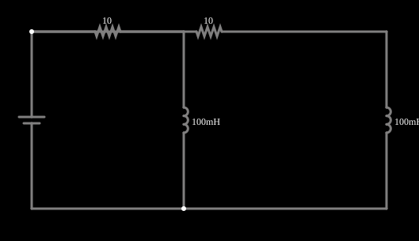

# Indutor saturável contra indutor linear

<!-- navegacao:inicio -->
[Índice](README.md) · [Próximo: Low vs High Drive (AC Saturation)](satcore-comparison.md)
<!-- navegacao:fim -->

## Objetivo

Mostrar o efeito da saturação do núcleo de um indutor: quando a corrente passa de um limite, a indutância cai, e a corrente cresce muito mais depressa do que num indutor linear.

## O circuito

<!-- esquema:inicio -->

<!-- esquema:fim -->

Dois ramos idênticos, cada um com um resistor de $10\ \Omega$ em série com um indutor de $100\ \text{mH}$, são ligados à mesma fonte de $10\ \text{V}$ contínuos. No ramo da esquerda o indutor é **saturável**, com corrente de saturação $I_{sat} = 0{,}3\ \text{A}$; no da direita é linear. Um osciloscópio mostra as correntes dos dois.

<!-- componentes:inicio -->
| N.º | Tipo | Elemento | Valores |
|----:|------|----------|---------|
| 0 | `VoltageElm` | voltage source | Voltage = 10; Waveform = D/C; DC Offset (V) = 0; Internal Resistance (ohms) = 0; Show Voltage = não; Circle Symbol = não |
| 1 | `ResistorElm` | resistor | Resistance (ohms) = 10 |
| 2 | `InductorElm` | inductor (sat) | Inductance (H) = 100m; Trapezoidal Approximation = sim; Initial Current (on Reset) (A) = 0; Saturation Current (A) (0=none) = 300m |
| 5 | `ResistorElm` | resistor | Resistance (ohms) = 10 |
| 6 | `InductorElm` | inductor | Inductance (H) = 100m; Trapezoidal Approximation = sim; Initial Current (on Reset) (A) = 0; Saturation Current (A) (0=none) = 0 |
<!-- componentes:fim -->

## Teoria

Num indutor com núcleo ferromagnético, o fluxo satura quando a corrente é alta, e a indutância efetiva cai. O simulador usa

$$L(i) = \frac{L_0}{1 + (i/I_{sat})^2},\qquad v = L(i)\,\frac{di}{dt},$$

de modo que $L(i) = L_0/2$ quando $i = I_{sat}$ e $L \to 0$ para $i \gg I_{sat}$.

**Indutor linear.** A equação $V = R\,i + L_0\,di/dt$ tem a solução $i(t) = \dfrac{V}{R}\left(1 - e^{-t/\tau}\right)$ com $\tau = L_0/R = 10\ \text{ms}$.

**Indutor saturável.** A equação $V - R\,i = L(i)\,di/dt$ não tem solução tão simples, mas se integra numericamente. A corrente final é a mesma, $V/R = 1\ \text{A}$ (em regime, $di/dt = 0$ e o indutor não importa), mas o caminho é outro: assim que a corrente passa de $I_{sat}$, a indutância despenca e a corrente "dispara".

## Resultados esperados

Integrando a equação do indutor saturável (e usando a fórmula acima para o linear):

| $t$ | saturável | linear |
|----:|----------:|-------:|
| $2\ \text{ms}$ | $0{,}2053\ \text{A}$ | $0{,}1813\ \text{A}$ |
| $5\ \text{ms}$ | $0{,}7054\ \text{A}$ | $0{,}3935\ \text{A}$ |
| $10\ \text{ms}$ | $0{,}9986\ \text{A}$ | $0{,}6321\ \text{A}$ |
| $20\ \text{ms}$ | $1{,}0000\ \text{A}$ | $0{,}8647\ \text{A}$ |

As verificações conferem a corrente do saturável em $2$, $5$ e $10\ \text{ms}$ e a do linear em $5$ e $10\ \text{ms}$, com tolerância de 2% (o simulador fica a menos de 0,3% da integração numérica).

## O que observar

- No gráfico, a corrente do indutor saturável tem um "joelho": sobe devagar até perto de $0{,}3\ \text{A}$ e depois depressa. A do linear é a exponencial suave de sempre.
- Reinicie a simulação e compare os instantes em que cada corrente passa de $0{,}5\ \text{A}$.
- Mude $I_{sat}$ (duplo clique no indutor): quanto maior, mais o saturável se parece com o linear.

## Limites do modelo

A fórmula $L_0/(1+(i/I_{sat})^2)$ é um modelo simples da curva de magnetização, não o resultado de um modelo de histerese; indutores reais têm uma curva $B$–$H$ com histerese e saturação mais abrupta, que dependem do material. O simulador avalia a indutância com a corrente do passo anterior.

## Referências

- C. K. Alexander e M. N. O. Sadiku, *Fundamentos de Circuitos Elétricos*, AMGH.
- P. Horowitz e W. Hill, *The Art of Electronics*, Cambridge University Press.

O circuito deste exemplo faz parte da coleção do simulador original de Paul Falstad e Iain Sharp (CircuitJS1); a explicação é deste projeto.
