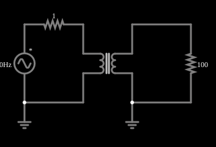

# Transformador com núcleo saturável

<!-- navegacao:inicio -->
[Índice](README.md) · [Anterior: Low vs High Drive (AC Saturation)](satcore-comparison.md)
<!-- navegacao:fim -->

## Objetivo

Mostrar um transformador cujos enrolamentos têm indutância que cai com a corrente (saturação), e o que isso muda nas formas de onda, e discutir as limitações desse modelo.

## O circuito

<!-- esquema:inicio -->

<!-- esquema:fim -->

Uma fonte senoidal de $20\ \text{V}$ de pico e $60\ \text{Hz}$, com $1\ \Omega$ em série, alimenta o primário (de $4\ \text{H}$) de um transformador $1{:}1$ com saturação ($I_{sat} = 0{,}5\ \text{A}$), cujo secundário alimenta um resistor de $100\ \Omega$. Dois osciloscópios mostram as tensões da fonte e da carga.

<!-- componentes:inicio -->
| N.º | Tipo | Elemento | Valores |
|----:|------|----------|---------|
| 0 | `VoltageElm` | A/C source | Max Voltage = 20; Waveform = A/C; DC Offset (V) = 0; Internal Resistance (ohms) = 0; Show Voltage = não; Frequency (Hz) = 60; Phase Offset (degrees) = 0 |
| 2 | `TransformerElm` | transformer (sat) | Primary Inductance (H) = 4; Ratio (N1/N2) = 1; Coupling Coefficient = 999m; Trapezoidal Approximation = sim; Swap Secondary Polarity = não; Saturation Current (A) (0=none) = 500m |
| 5 | `ResistorElm` | resistor | Resistance (ohms) = 1 |
| 9 | `ResistorElm` | resistor | Resistance (ohms) = 100 |
| 11 | `GroundElm` | ground | Symbol = Earth |
| 12 | `GroundElm` | ground | Symbol = Earth |
<!-- componentes:fim -->

## Teoria

Dois enrolamentos que compartilham fluxo magnético formam um transformador. Com indutâncias próprias $L_1$ e $L_2$ e indutância mútua $M = k\sqrt{L_1 L_2}$ (o coeficiente de acoplamento $k$ vale $0{,}999$ nestes exemplos),

$$v_1 = L_1\frac{di_1}{dt} - M\frac{di_2}{dt},\qquad v_2 = M\frac{di_1}{dt} - L_2\frac{di_2}{dt},$$

com $i_2$ a corrente que o secundário entrega à carga. A razão de espiras $n = N_1/N_2$ liga as indutâncias, $L_2 = L_1/n^2$. No limite ideal ($k \to 1$, $L_1\to\infty$):

$$\frac{V_2}{V_1} = \frac{1}{n},\qquad \frac{I_2}{I_1} = n,\qquad Z_{refletida} = n^2 R_L,$$

e a potência se conserva ($V_1 I_1 = V_2 I_2$). Em regime senoidal, com $R_s$ a resistência em série com a fonte, $Z_1 = R_s + j\omega L_1$ e $Z_2 = R_L + j\omega L_2$, a resolução exata do circuito dá

$$I_1 = \frac{V\,Z_2}{Z_1 Z_2 + \omega^2 M^2},\qquad \frac{V_L}{V} = \frac{j\omega M\,R_L}{Z_1 Z_2 + \omega^2 M^2}.$$

A diferença para o caso ideal vem da indutância de magnetização finita (que consome uma corrente reativa $V/\omega L_1$), da indutância de dispersão $(1-k^2)L_1$ e da resistência série $R_s$.

Com saturação, o simulador usa para cada enrolamento a indutância efetiva $L_{k}(i_k) = L_k/(1 + (i_k/I_k)^2)$, com $I_1 = I_{sat}$ e $I_2 = n\,I_{sat}$, e recalcula $M = k\sqrt{L_{1}(i_1)\,L_{2}(i_2)}$ a cada passo:

$$\begin{pmatrix} L_1(i_1) & -M \\ -M & L_2(i_2) \end{pmatrix}\begin{pmatrix}\dot i_1\\ \dot i_2\end{pmatrix} = \begin{pmatrix} v_s - R_s i_1 \\ -R_L i_2\end{pmatrix}.$$

## Resultados esperados

Integrando essas equações (com $L_1 = 4\ \text{H}$, $k = 0{,}999$) e comparando com o mesmo transformador sem saturação:

| grandeza | com saturação | sem saturação |
|:---------|--------------:|--------------:|
| tensão de pico na carga | $20{,}30\ \text{V}$ | $19{,}79\ \text{V}$ |
| corrente eficaz da fonte | $146{,}2\ \text{mA}$ | $140{,}7\ \text{mA}$ |
| corrente eficaz da carga | $140{,}2\ \text{mA}$ | $139{,}8\ \text{mA}$ |
| corrente de pico da fonte | $242{,}4\ \text{mA}$ | $209{,}8\ \text{mA}$ |

A corrente do primário aumenta com a saturação (a indutância de magnetização efetiva cai nos picos) e fica deformada. As verificações conferem os valores da coluna "com saturação", numa janela de um ciclo em regime (de $0{,}5$ a $0{,}5167\ \text{s}$), com tolerância de 2% e 3%; o simulador fica a menos de 0,4% da integração numérica.

## O que observar

- A corrente da fonte tem picos mais altos e pontudos que a da carga: é a corrente de magnetização, deformada pela saturação.
- A tensão de pico da carga passa um pouco de $20\ \text{V}$, mais que a da fonte. **Isto é um artefato do modelo**, e não o comportamento de um transformador real: como a saturação é aplicada a cada enrolamento pela *sua própria* corrente (e não ao fluxo líquido do núcleo), com carga as correntes dos dois enrolamentos são grandes e quase opostas, o fluxo líquido é pequeno, e um núcleo real nem chegaria perto de saturar.
- Diminua $I_{sat}$ (duplo clique no transformador) e veja a corrente da fonte se deformar mais.

## Limites do modelo

Este é o exemplo em que o modelo mais se afasta da física. A saturação de um transformador real depende do fluxo no núcleo, que é proporcional à diferença das ampères-espiras ($N_1 i_1 - N_2 i_2$), isto é, à corrente de magnetização; o modelo do simulador a calcula por enrolamento e não tem histerese. Por isso os números (em particular a tensão acima da da fonte) devem ser lidos como uma demonstração qualitativa de como a saturação deforma a corrente, e não como uma previsão de um transformador real.

## Referências

- C. K. Alexander e M. N. O. Sadiku, *Fundamentos de Circuitos Elétricos*, AMGH.
- P. Horowitz e W. Hill, *The Art of Electronics*, Cambridge University Press.

O circuito deste exemplo faz parte da coleção do simulador original de Paul Falstad e Iain Sharp (CircuitJS1); a explicação é deste projeto.
