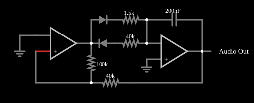

# Gerador de onda dente de serra

<!-- navegacao:inicio -->
[Índice](README.md) · [Anterior: Sine Wave Generator](sine.md) · [Próximo: Voltage-Controlled Oscillator](vco.md)
<!-- navegacao:fim -->

## Objetivo

Mostrar como o gerador de onda triangular se transforma em gerador de dente de serra: basta que o integrador carregue por um caminho lento e descarregue por um caminho rápido, escolhidos pelos dois diodos conforme o sinal do comparador.

## O circuito

<!-- esquema:inicio -->

<!-- esquema:fim -->

Como no gerador triangular, um comparador com histerese (operacional com resistores de $100\ \text{k}\Omega$ e $40\ \text{k}\Omega$) comanda um integrador (operacional com capacitor de $200\ \text{nF}$). A diferença está no caminho entre a saída do comparador e a entrada do integrador: dois ramos em paralelo, cada um com um diodo (em sentidos opostos), um resistor de $40\ \text{k}\Omega$ e outro de $1{,}5\ \text{k}\Omega$. Um elemento de saída de áudio e um osciloscópio mostram o dente de serra.

<!-- componentes:inicio -->
| N.º | Tipo | Elemento | Valores |
|----:|------|----------|---------|
| 0 | `OpAmpElm` | op-amp | Max Output (V) = 15; Min Output (V) = -15; Gain = 100k |
| 3 | `ResistorElm` | resistor | Resistance (ohms) = 100k |
| 4 | `OpAmpElm` | op-amp | Max Output (V) = 15; Min Output (V) = -15; Gain = 100k |
| 5 | `ResistorElm` | resistor | Resistance (ohms) = 40k |
| 9 | `CapacitorElm` | capacitor | Capacitance (F) = 200n; Trapezoidal Approximation = sim; Initial Voltage (on Reset) = 1m; Series Resistance = 0 |
| 11 | `GroundElm` | ground | Symbol = Earth |
| 13 | `GroundElm` | ground | Symbol = Earth |
| 14 | `ResistorElm` | resistor | Resistance (ohms) = 1.5k |
| 15 | `ResistorElm` | resistor | Resistance (ohms) = 40k |
| 16 | `DiodeElm` | diode | Model = default |
| 17 | `DiodeElm` | diode | Model = default |
| 19 | `AudioOutputElm` | audio output | Duration (s) = 1; Sampling Rate = 8000 |
<!-- componentes:fim -->

## Teoria

A tensão na entrada não inversora do comparador é a média ponderada da saída quadrada ($\pm V_\text{sat}$) e da saída do integrador, e o comparador muda de estado quando ela passa por zero, ou seja, quando o integrador chega a

$$\mp\,\frac{40\ \text{k}\Omega}{100\ \text{k}\Omega}\,V_\text{sat} = \mp\,6\ \text{V}.$$

Como a saída vai de $-6$ a $+6\ \text{V}$, o integrador percorre $\Delta V = 12\ \text{V}$. Quando o comparador está em $-15\ \text{V}$, só conduz o diodo que passa pelo resistor de $40\ \text{k}\Omega$ e a corrente é pequena; quando está em $+15\ \text{V}$, só conduz o outro diodo, com $1{,}5\ \text{k}\Omega$, e a corrente é grande. Com diodos ideais, as correntes são $V_\text{sat}/R_\text{lento}$ e $V_\text{sat}/R_\text{rápido}$ e os tempos de subida e de descida são

$$t_\text{lento} = \frac{\Delta V\,C\,R_\text{lento}}{V_\text{sat}}, \qquad t_\text{rápido} = \frac{\Delta V\,C\,R_\text{rápido}}{V_\text{sat}}.$$

Com $\Delta V = 12\ \text{V}$, $C = 200\ \text{nF}$ e $V_\text{sat} = 15\ \text{V}$:

$$T = t_\text{lento} + t_\text{rápido} = \frac{12\cdot 0{,}2\ \mu\text{F}\,(40\ \text{k}\Omega + 1{,}5\ \text{k}\Omega)}{15\ \text{V}} \approx 6{,}64\ \text{ms}, \quad f \approx 150{,}6\ \text{Hz}.$$

Os diodos reais caem $0{,}4$ a $0{,}7\ \text{V}$, o que reduz as correntes e alonga os tempos.

## Resultados esperados

O simulador, com os diodos do modelo, dá:

| Grandeza | Valor |
|----------|------:|
| Saída do integrador (dente de serra) | de $-6$ a $+6\ \text{V}$ (extremos medidos: $-5{,}999$ e $+6{,}028\ \text{V}$) |
| Saída do comparador | $\pm 15\ \text{V}$ |
| Frequência | $146{,}27\ \text{Hz}$ (contra $150{,}6\ \text{Hz}$ com diodos ideais) |
| Subida lenta | cerca de $6{,}6\ \text{ms}$; descida rápida: cerca de $0{,}25\ \text{ms}$ |

As verificações conferem a frequência (tolerância de 2%) e os extremos do dente de serra numa janela de $0{,}2\ \text{s}$.

## O que observar

- A forma de onda sobe devagar e cai quase na vertical: um dente de serra com subida lenta e descida rápida.
- Inverta o sentido dos dois diodos e a rampa lenta passa a ser a de descida.
- A corrente no ramo lento no instante $t = 50\ \text{ms}$ é de $0{,}365\ \text{mA}$, e a queda no diodo é de $0{,}40\ \text{V}$, o que explica a diferença para a frequência calculada com diodos ideais.

## Limites do modelo

Operacionais ideais, saturação em $\pm 15\ \text{V}$ e diodos de um modelo exponencial simples (sem tempo de recuperação). Em um circuito real, a queda dos diodos varia com a temperatura, por isso a frequência e a amplitude derivam.

## Referências

- A. S. Sedra e K. C. Smith, *Microeletrônica*, Pearson.
- P. Horowitz e W. Hill, *The Art of Electronics*, Cambridge University Press.
- S. Franco, *Design with Operational Amplifiers and Analog Integrated Circuits*, McGraw-Hill.

O circuito deste exemplo faz parte da coleção do simulador original de Paul Falstad e Iain Sharp (CircuitJS1); a explicação é deste projeto.
