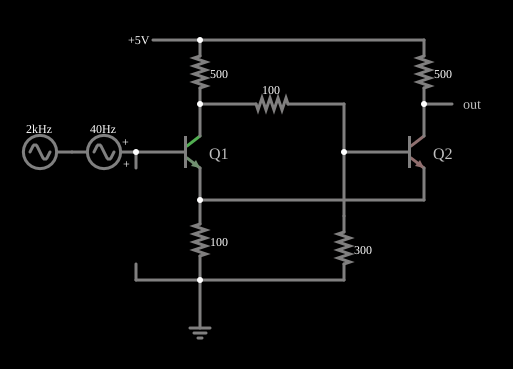

# Gatilho de Schmitt

<!-- navegacao:inicio -->
[Índice](README.md) · [Anterior: Unity-Gain Phase Splitter](phasesplit.md) · [Próximo: Current Source](currentsrc.md)
<!-- navegacao:fim -->

## Objetivo

Mostrar o gatilho de Schmitt: um comparador com histerese, cuja saída só comuta quando a entrada cruza um limiar superior ao subir e um limiar inferior (diferente) ao descer, o que o faz imune ao ruído.

## O circuito

<!-- esquema:inicio -->

<!-- esquema:fim -->

Dois transistores NPN, Q1 e Q2, têm os emissores ligados entre si e a um resistor comum de $100\ \Omega$ para a terra, e cada coletor tem um resistor de $500\ \Omega$ para a alimentação de $5\ \text{V}$. O coletor de Q1 alimenta a base de Q2 por um resistor de $100\ \Omega$ (com $300\ \Omega$ da base de Q2 para a terra). A entrada, na base de Q1, é uma senoide de $2\ \text{V}$ de pico com média de $2\ \text{V}$ ($40\ \text{Hz}$, de $0$ a $4\ \text{V}$) somada a um ruído de $0{,}2\ \text{V}$ de pico a $2\ \text{kHz}$. A saída é o coletor de Q2. Três osciloscópios mostram a entrada, a saída e a curva saída contra entrada.

<!-- componentes:inicio -->
| N.º | Tipo | Elemento | Valores |
|----:|------|----------|---------|
| 0 | `ResistorElm` | resistor | Resistance (ohms) = 500 |
| 1 | `ResistorElm` | resistor | Resistance (ohms) = 100 |
| 3 | `NTransistorElm` | transistor | Beta/hFE = 100; Swap E/C = não; Draw Circle = não; Model = default |
| 4 | `NTransistorElm` | transistor | Beta/hFE = 100; Swap E/C = não; Draw Circle = não; Model = default |
| 8 | `ResistorElm` | resistor | Resistance (ohms) = 500 |
| 13 | `ResistorElm` | resistor | Resistance (ohms) = 300 |
| 14 | `ResistorElm` | resistor | Resistance (ohms) = 100 |
| 16 | `RailElm` | voltage source | Voltage = 5; Waveform = D/C; DC Offset (V) = 0; Internal Resistance (ohms) = 0 |
| 17 | `GroundElm` | ground | Symbol = Earth |
| 18 | `RailElm` | A/C source | Max Voltage = 200m; Waveform = A/C; DC Offset (V) = 0; Internal Resistance (ohms) = 0; Show Voltage = não; Frequency (Hz) = 2k; Phase Offset (degrees) = 0 |
| 19 | `ProbeElm` | voltmeter | Show Voltage = não; Value = Voltage; Scale = Auto; Use Circle Symbol = não; Series Resistance (0 = infinite) = 0 |
| 21 | `VoltageElm` | A/C source | Max Voltage = 2; Waveform = A/C; DC Offset (V) = 2; Internal Resistance (ohms) = 0; Show Voltage = não; Frequency (Hz) = 40; Phase Offset (degrees) = 0 |
| 22 | `OutputElm` | output | Show Voltage = não |
| 23 | `TextElm` | text | Text = Q1; Size = 16; Draw Bar On Top = não; Color = #c0c0c0 |
| 24 | `TextElm` | text | Text = Q2; Size = 16; Draw Bar On Top = não; Color = #c0c0c0 |
<!-- componentes:fim -->

## Teoria

O transistor bipolar do simulador (modelo "default") segue o modelo de Ebers–Moll, com $V_{BE}$ e $V_{BC}$ as tensões base-emissor e base-coletor (para um NPN):

$$I_C = I_s\left(e^{V_{BE}/V_T} - e^{V_{BC}/V_T}\right) - \frac{I_s}{\beta_R}\left(e^{V_{BC}/V_T} - 1\right),\qquad I_B = \frac{I_s}{\beta}\left(e^{V_{BE}/V_T} - 1\right) + \frac{I_s}{\beta_R}\left(e^{V_{BC}/V_T} - 1\right),$$

com $I_s = 10^{-13}\ \text{A}$, $\beta = 100$, $\beta_R = 1$ e $V_T = 25{,}865\ \text{mV}$; sem efeito Early, sem capacitâncias e sem resistências série. Na **região ativa** ($V_{BE} \approx 0{,}65$ a $0{,}75\ \text{V}$, junção base-coletor com polarização inversa) isso se reduz a $I_C = \beta I_B = I_s\,e^{V_{BE}/V_T}$, com transcondutância $g_m = I_C/V_T$ e resistência de emissor $r_e = V_T/I_E$. O PNP é o complementar, com todas as tensões e correntes invertidas.

## Resultados esperados

O acoplamento pelo emissor comum faz o circuito ter realimentação positiva: quando Q1 está cortado, Q2 conduz e a corrente de Q2 no resistor de emissor comum fixa a tensão de emissor num valor alto; Q1 só liga quando sua base passa de $V_E + V_{BE}$ (**limiar superior**). Ao ligar, Q1 rouba corrente do resistor comum, o emissor cai, e Q2 desliga. Na volta, o limiar é diferente, porque a tensão de emissor com Q1 conduzindo é menor (**limiar inferior**). A diferença entre os dois limiares é a **histerese**:

$$V_H = V_{LS} - V_{LI}.$$

Com histerese, uma entrada lenta e com ruído, que cruza o limiar várias vezes, gera uma saída que comuta uma vez só.

## O que observar

A saída vai a $5{,}0\ \text{V}$ no estado alto e cai a menos de $1\ \text{V}$ no baixo. Na simulação, com a entrada subindo, a saída passa de $2{,}5\ \text{V}$ para cima quando a entrada chega a $1{,}479\ \text{V}$; com a entrada descendo, passa para baixo em torno de $1{,}06\ \text{V}$ (na integração independente, entre $1{,}02$ e $1{,}06\ \text{V}$: o ruído de $0{,}2\ \text{V}$ faz o ponto de cruzamento variar um pouco): histerese de $\approx 0{,}42\ \text{V}$. A entrada, na base de Q1, varia de $-0{,}199$ a $4{,}199\ \text{V}$ (a senoide mais o ruído). As verificações conferem o nível alto da saída e os extremos da entrada (tolerância de 1%); os limiares vêm da análise da forma de onda e não são verificados.

## Limites do modelo

- Na curva saída contra entrada (terceiro osciloscópio) aparece o laço de histerese.
- O ruído de $2\ \text{kHz}$ na entrada, que cruza os limiares várias vezes por ciclo, não faz a saída tremer: a histerese é maior que o ruído ($0{,}2\ \text{V}$ de pico).
- Uma versão com amplificador operacional faz o mesmo (veja os exemplos de amp-ops).

## Referências

Os limiares dependem das resistências e de $V_{BE}$ (e, portanto, da temperatura); o nível baixo da saída varia com a corrente. O modelo não tem tempos de comutação.

O circuito deste exemplo faz parte da coleção do simulador original de Paul Falstad e Iain Sharp (CircuitJS1); a explicação é deste projeto.
