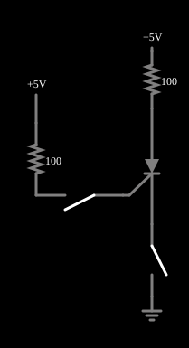

# Retificador controlado de silício

<!-- navegacao:inicio -->
[Índice](README.md) · [Próximo: AC Trigger](scractrig.md)
<!-- navegacao:fim -->

## Objetivo

Mostrar o **travamento** (*latching*) de um SCR: um pulso de corrente no gatilho o liga e ele continua ligado depois que o pulso termina, até que a corrente de ânodo seja interrompida.

## O circuito

<!-- esquema:inicio -->

<!-- esquema:fim -->

Uma fonte de $5\ \text{V}$ alimenta o ânodo do SCR por um resistor de $100\ \Omega$; o cátodo vai à terra por uma chave (o *reset*). O gatilho é alimentado por outra fonte de $5\ \text{V}$ e outro resistor de $100\ \Omega$, por uma segunda chave (o *disparo*). As duas chaves começam abertas.

<!-- componentes:inicio -->
| N.º | Tipo | Elemento | Valores |
|----:|------|----------|---------|
| 0 | `ResistorElm` | resistor | Resistance (ohms) = 100 |
| 1 | `RailElm` | voltage source | Voltage = 5; Waveform = D/C; DC Offset (V) = 0; Internal Resistance (ohms) = 0 |
| 2 | `SwitchElm` | switch (SPST) | Momentary Switch = não; IEC Symbol = não; Label (for linking) = ; Keyboard Shortcut = ; On Resistance (ohms) = 0 |
| 3 | `SwitchElm` | switch (SPST) | Momentary Switch = não; IEC Symbol = não; Label (for linking) = ; Keyboard Shortcut = ; On Resistance (ohms) = 0 |
| 4 | `ResistorElm` | resistor | Resistance (ohms) = 100 |
| 5 | `RailElm` | voltage source | Voltage = 5; Waveform = D/C; DC Offset (V) = 0; Internal Resistance (ohms) = 0 |
| 6 | `GroundElm` | ground | Symbol = Earth |
| 7 | `SCRElm` | SCR | Trigger Current (A) = 10m; Holding Current (A) = 8.2m; Gate Resistance (ohms) = 50 |
<!-- componentes:fim -->

## Símbolos e parâmetros

Os símbolos usados neste documento (definições completas no [glossário](../glossario-simbolos.md)):

| Símbolo | Nome | Significado | Unidade |
|---------|------|-------------|---------|
| $t$ | tempo | instante, contado a partir do início da simulação | s |
| $V$ | tensão | diferença de potencial elétrico entre dois pontos do circuito | V |
| $I$ | corrente | intensidade da corrente elétrica que passa por um ramo | A |

## Teoria

O SCR (retificador controlado de silício, ou tiristor) é um dispositivo de quatro camadas que, polarizado diretamente, só conduz depois de um pulso de corrente no gatilho. No modelo do simulador, o SCR passa a conduzir quando a corrente do gatilho passa da **corrente de disparo**, de $10\ \text{mA}$; uma vez conduzindo, **trava**: continua conduzindo, mesmo sem o gatilho, enquanto a corrente de ânodo for maior que a **corrente de manutenção**, de $8{,}2\ \text{mA}$, e desliga quando cai abaixo dela. A resistência do gatilho é de $50\ \Omega$ e a queda direta na condução, de cerca de $0{,}64\ \text{V}$.

Sequência do exemplo (as chaves acionadas pelo usuário):

1. Fecha-se a chave do cátodo: não passa corrente, porque o SCR está desligado (só a fuga de $5\ \mu\text{A}$ do modelo).
2. Fecha-se a chave do gatilho: a corrente de gatilho é $5\ \text{V}/(100 + 50)\ \Omega = 33{,}3\ \text{mA}$ (o resistor de $100\ \Omega$ mais os $50\ \Omega$ do gatilho), maior que $10\ \text{mA}$: o SCR dispara e passa a conduzir $(5 - 0{,}64)/100 = 43{,}6\ \text{mA}$.
3. Abre-se a chave do gatilho: a corrente de ânodo, de $43{,}6\ \text{mA}$, é maior que a de manutenção ($8{,}2\ \text{mA}$) e o SCR **continua** conduzindo.
4. Abre-se a chave do cátodo: a corrente cai a zero e o SCR desliga.
5. Fechando de novo a chave do cátodo, **sem** gatilho, o SCR continua desligado.

## Resultados esperados

O simulador dá:

- **Início** (chave do cátodo aberta): corrente de ânodo nula.
- **Cátodo fechado, sem gatilho:** corrente nula (apenas $5\ \mu\text{A}$ de fuga).
- **Com o gatilho fechado:** corrente de gatilho de $33{,}3\ \text{mA}$ e corrente de ânodo de $43{,}56\ \text{mA}$ ($5\ \text{V}$ menos $0{,}644\ \text{V}$ de queda, sobre $100\ \Omega$).
- **Gatilho aberto de novo:** a corrente de ânodo permanece em $43{,}56\ \text{mA}$ (travado).
- **Cátodo aberto:** a corrente cai a zero; fechando-o de novo, ela continua zero.

## O que observar

Repita a sequência na simulação e observe que o SCR guarda um bit: o gatilho liga, o interruptor do cátodo desliga. É a memória elementar de um alarme: depois de disparado, o alarme continua soando até ser desarmado.

## Limites do modelo

- O gatilho do modelo é um diodo em série com a resistência de $50\ \Omega$; um SCR real tem uma junção gatilho–cátodo com tensão de disparo própria e correntes de disparo e de manutenção que variam com a temperatura.
- O modelo não tem limite de $dV/dt$ nem de $dI/dt$, por isso não dispara por um pulso rápido de tensão.

## Referências

Rashid, *Power Electronics*, capítulo sobre tiristores; Horowitz e Hill, *The Art of Electronics*, seção sobre tiristores (SCR).

O circuito deste exemplo faz parte da coleção do simulador original de Paul Falstad e Iain Sharp (CircuitJS1); a explicação é deste projeto.
