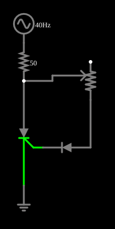

# Disparo de SCR em corrente alternada

<!-- navegacao:inicio -->
[Índice](README.md) · [Anterior: SCR](scr.md)
<!-- navegacao:fim -->

## Objetivo

Mostrar o **controle de fase** com um SCR: ligado a uma rede alternada, o SCR dispara num ponto escolhido do semiciclo, e a carga recebe a corrente só depois desse ponto. O ponto de disparo é ajustado por um potenciômetro.

## O circuito

<!-- esquema:inicio -->

<!-- esquema:fim -->

Uma fonte senoidal de $20\ \text{V}$ de pico e $40\ \text{Hz}$ alimenta, por um resistor de carga de $50\ \Omega$, o ânodo de um SCR cujo cátodo vai à terra. O gatilho recebe, do ânodo, uma corrente por um diodo e por um potenciômetro de $1{,}8\ \text{k}\Omega$ (*Trigger Voltage*, ajustado em $80{,}7\ \%$, isto é, $1{,}45\ \text{k}\Omega$ em série com o gatilho).

<!-- componentes:inicio -->
| N.º | Tipo | Elemento | Valores |
|----:|------|----------|---------|
| 0 | `SCRElm` | SCR | Trigger Current (A) = 10m; Holding Current (A) = 8.2m; Gate Resistance (ohms) = 50 |
| 1 | `ResistorElm` | resistor | Resistance (ohms) = 50 |
| 2 | `RailElm` | A/C source | Max Voltage = 20; Waveform = A/C; DC Offset (V) = 0; Internal Resistance (ohms) = 0; Show Voltage = não; Frequency (Hz) = 40; Phase Offset (degrees) = 0 |
| 3 | `DiodeElm` | diode | Model = default |
| 4 | `GroundElm` | ground | Symbol = Earth |
| 7 | `PotElm` | potentiometer | Resistance (ohms) = 1.8k; Slider Text = Trigger Voltage; Show Values = não; Group Number (for linking) = 0 |
<!-- componentes:fim -->

## Teoria

O SCR (retificador controlado de silício, ou tiristor) é um dispositivo de quatro camadas que, polarizado diretamente, só conduz depois de um pulso de corrente no gatilho. No modelo do simulador, o SCR passa a conduzir quando a corrente do gatilho passa da **corrente de disparo**, de $10\ \text{mA}$; uma vez conduzindo, **trava**: continua conduzindo, mesmo sem o gatilho, enquanto a corrente de ânodo for maior que a **corrente de manutenção**, de $8{,}2\ \text{mA}$, e desliga quando cai abaixo dela. A resistência do gatilho é de $50\ \Omega$ e a queda direta na condução, de cerca de $0{,}64\ \text{V}$.

O gatilho só recebe corrente quando a fonte é positiva. O SCR dispara no ponto em que a corrente de gatilho atinge $10\ \text{mA}$:

$$V_s\sin\alpha = V_D + I_{trig}\thinspace(R_{pot} + R_{gate}) = 0{,}57 + 0{,}010\thinspace(1452 + 50) = 15{,}6\ \text{V},$$

onde $V_D = 0{,}57\ \text{V}$ é a queda do diodo com $10\ \text{mA}$. Isso dá $\sin\alpha = 15{,}6/20 = 0{,}78$ e o ângulo de disparo $\alpha = 51^\circ$, $3{,}6\ \text{ms}$ depois do início do semiciclo positivo. A partir daí o SCR conduz até o fim do semiciclo e a carga recebe a tensão da fonte menos a queda de $0{,}64\ \text{V}$. O valor eficaz na carga seria, sem a queda,

$$V_{ef} = V_p\sqrt{\frac{\pi - \alpha + \tfrac12\sin 2\alpha}{4\pi}} = 9{,}3\ \text{V},$$

e o valor médio, $V_p(1 + \cos\alpha)/(2\pi) = 5{,}2\ \text{V}$.

## Resultados esperados

O simulador dá, no resistor de carga (com a polaridade do elemento, a tensão conduzida é negativa):

- **Tensão máxima na carga:** $19{,}24\ \text{V}$ em módulo ($20\ \text{V}$ menos a queda do SCR).
- **Valor eficaz:** $8{,}84\ \text{V}$ (a estimativa sem queda é $9{,}3\ \text{V}$; a queda de $0{,}64\ \text{V}$ explica a diferença); **valor médio:** $4{,}86\ \text{V}$ em módulo (a estimativa é $5{,}2\ \text{V}$).
- **Disparo:** a tensão direta máxima que o SCR suporta antes de conduzir é de $15{,}56\ \text{V}$ (o valor previsto, $15{,}6\ \text{V}$), e a corrente do diodo de gatilho chega a $9{,}98\ \text{mA}$, a corrente de disparo de $10\ \text{mA}$.
- **Semiciclo negativo:** o SCR bloqueia a tensão reversa de $20\ \text{V}$ e a carga não recebe corrente.

## O que observar

Mova o potenciômetro: com um valor maior a corrente de gatilho demora mais a atingir $10\ \text{mA}$, o disparo se atrasa e a carga recebe menos energia; com um valor menor, o SCR dispara cedo e a carga recebe quase meio ciclo inteiro. É um dimmer de meia onda.

## Limites do modelo

- O controle é de meia onda: a carga só recebe corrente num dos semiciclos; para os dois semiciclos usa-se um TRIAC ou dois SCR em antiparalelo (veja o exemplo *DIAC/TRIAC Dimmer*).
- O modelo despreza o atraso de disparo do SCR real e a variação das correntes de disparo e de manutenção com a temperatura.

## Referências

Rashid, *Power Electronics*, capítulo sobre tiristores; Horowitz e Hill, *The Art of Electronics*, seção sobre tiristores (SCR).

O circuito deste exemplo faz parte da coleção do simulador original de Paul Falstad e Iain Sharp (CircuitJS1); a explicação é deste projeto.
