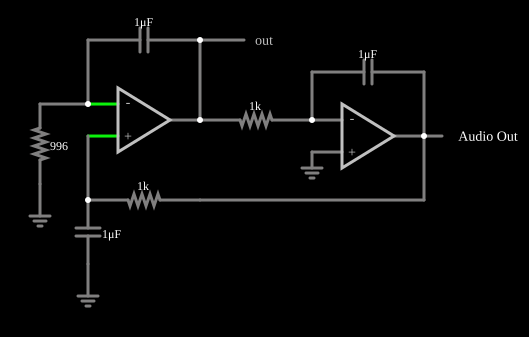

# Gerador de onda senoidal

<!-- navegacao:inicio -->
[Índice](README.md) · [Anterior: Triangle Wave Generator](triangle.md) · [Próximo: Sawtooth Wave Generator](sawtooth.md)
<!-- navegacao:fim -->

## Objetivo

Mostrar um oscilador senoidal feito com dois amplificadores operacionais e três capacitores, sem indutores: um integrador e um segundo estágio com realimentação capacitiva formam um laço cujos polos ficam sobre o eixo imaginário, de modo que o circuito oscila na frequência $1/(2\pi RC)$.

## O circuito

<!-- esquema:inicio -->

<!-- esquema:fim -->

O primeiro operacional (não inversor) tem a entrada inversora ligada à terra por um resistor de $996\ \Omega$ e à sua própria saída por um capacitor de $1\ \mu\text{F}$. A entrada não inversora recebe, por um resistor de $1\ \text{k}\Omega$, a saída do segundo operacional e tem um capacitor de $1\ \mu\text{F}$ para a terra. O segundo operacional é um integrador inversor: um resistor de $1\ \text{k}\Omega$ leva a saída do primeiro à sua entrada inversora e um capacitor de $1\ \mu\text{F}$ liga a saída a essa entrada. Dois osciloscópios e um elemento de saída de áudio ($8\ \text{kHz}$) mostram as formas de onda.

<!-- componentes:inicio -->
| N.º | Tipo | Elemento | Valores |
|----:|------|----------|---------|
| 0 | `OpAmpElm` | op-amp | Max Output (V) = 15; Min Output (V) = -15; Gain = 100k |
| 3 | `OpAmpElm` | op-amp | Max Output (V) = 15; Min Output (V) = -15; Gain = 100k |
| 6 | `CapacitorElm` | capacitor | Capacitance (F) = 1μ; Trapezoidal Approximation = sim; Initial Voltage (on Reset) = 1m; Series Resistance = 0 |
| 8 | `ResistorElm` | resistor | Resistance (ohms) = 1k |
| 9 | `GroundElm` | ground | Symbol = Earth |
| 11 | `CapacitorElm` | capacitor | Capacitance (F) = 1μ; Trapezoidal Approximation = sim; Initial Voltage (on Reset) = 1m; Series Resistance = 0 |
| 13 | `ResistorElm` | resistor | Resistance (ohms) = 1k |
| 15 | `CapacitorElm` | capacitor | Capacitance (F) = 1μ; Trapezoidal Approximation = sim; Initial Voltage (on Reset) = 1m; Series Resistance = 0 |
| 16 | `GroundElm` | ground | Symbol = Earth |
| 17 | `ResistorElm` | resistor | Resistance (ohms) = 996 |
| 18 | `GroundElm` | ground | Symbol = Earth |
| 19 | `OutputElm` | output | Show Voltage = não |
| 20 | `AudioOutputElm` | audio output | Duration (s) = 1; Sampling Rate = 8000 |
<!-- componentes:fim -->

## Teoria

Seja $\tau = RC = 1\ \text{k}\Omega\cdot 1\ \mu\text{F} = 1\ \text{ms}$ e $x = s\tau$. Os blocos do laço são:

- primeiro operacional, ganho não inversor $1 + \dfrac{1}{s C R_{17}} = 1 + \dfrac{1}{a x}$, com $a = R_{17}/R = 0{,}996$;
- passa-baixas $R_{13}C_{15}$ na entrada não inversora: $\dfrac{1}{1+x}$;
- integrador inversor: $-\dfrac{1}{x}$.

A condição de oscilação (ganho de laço igual a 1) leva a

$$a\,x^3 + a\,x^2 + a\,x + 1 = 0 .$$

Com $a = 1$ o polinômio é $(x+1)(x^2+1)$, com raízes $x = \pm j$: um par de polos sobre o eixo imaginário, em $\omega = 1/\tau$,

$$f_0 = \frac{1}{2\pi R C} = \frac{1}{2\pi\cdot 1\ \text{k}\Omega\cdot 1\ \mu\text{F}} \approx 159{,}15\ \text{Hz}.$$

O resistor de $996\ \Omega$ (em vez de $1\ \text{k}\Omega$) afasta $a$ de 1 em $-0{,}4\%$ e desloca o par de polos ligeiramente para o semiplano direito (a parte real passa a $+0{,}001/\tau$, ou seja, o crescimento é lento, da ordem de $1\ \text{s}^{-1}$). Isso garante que a oscilação não se extinga; a amplitude fica limitada pela saturação dos operacionais.

## Resultados esperados

| Grandeza | Valor |
|----------|------:|
| Frequência | $159{,}15\ \text{Hz}$ |
| Amplitude no regime permanente | cerca de $\pm 15\ \text{V}$ (saturação, $15{,}03\ \text{V}$ no simulador) |

O simulador dá $159{,}150\ \text{Hz}$ para a frequência medida em uma janela de $0{,}2\ \text{s}$ perto de $0{,}3\ \text{s}$, concordando com $1/(2\pi RC)$ dentro de $0{,}01\%$. As verificações conferem a frequência (tolerância de 1%) e os extremos da saída do integrador.

## O que observar

- O circuito oscila desde o início, porque o arquivo guarda tensões iniciais nos capacitores.
- Duplique $C$ (ou $R$) em todos os estágios e a frequência cai à metade.
- O resistor de $996\ \Omega$ é crítico: com exatamente $1\ \text{k}\Omega$ os polos ficam sobre o eixo imaginário e a amplitude depende só das condições iniciais; com um valor maior que $1\ \text{k}\Omega$ a oscilação se extingue.

## Limites do modelo

Operacionais ideais com saturação em $\pm 15\ \text{V}$, sem *offset* nem ruído. A frequência é a do modelo de componentes exatos; num circuito real, a tolerância de $R$ e $C$ (5% ou mais) desloca-a na mesma proporção, e o ajuste fino da amplitude exige uma malha de controle de ganho.

## Referências

- A. S. Sedra e K. C. Smith, *Microeletrônica*, Pearson.
- P. Horowitz e W. Hill, *The Art of Electronics*, Cambridge University Press.
- S. Franco, *Design with Operational Amplifiers and Analog Integrated Circuits*, McGraw-Hill.

O circuito deste exemplo faz parte da coleção do simulador original de Paul Falstad e Iain Sharp (CircuitJS1); a explicação é deste projeto.
