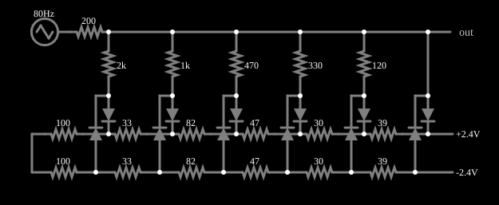

# Conversor de triangular em senoide

<!-- navegacao:inicio -->
[Índice](README.md) · [Anterior: Waveform Clipper](diodeclip.md) · [Próximo: Ring Modulator](ringmod.md)
<!-- navegacao:fim -->

## Objetivo

Mostrar como uma rede de resistores e diodos arredonda os picos de uma onda triangular até que ela fique muito parecida com uma senoide (um "conformador de senoide" a diodos).

## O circuito

<!-- esquema:inicio -->

<!-- esquema:fim -->

Uma onda triangular de $5\ \text{V}$ de pico e $80\ \text{Hz}$ passa por um divisor de tensão de vários trechos: uma escada de resistores em série (de $100\ \Omega$ a $39\ \Omega$ em seu lado de saída) com pares de diodos em antiparalelo ligados em derivação, cada par com seu resistor e uma tensão de polarização ($\pm 2{,}4\ \text{V}$ nos extremos). Conforme a tensão sobe, mais diodos conduzem e a inclinação da saída diminui.

<!-- componentes:inicio -->
| N.º | Tipo | Elemento | Valores |
|----:|------|----------|---------|
| 0 | `DiodeElm` | diode | Model = default |
| 1 | `DiodeElm` | diode | Model = default |
| 3 | `ResistorElm` | resistor | Resistance (ohms) = 100 |
| 4 | `ResistorElm` | resistor | Resistance (ohms) = 100 |
| 5 | `ResistorElm` | resistor | Resistance (ohms) = 33 |
| 6 | `ResistorElm` | resistor | Resistance (ohms) = 33 |
| 8 | `DiodeElm` | diode | Model = default |
| 9 | `DiodeElm` | diode | Model = default |
| 10 | `DiodeElm` | diode | Model = default |
| 11 | `DiodeElm` | diode | Model = default |
| 13 | `ResistorElm` | resistor | Resistance (ohms) = 82 |
| 14 | `ResistorElm` | resistor | Resistance (ohms) = 82 |
| 15 | `ResistorElm` | resistor | Resistance (ohms) = 47 |
| 16 | `DiodeElm` | diode | Model = default |
| 17 | `DiodeElm` | diode | Model = default |
| 19 | `ResistorElm` | resistor | Resistance (ohms) = 47 |
| 20 | `ResistorElm` | resistor | Resistance (ohms) = 30 |
| 21 | `ResistorElm` | resistor | Resistance (ohms) = 39 |
| 22 | `DiodeElm` | diode | Model = default |
| 23 | `DiodeElm` | diode | Model = default |
| 24 | `DiodeElm` | diode | Model = default |
| 25 | `DiodeElm` | diode | Model = default |
| 28 | `ResistorElm` | resistor | Resistance (ohms) = 30 |
| 29 | `ResistorElm` | resistor | Resistance (ohms) = 39 |
| 30 | `RailElm` | voltage source | Voltage = 2.4; Waveform = D/C; DC Offset (V) = 0; Internal Resistance (ohms) = 0 |
| 31 | `RailElm` | voltage source | Voltage = -2.4; Waveform = D/C; DC Offset (V) = 0; Internal Resistance (ohms) = 0 |
| 38 | `ResistorElm` | resistor | Resistance (ohms) = 2k |
| 39 | `ResistorElm` | resistor | Resistance (ohms) = 1k |
| 40 | `ResistorElm` | resistor | Resistance (ohms) = 470 |
| 41 | `ResistorElm` | resistor | Resistance (ohms) = 330 |
| 42 | `ResistorElm` | resistor | Resistance (ohms) = 120 |
| 48 | `ResistorElm` | resistor | Resistance (ohms) = 200 |
| 49 | `RailElm` | triangle gen | Max Voltage = 5; Waveform = Triangle; DC Offset (V) = 0; Internal Resistance (ohms) = 0; Show Voltage = não; Frequency (Hz) = 80; Phase Offset (degrees) = 0 |
| 50 | `OutputElm` | output | Show Voltage = não |
<!-- componentes:fim -->

## Teoria

O diodo do simulador (modelo "default") segue a equação de Shockley,

$$i = I_s\left(e^{v/(nV_T)} - 1\right),\qquad I_s = 1{,}714\cdot 10^{-7}\ \text{A},\quad n = 2,\quad V_T = 25{,}865\ \text{mV},$$

sem resistência série. Para uma corrente $i \gg I_s$ a tensão é $v = nV_T\ln(i/I_s + 1)$, que dá $0{,}806\ \text{V}$ em $1\ \text{A}$, $0{,}568\ \text{V}$ em $10\ \text{mA}$ e $0{,}449\ \text{V}$ em $1\ \text{mA}$: a tensão cresce $nV_T\ln 10 = 119\ \text{mV}$ a cada década de corrente. Para $v < 0$ a corrente tende a $-I_s = -0{,}17\ \mu\text{A}$.

## Resultados esperados

A rede aproxima a função seno por trechos de reta. Uma onda triangular tem inclinação constante; a senoide, de mesma amplitude, tem inclinação que diminui perto dos picos. Cada par de diodos conduz a partir de um limiar de tensão (a polarização mais $v_D$) e "dobra" a curva da saída para baixo, de modo que a inclinação diminui com a amplitude, como na senoide. Quanto mais trechos, melhor a aproximação.

A qualidade se mede pela distorção harmônica total (THD): a razão entre a raiz da soma dos quadrados das amplitudes dos harmônicos e a amplitude da fundamental,

$$\text{THD} = \frac{\sqrt{V_3^2 + V_5^2 + V_7^2 + \dots}}{V_1}.$$

Para uma onda triangular, só há harmônicos ímpares, de amplitude $V_n = V_1/n^2$.

## O que observar

A análise de Fourier da saída (da simulação e da integração independente, que coincidem) dá, em regime ($0{,}1$ a $0{,}2\ \text{s}$):

| harmônico | amplitude | relativa à fundamental |
|----------:|----------:|-----------------------:|
| 1.º ($80\ \text{Hz}$) | $3{,}039\ \text{V}$ | $100\%$ |
| 3.º | $0{,}0826\ \text{V}$ | $2{,}7\%$ |
| 5.º | $0{,}0226\ \text{V}$ | $0{,}7\%$ |
| 7.º | $0{,}0117\ \text{V}$ | $0{,}4\%$ |
| 9.º | $0{,}0023\ \text{V}$ | $0{,}1\%$ |

A THD (até o 9.º harmônico) é de $2{,}84\%$, contra $12{,}0\%$ da onda triangular original. A saída tem pico de $2{,}931\ \text{V}$ ($\pm$), e a fundamental, de $3{,}039\ \text{V}$, é maior que o pico, porque a saída ainda não é uma senoide perfeita. As verificações conferem o pico positivo e o negativo da saída e o pico da entrada (tolerância de 1%); a tabela de harmônicos vem de uma análise à parte, não de uma verificação.

## Limites do modelo

- Compare a saída com a entrada nos osciloscópios: a triangular ganha picos arredondados e uma forma suave.
- Experimente apagar um par de diodos e compare a forma da saída: com menos trechos a aproximação da senoide deve piorar.
- A amplitude da saída é menor que a da entrada ($2{,}9$ contra $5\ \text{V}$): o divisor atenua.

## Referências

A forma de onda ideal exigiria as inclinações exatas da senoide em cada trecho (que a rede aproxima com resistores de valores padrão); uma variação da amplitude da entrada muda a THD (a rede é projetada para $5\ \text{V}$). O circuito não é compensado em temperatura.

O circuito deste exemplo faz parte da coleção do simulador original de Paul Falstad e Iain Sharp (CircuitJS1); a explicação é deste projeto.
