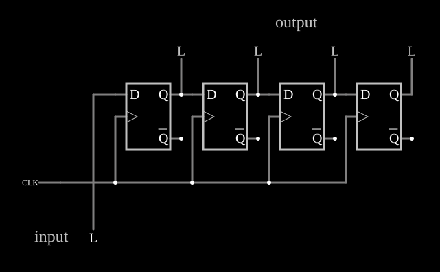

# Registrador de deslocamento série-paralelo

<!-- navegacao:inicio -->
[Índice](README.md) · [Próximo: Parallel-In Serial-Out](piso-sr.md)
<!-- navegacao:fim -->

## Objetivo

Mostrar o **registrador de deslocamento** com entrada série e saídas paralelas: a cada pulso do relógio, o bit da entrada entra na primeira posição e os bits já guardados avançam uma posição.

## O circuito

<!-- esquema:inicio -->

<!-- esquema:fim -->

Quatro flip-flops D disparados pela borda de subida, em cadeia: a entrada série (elemento 9, rotulada *input*) vai ao $D$ do primeiro, e o $Q$ de cada um vai ao $D$ do seguinte. Todos recebem o mesmo relógio, uma onda quadrada de $100\ \text{Hz}$ (bordas de subida em $0$, $10$, $20\ \text{ms}$, …). As saídas $Q_0$ a $Q_3$ vão às saídas lógicas 20 a 23 (*output*). O exemplo abre com a entrada em $0$ e os flip-flops zerados.

<!-- componentes:inicio -->
| N.º | Tipo | Elemento | Valores |
|----:|------|----------|---------|
| 0 | `DFlipFlopElm` | D flip-flop | High Logic Voltage = 5; Reset Pin = não; Set Pin = não; Invert Set/Reset = não |
| 1 | `DFlipFlopElm` | D flip-flop | High Logic Voltage = 5; Reset Pin = não; Set Pin = não; Invert Set/Reset = não |
| 3 | `DFlipFlopElm` | D flip-flop | High Logic Voltage = 5; Reset Pin = não; Set Pin = não; Invert Set/Reset = não |
| 4 | `DFlipFlopElm` | D flip-flop | High Logic Voltage = 5; Reset Pin = não; Set Pin = não; Invert Set/Reset = não |
| 5 | `RailElm` | square wave gen | Max Voltage = 2.5; Waveform = Square Wave; DC Offset (V) = 2.5; Internal Resistance (ohms) = 0; Show Voltage = não; Specify As = Frequency/Duty Cycle; Frequency (Hz) = 100; Phase Offset (degrees) = 0; Duty Cycle = 50; Rise/Fall Time (s) = 0 |
| 9 | `LogicInputElm` | logic input | Momentary Switch = não; High Logic Voltage = 5; Low Voltage = 0; Numeric = não; Ternary = não; Keyboard Shortcut =  |
| 11 | `TextElm` | text | Text = input; Size = 24; Draw Bar On Top = não; Color = #c0c0c0 |
| 12 | `TextElm` | text | Text = output; Size = 24; Draw Bar On Top = não; Color = #c0c0c0 |
| 20 | `LogicOutputElm` | logic output | Threshold = 2.5; Current Required = não; Numeric = não; Ternary = não |
| 21 | `LogicOutputElm` | logic output | Threshold = 2.5; Current Required = não; Numeric = não; Ternary = não |
| 22 | `LogicOutputElm` | logic output | Threshold = 2.5; Current Required = não; Numeric = não; Ternary = não |
| 23 | `LogicOutputElm` | logic output | Threshold = 2.5; Current Required = não; Numeric = não; Ternary = não |
<!-- componentes:fim -->

## Teoria

Na borda de subida, todos os flip-flops copiam ao mesmo tempo o seu $D$, que é a saída do vizinho **antes** da borda; por isso cada bit avança exatamente uma posição por pulso:

$$Q_0^{+} = D_{in}, \qquad Q_k^{+} = Q_{k-1} \quad (k = 1, 2, 3).$$

Depois de quatro pulsos, os quatro últimos bits da entrada estão disponíveis em paralelo: é a conversão série-paralelo usada na recepção de dados seriais (UART, SPI). O registrador também atrasa um sinal de $k$ períodos de relógio na saída $Q_{k-1}$.

## Resultados esperados

O simulador dá, com a entrada em $1$ desde o início: $1000$ em $1\ \text{ms}$, $1100$ em $11\ \text{ms}$, $1110$ em $21\ \text{ms}$ e $1111$ em $31\ \text{ms}$ ($Q_0 Q_1 Q_2 Q_3$). Com a entrada levada a $1$ em $12\ \text{ms}$, o $1$ só entra na borda de $20\ \text{ms}$: $1000$ em $21\ \text{ms}$. Com a entrada em $0$, as saídas ficam todas em $0$.

## O que observar

Mude a entrada entre duas bordas e veja o bit "andar" para a direita a cada período do relógio.

## Limites do modelo

- Os flip-flops não têm atraso; num registrador real o funcionamento depende justamente de o atraso de cada flip-flop ser maior que o seu tempo de *hold*.

## Referências

Mano e Ciletti, *Digital Design*, capítulo sobre registradores de deslocamento; Texas Instruments, folha de dados do SN74164.

O circuito deste exemplo faz parte da coleção do simulador original de Paul Falstad e Iain Sharp (CircuitJS1); a explicação é deste projeto.
