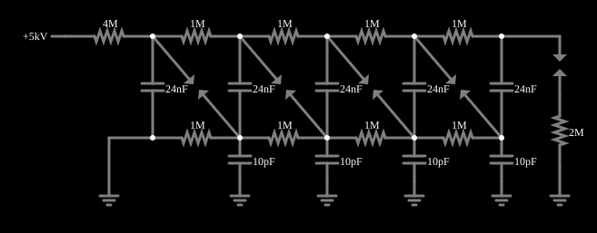

# Gerador de Marx

<!-- navegacao:inicio -->
[Índice](README.md) · [Anterior: Tesla Coil](tesla.md)
<!-- navegacao:fim -->

## Objetivo

Mostrar o **gerador de Marx**: vários capacitores são carregados em paralelo por uma fonte de tensão média, e centelhadores os ligam em série para uma descarga de tensão alta sobre uma carga.

## O circuito

<!-- esquema:inicio -->

<!-- esquema:fim -->

Cinco capacitores de $24\ \text{nF}$ são carregados, por resistores de $1\ \text{M}\Omega$ (e um de $4\ \text{M}\Omega$ na entrada), por uma fonte de $5\ \text{kV}$. Entre estágios há quatro centelhadores de ruptura $4\ \text{kV}$ e, na saída, um centelhador de $11\ \text{kV}$ liga o conjunto a uma carga de $2\ \text{M}\Omega$. Pequenos capacitores de $10\ \text{pF}$ representam as capacitâncias parasitas dos nós dos centelhadores.

<!-- componentes:inicio -->
| N.º | Tipo | Elemento | Valores |
|----:|------|----------|---------|
| 0 | `ResistorElm` | resistor | Resistance (ohms) = 4M |
| 1 | `CapacitorElm` | capacitor | Capacitance (F) = 24n; Trapezoidal Approximation = sim; Initial Voltage (on Reset) = 1m; Series Resistance = 0 |
| 2 | `ResistorElm` | resistor | Resistance (ohms) = 1M |
| 3 | `ResistorElm` | resistor | Resistance (ohms) = 1M |
| 4 | `CapacitorElm` | capacitor | Capacitance (F) = 24n; Trapezoidal Approximation = sim; Initial Voltage (on Reset) = 1m; Series Resistance = 0 |
| 5 | `ResistorElm` | resistor | Resistance (ohms) = 1M |
| 6 | `ResistorElm` | resistor | Resistance (ohms) = 1M |
| 7 | `CapacitorElm` | capacitor | Capacitance (F) = 24n; Trapezoidal Approximation = sim; Initial Voltage (on Reset) = 1m; Series Resistance = 0 |
| 8 | `SparkGapElm` | spark gap | On resistance (ohms) = 1k; Off resistance (ohms) = 1G; Breakdown voltage = 4k; Holding current (A) = 1.5m |
| 9 | `SparkGapElm` | spark gap | On resistance (ohms) = 1k; Off resistance (ohms) = 1G; Breakdown voltage = 4k; Holding current (A) = 1m |
| 10 | `SparkGapElm` | spark gap | On resistance (ohms) = 1k; Off resistance (ohms) = 1G; Breakdown voltage = 11k; Holding current (A) = 1m |
| 11 | `GroundElm` | ground | Symbol = Earth |
| 12 | `RailElm` | voltage source | Voltage = 5k; Waveform = D/C; DC Offset (V) = 0; Internal Resistance (ohms) = 0 |
| 14 | `GroundElm` | ground | Symbol = Earth |
| 15 | `CapacitorElm` | capacitor | Capacitance (F) = 10p; Trapezoidal Approximation = não; Initial Voltage (on Reset) = 1m; Series Resistance = 0 |
| 16 | `CapacitorElm` | capacitor | Capacitance (F) = 10p; Trapezoidal Approximation = não; Initial Voltage (on Reset) = 1m; Series Resistance = 0 |
| 17 | `GroundElm` | ground | Symbol = Earth |
| 18 | `GroundElm` | ground | Symbol = Earth |
| 19 | `GroundElm` | ground | Symbol = Earth |
| 20 | `GroundElm` | ground | Symbol = Earth |
| 21 | `CapacitorElm` | capacitor | Capacitance (F) = 10p; Trapezoidal Approximation = não; Initial Voltage (on Reset) = 1m; Series Resistance = 0 |
| 22 | `CapacitorElm` | capacitor | Capacitance (F) = 10p; Trapezoidal Approximation = não; Initial Voltage (on Reset) = 1m; Series Resistance = 0 |
| 23 | `SparkGapElm` | spark gap | On resistance (ohms) = 1k; Off resistance (ohms) = 1G; Breakdown voltage = 4k; Holding current (A) = 1m |
| 24 | `SparkGapElm` | spark gap | On resistance (ohms) = 1k; Off resistance (ohms) = 1G; Breakdown voltage = 4k; Holding current (A) = 1m |
| 25 | `CapacitorElm` | capacitor | Capacitance (F) = 24n; Trapezoidal Approximation = sim; Initial Voltage (on Reset) = 1m; Series Resistance = 0 |
| 26 | `ResistorElm` | resistor | Resistance (ohms) = 1M |
| 27 | `ResistorElm` | resistor | Resistance (ohms) = 1M |
| 28 | `CapacitorElm` | capacitor | Capacitance (F) = 24n; Trapezoidal Approximation = sim; Initial Voltage (on Reset) = 1m; Series Resistance = 0 |
| 29 | `ResistorElm` | resistor | Resistance (ohms) = 1M |
| 30 | `ResistorElm` | resistor | Resistance (ohms) = 1M |
| 32 | `ResistorElm` | resistor | Resistance (ohms) = 2M |
<!-- componentes:fim -->

## Teoria

O centelhador (*spark gap*) do simulador é uma chave controlada pela tensão: com resistência de **abertura** muito alta ($1\ \text{G}\Omega$) até que a tensão entre os terminais atinja a **tensão de ruptura**; a partir daí ele passa a ter a resistência de **condução**, e só volta a abrir quando a corrente cai abaixo da **corrente de manutenção**.

Num gerador de Marx de $N$ estágios, os capacitores $C$ são carregados em paralelo à tensão $V_0$ e, quando os centelhadores disparam, se ligam em série: a tensão de saída ideal é $N V_0$ e a capacitância equivalente em série é $C/N$. A ruptura do primeiro centelhador, ao atingir $4\ \text{kV}$, dispara em cascata os seguintes, porque a sobretensão aplicada a cada um passa a ser a soma dos estágios anteriores. A carga é limitada pela ruptura dos centelhadores intermediários, não pela fonte de $5\ \text{kV}$: cada estágio chega a perto de $4\ \text{kV}$.

## Resultados esperados

O simulador dá, ao longo de $2\ \text{s}$ (vários ciclos de carga e descarga):

- **Primeiro centelhador:** a tensão máxima é $4000\ \text{V}$, a de ruptura.
- **Primeiro capacitor:** carrega até $4{,}18\ \text{kV}$.
- **Centelhador de saída** (ruptura de $11\ \text{kV}$): a tensão máxima é $12{,}78\ \text{kV}$, acima da ruptura porque o centelhador só passa a conduzir um passo de simulação depois de a tensão cruzá-la.
- **Capacitância parasita do último nó:** chega a $11{,}45\ \text{kV}$.

## O que observar

Os osciloscópios mostram as tensões nos centelhadores: cada um cai de $4\ \text{kV}$ a quase $0$ quando dispara, em cascata, e o de saída leva a tensão total à carga. A saída fica abaixo do ideal de $N V_0$ porque o disparo em cascata termina antes de os cinco estágios estarem em série.

## Limites do modelo

- O disparo em cascata depende das capacitâncias parasitas ($10\ \text{pF}$) dos nós; num gerador real elas são parte do projeto.
- A tensão de saída de $12{,}8\ \text{kV}$ é bem menor que o limite ideal de $5\cdot 4 = 20\ \text{kV}$; este projeto não investigou o detalhe da cascata.
- Os centelhadores são modelos de chave com histerese, sem tempo de formação do arco.

## Referências

Kuffel, Zaengl e Kuffel, *High Voltage Engineering: Fundamentals*, capítulos sobre ruptura de gases e geradores de impulso; Marx, *Eine neue Methode zur Erzeugung hoher Spannungen*, Elektrotechnische Zeitschrift (1924).

O circuito deste exemplo faz parte da coleção do simulador original de Paul Falstad e Iain Sharp (CircuitJS1); a explicação é deste projeto.
